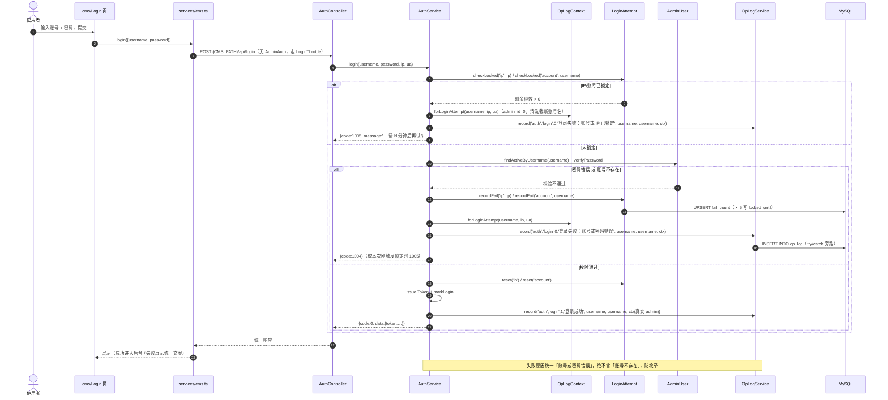
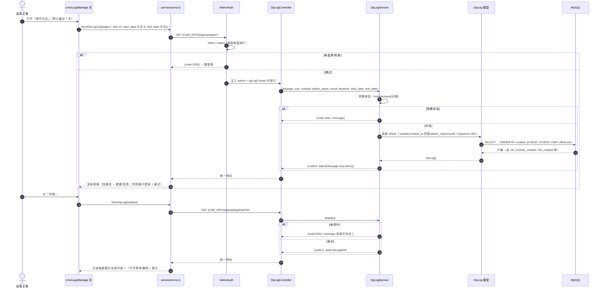
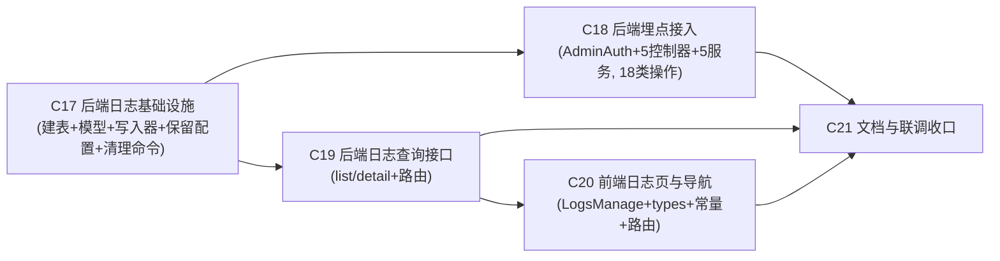

# 企业官网 CMS 后台 · 操作日志模块（C-P1-3）· 增量架构设计与任务分解

| 项目 | 内容 |
| --- | --- |
| 文档名称 | ARCHITECTURE-CMS-OPLOG.md（增量架构设计） |
| 版本 | v1.0 |
| 需求编号 | **C-P1-3**（操作日志；P0） |
| 上游文档 | `docs/PRD-CMS-OPLOG.md` v1.0、`docs/ARCHITECTURE-CMS.md` v1.0、`docs/PRD-CMS.md` v1.0 |
| 负责人 | 高见远（架构师） |
| 目标读者 | 工程师寇豆码（按本文件第五节任务列表实现） |
| 输出语言 | 简体中文 |
| 后端 | ThinkPHP 8 + MySQL 8（库 `corporate_site`） |
| 前端 | Vite + React 18 + React Router v6 + Tailwind 3（**复用同一 SPA 工程**） |
| 硬约束 | **不引入任何第三方依赖**（后端不加 composer 包，前端不加 npm 包）；**本期不新增错误码** |
| 范围 | 只做「记录 + 查询 + 保留/清理命令」，不做导出/diff/告警/定时任务/日志写删 HTTP 接口 |

> **本文件定位**：仅描述**本次新增**的增量设计，已有约定一律引用 `ARCHITECTURE-CMS.md`（如「见 A-CMS §3.2」）。与现有文档风格保持一致（中文、表格化、Mermaid）。

---

## 目录

1. [实现方案概述](#一实现方案概述)
2. [四个核心技术难点的正面解决方案](#二四个核心技术难点的正面解决方案)（含选型权衡与改动面）
3. [数据库设计（DDL + 索引）](#三数据库设计ddl--索引)
4. [模型层 / 写入器 / 查询接口设计](#四模型层--写入器--查询接口设计)
5. [埋点落点清单（施工图）](#五埋点落点清单施工图)
6. [清理命令设计](#六清理命令设计)
7. [前端改造点](#七前端改造点)
8. [文件清单](#八文件清单)
9. [类图（Mermaid）](#九类图mermaid)
10. [时序图（Mermaid）](#十时序图mermaid)
11. [共享知识（跨文件约定）](#十一共享知识跨文件约定)
12. [有序任务列表与依赖图](#十二有序任务列表与依赖图)
13. [依赖包列表](#十三依赖包列表)
14. [待明确事项](#十四待明确事项)

---

## 一、实现方案概述

### 1.1 一句话方案

新增**一张高增长追加表 `op_log`** + **一个统一写入器 `OpLogService::record()`（字段白名单 + try/catch 旁路）** + **两个只读查询接口**（`{P}/api/oplog/list`、`{P}/api/oplog/detail`，挂 `AdminAuth`）+ **一个命令行清理命令 `oplog:clean`**；在 PRD §5.2 的 **18 类写操作**处「随业务动作显式记录」；后台新增只读页 `/{CMS_PATH}/oplogs`。

### 1.2 整体思路（三句话）

1. **记录旁路、绝不断主流程**：所有埋点都调用同一个写入器；写入器内部 `try/catch` 全包，任何异常只落 `Log::error`，**绝不**向调用方抛出，主业务 Result 不受影响（PRD §9「写入旁路」）。
2. **上下文显式传递、不搞隐式全局**：当前操作人（`admin_id/admin_name`）+ `ip/user_agent` 由 `AdminAuth` 在鉴权边界一次性采集为 `OpLogContext`，控制器透传给 Service，Service 再透传给写入器（详见第二节难点 1）。**Service 不依赖 HTTP `request()`**，因此 CLI（`cms:init` / `oplog:clean`）零风险。
3. **只增不改、只读可查**：后端**只有**写入器能写 `op_log`；对外**只暴露 list/detail 两个读接口**；无任何 UPDATE/DELETE 日志的 HTTP 路径（清理仅命令行走 `created_at < now-retain` 批量删，见第六节）。

### 1.3 组件关系（数据流）

```
[HTTP 请求] → AdminAuth(采集 OpLogContext 并挂到 request)
                     │
        Controller(读 ctx，透传)
                     │
            Service(执行业务 + 在关键动作处调 record)
                     │
        OpLogService::record(白名单裁剪 + try/catch)
                     │
                 OpLog::create → MySQL(op_log)
                     ▲
   [查询] OpLogController → OpLogService::list/detail → OpLog(只读)
   [清理] oplog:clean 命令 → DELETE WHERE created_at < 截止（不写日志）
```

### 1.4 与已有模块的边界（引用）

- 鉴权：日志接口与日志页**必须**在 `AdminAuth` 之内（见 A-CMS §3.2）；未登录 → `1003`；未改初始密码 → `1006`（`oplog/*` **不进** `$pwdWhitelist`，与账号管理一致）。
- 响应结构：沿用 `{code,message,data}`（见 `app/common.php`）。
- 错误码：**不新增**，复用 `1001/1003/4004/5000`（查询参数非法→`1001`；日志 id 不存在→`4004`）。
- 缓存：日志页为纯后台读，**不挂** `ContentCache`。
- 账号删除后的日志：`op_log.admin_id` **不设外键**、**不级联删除**，靠 `admin_name` 快照保持可读（PRD §7）。

---

## 二、四个核心技术难点的正面解决方案

### 难点 1（最关键）：埋点上下文如何取得「当前操作人」

#### 2.1.1 现状核对（基于真实代码）

| Service 方法（现状签名） | 是否有 admin 参数 | 调用方 |
| --- | --- | --- |
| `ContentService::save(string $type, array $data)` | ❌ 无 | `Content.php` 的 `productSave/newsSave/caseSave/advantageSave` |
| `ContentService::remove(string $type, string\|int $id)` | ❌ 无 | `Content.php` 的 4 个 `*Delete` |
| `ContentService::saveAbout(array $data)` | ❌ 无 | `Content.php::aboutSave` |
| `ContentService::saveSiteConfig(array $data)` | ❌ 无 | `Content.php::siteSave` |
| `MessageService::markStatus(int $id, int $status)` | ❌ 无 | `Message.php::markStatus` |
| `MessageService::remove(int $id)` | ❌ 无 | `Message.php::delete` |
| `UploadService::image(?UploadedFile $file, string $type)` | ❌ 无 | `Upload.php::image` |
| `AuthService::logout(string $token)` | ❌ 无 | `Auth.php::logout` |
| `AuthService::login(string $username,string $password,string $ip,string $ua)` | ✅ 已含 ip/ua | `Auth.php::login` |
| `AuthService::changePassword(AdminUser $admin, ...)` / `resetPassword(AdminUser $admin, ...)` | ✅ 已含 admin | `Auth.php` |
| `AdminService::{list,toggleStatus,resetPassword,remove}` | ⚠️ 含 `int $currentAdminId`，**缺 admin_name** | `Admin.php` |

结论：**矛盾真实存在**——除 `auth`/`admin` 外，服务方法拿不到「操作人」，而 PRD 要求非账号管理模块也要记 `admin_id + admin_name`。

#### 2.1.2 候选方案评估

| 方案 | 说明 | 评价 |
| --- | --- | --- |
| **(a) 改 Service 签名，显式加参数** | 由 Controller 把操作人传入 Service | ✅ **采用**（见下） |
| (b) 请求级上下文容器（容器单例 / 静态类） | 中间件写入，Service 读取 | ⚠️ **不采用**：本项目为 FPM + `php think run`（PHP 内置服务器**逐请求重置**静态状态），**当前**无 Swoole/Octane 常驻进程，静态污染风险低；但引入隐式全局单例会降低可测性，且一旦未来切换常驻运行时（Swoole），会出现**跨请求串号**（A 管理员的操作记到 B 名下）——审计场景对该错误的容错为 0，故拒绝。 |
| (c) Service 内用 `request()` 取 `$request->admin` | 直接读 HTTP 上下文 | ❌ **不采用**：Service 耦合 HTTP；CLI（`cms:init`/`oplog:clean`）无 request，`request()` 会抛/返回空；单测需伪造请求；现有 Service 均**不**调用 `request()`，破坏分层。 |
| (d) 混合 | (a) 为主 + 上下文容器兜底 | 部分采用其思想：(a) 为**唯一契约**，另以 `OpLogContext` 值对象承载「操作人 + ip + ua」，在**鉴权边界**一次性构造，避免每个调用点散拼参数。 |

#### 2.1.3 选定方案（(a) 的收敛形态）

**在鉴权边界构造一个不可变值对象 `OpLogContext`，经 Controller 显式透传给 Service。**

- `AdminAuth` 在放行前，除现有 `$request->admin` / `$request->adminToken` 外，**额外**注入 `$request->opLogContext = OpLogContext::fromRequest($request)`（一次性采集 admin_id、admin_name、ip、user_agent）。
- 各 Controller 读 `$request->opLogContext`，作为**新增参数**传给对应 Service。
- Service 在执行到「关键动作」处，调用 `OpLogService::record(..., $ctx)`。
- Service 新增参数类型为 **`?OpLogContext $ctx`（必填、可传 null）**：显式传递 → 漏改调用点会在开发/测试期**立即 `ArgumentCountError`**（响亮失败，易发现），而 CLI/无操作人场景可显式传 `null`（写入器降级为 `admin_id=0 / admin_name='system'`）。

> **为什么用 `OpLogContext` 而不是裸 `AdminUser`**：日志除操作人外还**必须**有 `ip`（必填）与 `user_agent`；若只传 `AdminUser`，Service 仍拿不到 ip/ua，只能再加两个参数（更脏）或退回读 request（违反 (c)）。用一个值对象把「操作人 + 请求来源」一次带下去，签名只多一个参数，且天然可测（单测直接 `new OpLogContext(...)`，无需 HTTP）。

#### 2.1.4 改动面（精确清单）

**新增参数（签名只增一个尾参 `?OpLogContext $ctx`）：**

| 文件 | 方法 | 变更 |
| --- | --- | --- |
| `app/service/ContentService.php` | `save`, `remove`, `saveAbout`, `saveSiteConfig` | `+ ?OpLogContext $ctx` |
| `app/service/MessageService.php` | `markStatus`, `remove` | `+ ?OpLogContext $ctx` |
| `app/service/UploadService.php` | `image` | `+ ?OpLogContext $ctx` |
| `app/service/AuthService.php` | `logout` | `+ ?OpLogContext $ctx` |
| `app/service/AuthService.php` | `login` | **签名不变**（已含 username/ip/ua，内部自建 ctx） |
| `app/service/AuthService.php` | `changePassword`, `resetPassword` | `+ ?OpLogContext $ctx`（**尾参**；ip/ua 由 `AdminAuth` 注入的 ctx 提供，Controller 透传） |
| `app/service/AdminService.php` | `list`, `toggleStatus`, `resetPassword`, `remove` | 把 `int $currentAdminId` **替换为** `OpLogContext $ctx`（ctx 已含 `adminId / adminName / ip / userAgent`，故**不再传裸 `AdminUser`**；内部用 `$ctx->adminId` 承担原 `currentAdminId` 逻辑，`$ctx` 直接用于记日志）；`create` 同步改为必填 `OpLogContext $ctx`（原无 currentAdminId） |

**调用点同步修改（全部在控制器层）：**

| 文件 | 方法 | 变更 |
| --- | --- | --- |
| `app/controller/Content.php` | `productSave/productDelete/newsSave/newsDelete/caseSave/caseDelete/advantageSave/advantageDelete/aboutSave/siteSave`（10 处） | 传入 `$request->opLogContext` |
| `app/controller/Message.php` | `markStatus`, `delete` | 传入 `$request->opLogContext` |
| `app/controller/Upload.php` | `image` | 传入 `$request->opLogContext` |
| `app/controller/Auth.php` | `logout`, `changePassword`, `resetPassword` | 传入 `$request->opLogContext`（已有 `currentAdmin()` 模式，新增读 ctx） |
| `app/controller/Admin.php` | `adminList/create/toggleStatus/resetPassword/delete` | 全部传入 `$this->logContext($request)`（读 `$request->opLogContext`，`?? OpLogContext::system()` 保证非空） |

**对外契约变化：无。** HTTP 接口路径、请求参数、响应结构、错误码**完全不变**——本方案只改**内部 PHP 方法签名**与调用点。

#### 2.1.5 CLI 安全性论证

- `cms:init`（`app/command/CmsInit.php`）：只用 **Model**（`AdminUser::createAccount` 等），**从不调用**上述 Service → 不受影响。
- `oplog:clean`（新增）：只做 `DELETE FROM op_log`，**不写日志**、不调用业务 Service → 不受影响。
- 即便未来有 CLI 复用某 Service，只需显式传 `null`，写入器降级为 `admin_id=0 / admin_name='system' / ip='0.0.0.0'`，**绝不抛异常**。

---

### 难点 2：日志写入失败绝不阻断主流程

#### 2.2.1 统一写入入口

```php
// app/service/OpLogService.php（节选，完整见第四节）
final class OpLogService
{
    /** 允许写入的字段白名单（PRD §4 定义的 12 字段，id/created_at 由系统填） */
    private const ALLOWED_FIELDS = [
        'admin_id', 'admin_name', 'created_at', 'module', 'action',
        'target', 'target_name', 'ip', 'user_agent', 'result', 'detail',
    ];

    /**
     * 记录一条操作日志（旁路：任何异常都不抛出，仅 Log::error）
     * @param string $module   模块枚举（见 PRD §4.2）
     * @param string $action   动作枚举（见 PRD §4.3）
     * @param int    $result   1=成功 0=失败
     * @param string $detail   变化摘要 / 失败原因（≤500，超长截断加 …）
     * @param string $target   目标可读标识（≤120）
     * @param string $targetName 目标人类可读名（≤120）
     * @param OpLogContext|null $ctx 操作人上下文（null=CLI/未知）
     */
    public static function record(
        string $module, string $action, int $result,
        string $detail = '', string $target = '', string $targetName = '',
        ?OpLogContext $ctx = null
    ): void {
        try {
            $row = self::buildRow($module, $action, $result, $detail, $target, $targetName, $ctx);
            OpLog::create($row);            // 只写白名单字段
        } catch (\Throwable $e) {
            // 旁路：绝不抛出，仅记框架日志，避免「静默丢日志」
            Log::error('[cms:oplog] 写入失败：' . $e->getMessage());
        }
    }
}
```

#### 2.2.2 字段白名单机制（PRD §9 第 8 条）

`buildRow()` **不接受任意数组**，而是从**固定的具名参数**构造行，并用常量白名单 `array_intersect_key` 收口，保证：

1. 任何未来「顺手多记一个字段」（如 password / token / hash）都会被白名单**丢弃**；
2. 白名单以外的键**永远不会**进入 `INSERT`。

```php
private static function buildRow(...): array
{
    $ctx = $ctx ?? OpLogContext::system();
    $raw = [
        'admin_id'    => $ctx->adminId,
        'admin_name'  => self::clip($ctx->adminName, 50),
        'created_at'  => date('Y-m-d H:i:s'),          // 服务端时间，防伪造
        'module'      => self::clip($module, 20),
        'action'      => self::clip($action, 20),
        'target'      => self::clip($target, 120),
        'target_name' => self::clip($targetName, 120),
        'ip'          => self::clip($ctx->ip, 45),
        'user_agent'  => self::clip($ctx->userAgent, 255),
        'result'      => $result === 1 ? 1 : 0,
        'detail'      => self::clipWithEllipsis($detail, 500),
    ];

    return array_intersect_key($raw, array_flip(self::ALLOWED_FIELDS));
}
```

`clip()`：`trim` → 去控制字符（`preg_replace('/[\x00-\x1F\x7F]/u','',...)`）→ `mb_substr` 截断；`clipWithEllipsis()`：超长时截断并追加 `…`。

#### 2.2.3 登录失败场景的 `admin_id / admin_name` 规则

| 场景 | `admin_id` | `admin_name` | 说明 |
| --- | --- | --- | --- |
| 登录成功 | `$admin->id` | `$admin->username` | 正常操作人 |
| 登录失败（账号存在但密码错 / 账号不存在 / 被锁定） | `0` | **请求中提交的 `username`** | 账号不存在时无法取到真实名 → 存**提交值**作为「尝试账号」；该值来自攻击者输入，**必须**：`trim` → 去控制字符 → `mb_substr(…, 0, 50)`。`result=0` 且 `detail` 用**统一文案**（见 §2.4） |
| CLI / 无上下文 | `0` | `'system'` | `OpLogContext::system()` 兜底 |

> **安全**：登录失败**绝不**记请求体、绝不含「账号不存在 / 密码错误」的可枚举区分；`detail` 统一为 `登录失败：账号或密码错误` / `登录失败：账号已锁定`（PRD §9 第 6 条）。

---

### 难点 3：`detail` 与「目标对象」的业务语义提取

#### 2.3.1 `target` / `target_name` 逐表取字段（明确到列名）

| 模块 | 表 | `target` | `target_name` 取字段 | 备注 |
| --- | --- | --- | --- | --- |
| `product` | `product` | `id`（slug） | **`name`** | 名称 ≤60 |
| `news` | `news` | `id`（slug） | **`title`** | 标题 ≤100 |
| `case` | `case_item` | `id`（slug） | **`name`** | 客户名 ≤50 |
| `advantage` | `advantage` | `(string)id`（自增） | **`label`**，`label` 为空时回退 **`value`** | advantage 无 `name`；`label`（标签）最可读，`value`（数字）兜底 |
| `about` | `about` | 常量 `about` | 常量 `关于我们` | 单例 |
| `site` | `site_config` | 常量 `site_config` | 常量 `网站配置` | 单例 |
| `message` | `message` | `(string)id` | **`name`**（留言人姓名），为空时用 `(string)id` | |
| `account` | `admin_user` | `username` | `username` | 账号名本身即可读；`detail` 补充主/普通 |
| `auth`（登录） | — | `username`（尝试账号） | `username` | 成功=真实账号名；失败=提交值 |
| `upload` | — | 落盘相对路径（如 `/uploads/news/ab12….png`） | 原始文件名（截断 120、去控制字符；仅作可读标签） | 二进制内容不记 |

#### 2.3.2 「先取后删」顺序（删除场景）

**所有删除操作，必须先从行内取出 `target_name` 与「关键字段摘要」，再 `delete()`。** 删除后行不存在、无法再取。

```php
// 反例（错误）：先删再取 → 取不到
$row->delete(); $name = $row->name;   // ✗

// 正例：先取，后删
$name = (string) $row->name;          // ✓ 删除前取
$row->delete();
OpLogService::record('product','delete',1,"删除：名称={$name}", (string)$row->id, $name, $ctx);
```

#### 2.3.3 每个 `fail` 分支是否记、记什么（**可执行落点清单**）

> 约定：`record()` 中 `$ctx` 即当前请求上下文；`action` 与 `module` 按上表；`result=1` 省略表述为「成功记」。

**`ContentService::save($type,$data,$ctx)`**

| 位置 | 返回 | 是否记 | module/action | detail |
| --- | --- | --- | --- | --- |
| `!in_array($type, TYPES)` | 4004 | **不记** | — | 该分支仅可能由内部误调触发（Controller 只传合法 type），无审计价值，跳过 |
| 校验失败 `!$validate->check()` | 1001 | **记** `result=0` | 按**意图** action（见下） | `校验失败：{validate->getError()}` |
| advantage 编辑但 `find` 为空 | 4004 | **记** `result=0` | `update` | `编辑失败：资源不存在` |
| slug 新增但 id 已存在 | 1001 | **记** `result=0` | `create` | `新增失败：该 id 已存在` |
| 编辑保存成功 | 0 | **记** `result=1` | `update` | `变更字段：{changed}`（对比旧行得出；无变化则 `保存成功（内容无变化）`） |
| 新增成功 | 0 | **记** `result=1` | `create` | `新增：名称/标题/标签={target_name}` |
| `catch(\Throwable)` | 5000 | **记** `result=0` | 同上 | `保存异常`（不记堆栈/SQL） |

> **「意图 action」判定**：在 `normalize`/`validate` **之前**先算 `$isEdit`：
> - slug 类型：`$isEdit = (bool)($data['_editing'] ?? false)`；
> - `advantage`：`$isEdit = ((int)($data['id'] ?? 0)) > 0`。
> 供**校验失败**分支记录 `action=create|update`。
> **「变更字段」计算**：编辑分支在 `save()` 前把旧行 `toArray()` 存下，保存后用 `SAVE_FIELDS` 白名单逐字段比较（`!=` 宽松比较，兼容 JSON 文本），得到字段名列表。

**`ContentService::remove($type,$id,$ctx)`**

| 位置 | 返回 | 记法 |
| --- | --- | --- |
| `!in_array($type)` | 4004 | 不记（同上） |
| `find` 为空 | 4004 | 记 `result=0`，`delete`，`删除失败：资源不存在`，`target=(string)$id`，`target_name=''` |
| 删除成功 | 0 | 记 `result=1`，`delete`，`删除：{关键字段}={target_name}`（**先取后删**） |
| `catch` | 5000 | 记 `result=0`，`删除异常` |

**`ContentService::saveAbout($data,$ctx)`**：校验失败 → `result=0` `update` `校验失败：…`；成功 → `result=1` `update`，`target=about`，`target_name=关于我们`，`detail=变更字段：{changed}`（对比旧单例）；`catch` → `result=0`。

**`ContentService::saveSiteConfig($data,$ctx)`**：同上，`target=site_config`，`target_name=网站配置`，`detail=变更字段：{changed}`（字段如 `company_name,phone,email,…`）。

**`MessageService::markStatus($id,$status,$ctx)`**

| 位置 | 返回 | 记法 |
| --- | --- | --- |
| `$id < 1` | 1001 | 记 `result=0`，`update`，`标记失败：留言 ID 不合法`，`target=(string)$id` |
| `markStatus` 返回 false（不存在） | 4004 | 记 `result=0`，`update`，`标记失败：资源不存在` |
| 成功 | 0 | 记 `result=1`，`update`，`detail=标记为{已处理/待处理}`（**先取 `name` 后改**，用于 `target_name`） |
| `catch` | 5000 | 记 `result=0` |

**`MessageService::remove($id,$ctx)`**

| 位置 | 返回 | 记法 |
| --- | --- | --- |
| `$id < 1` | 1001 | 记 `result=0`，`delete`，`删除失败：留言 ID 不合法` |
| `find` 为空 | 4004 | 记 `result=0`，`delete`，`删除失败：资源不存在` |
| 成功 | 0 | 记 `result=1`，`delete`，`删除留言：{name}`（**先取后删**） |
| `catch` | 5000 | 记 `result=0` |

**`UploadService::image($file,$type,$ctx)`**（`module=upload, action=upload`）

| 位置 | 返回 | detail |
| --- | --- | --- |
| type 非白名单 | 1001 | `result=0` `上传失败：不支持的图片类型` |
| 无文件 | 1001 | `result=0` `上传失败：未选择图片` |
| `!isValid()` | 1001 | `result=0` `上传失败：上传无效` |
| size ≤ 0 | 1001 | `result=0` `上传失败：图片内容为空` |
| size > 5MB | 1001 | `result=0` `上传失败：超过 5MB` |
| MIME 不允许 | 1001 | `result=0` `上传失败：不支持的格式` |
| 扩展名不匹配 | 1001 | `result=0` `上传失败：格式与扩展名不匹配` |
| 成功 | 0 | `result=1`，`target=相对路径`，`target_name=原始文件名(截断)`，`detail={path}, {KB}KB, {mime}` |
| `catch` | 5000 | `result=0` `上传失败：保存异常` |

**`AuthService::login($username,$password,$ip,$ua)`**（自建 ctx）

| 位置 | 返回 | 记法 |
| --- | --- | --- |
| 校验失败 | 1001 | `result=0`，`auth/login`，`admin_id=0`，`admin_name=sanitize($username)`，`detail=登录失败：参数不合法` |
| IP 锁定 | 1005 | `result=0`，`detail=登录失败：账号或 IP 已锁定` |
| 账号锁定 | 1005 | `result=0`，`detail=登录失败：账号已锁定` |
| 密码错/账号不存在（含本次刚触发锁定） | 1004（或 1005） | **在校验失败点记录 1 条**：`result=0`，`detail=登录失败：账号或密码错误`（统一文案，**不区分**账号/密码，防枚举）。紧随其后的 1004/1005 分支**不重复记** |
| 成功 | 0 | `result=1`，`admin_id=$admin->id`，`admin_name=$admin->username`，`detail=登录成功` |
| `catch` | 5000 | `result=0`，`detail=登录异常` |

**`AuthService::logout($token,$ctx)`**：成功 → `result=1`，`auth/logout`，`detail=登出`，`target/target_name=ctx.adminName`；`catch` → `result=0`。

**`AuthService::changePassword($admin,...,)`**（`action=change_password`）：校验失败/原密码错/强度不足/与原密码相同 → 各 `result=0`（`detail` 用对应中文，如 `修改密码失败：原密码错误`）；成功 → `result=1`，`detail=修改本人密码成功`；`catch` → `result=0`。

**`AuthService::resetPassword($admin,...,)`**（首次强制改密，`action=change_password`）：`must_change_password!==1` → `result=0`（`强制改密失败：当前账号无需强制修改初始密码`）；校验/强度失败 → `result=0`；成功 → `result=1`，`detail=首次强制改密成功`；`catch` → `result=0`。

**`AdminService`（`module=account`）**

> **事务与日志顺序（重要）**：`toggleStatus` / `remove` 的守卫判定在 `Db::transaction()` 闭包内。失败分支返回 `fail(...)` 属于「正常返回」→ **事务会提交**，此时在闭包内写日志会随之提交、可保留。但为**避免「闭包内写日志 + 后续异常回滚」把失败日志一起吞掉**，统一采用：**先执行事务、拿到 `Response` 后再在事务外记日志**（detail 取闭包 by-ref 捕获的目标名/原因或 Response message）。
>
> ```php
> $name = ''; $reason = '';
> $resp = Db::transaction(function () use (...) { /* 守卫；$name = $user->username; 失败时 $reason = '主账号不可停用'; return fail/success */ });
> $code = $resp->getData()['code'] ?? 5000;
> OpLogService::record('account', $action, $code === 0 ? 1 : 0, $code === 0 ? $okDetail : $reason, ...);
> return $resp;
> ```

| 方法 | 失败分支（result=0）与 detail | 成功（result=1） |
| --- | --- | --- |
| `create` | 校验失败 `新建失败：{msg}`；重名(1002) `新建失败：账号已存在`；并发 1062 同 1002；其它 5000 `新建失败：异常` | `create`，`target=target_name=username`，`detail=新建账号 {username}（普通账号）` |
| `toggleStatus` | 校验失败 `停用/启用失败：参数不合法`；不存在 4004 `…失败：资源不存在`；停用自己 `停用失败：不能停用当前登录的账号`；主账号 `停用失败：主账号不可停用`；保底 `停用失败：系统至少需保留 1 个启用账号` | `action = status===1?'enable':'disable'`，`target=username`，`detail=启用/停用账号 {username}`。**幂等无变化（已是目标状态）不记**（PRD §5.1：状态未改变不记） |
| `resetPassword` | 重置自己 1001 `重置密码失败：不能重置自己的密码`；不存在 4004 `…失败：资源不存在`；其它 5000 | `reset_password`，`detail=重置 {username} 密码（一次性密码，未记录）`（**绝不含明文密码**，PRD §9 第 5 条） |
| `remove` | 校验失败 `删除失败：参数不合法`；不存在 4004 `…失败：资源不存在`；账号名不一致 `删除失败：账号名与目标账号不一致`；删自己 `删除失败：不能删除当前登录的账号`；主账号 `删除失败：主账号不可删除`；保底 `删除失败：系统至少需保留 1 个启用账号` | `delete`，`target=username`，`detail=删除账号 {username}`（**先取 username 后删**） |

---

### 难点 4：查询性能与索引

#### 2.4.1 索引方案（为何这样建）

日志表是**高增长追加表**，查询模式固定为「**一个维度筛选 + 时间范围 + 默认按时间倒序分页**」。因此每个维度都建**「维度列 + `created_at` + `id`」的组合索引**，`created_at` 与 `id` 均同向（`DESC`），使 `ORDER BY created_at DESC, id DESC` **完全走索引、无 filesort**；时间范围过滤也用同一索引前缀。

| 索引 | 列 | 支撑的筛选组合 |
| --- | --- | --- |
| `idx_created` | `(created_at, id)` | **默认视图**（最近 7 天 + 倒序分页）、纯时间范围、清理命令 `WHERE created_at < ?` |
| `idx_module_created` | `(module, created_at, id)` | 模块 + 时间（最常见） |
| `idx_admin_created` | `(admin_name, created_at, id)` | 操作人 + 时间（**用 `admin_name` 而非 `admin_id`**：筛选值传 `admin_name`，兼容已删除账号的历史日志） |
| `idx_result_created` | `(result, created_at, id)` | 结果 + 时间（失败日志通常极少，选择性好） |

> **为何不建一个「六列大复合索引」**：6 项筛选可**任意组合**，单一复合索引受最左前缀限制无法覆盖全部组合；且 `module/admin_name/result` 均为低基数维度，把 `created_at` 放在各索引末位，交由优化器按「本次实际出现的维度」选最合适的一个。**不建全文索引/不让 `LIKE` 走索引**（理由见 2.4.2）。

#### 2.4.2 关键词模糊匹配（`LIKE '%kw%'`）应对

- `target / target_name / detail` 的 `LIKE '%kw%'` **无法用索引**（前导通配符）。应对：
  1. **默认时间窗（最近 7 天）+ 其它维度筛选**先把候选集收窄，`LIKE` 只在**已收窄**的结果集上过滤；
  2. **强制关键词最小长度**：`trim` 后长度 **< 1 视为未填**；若仅填关键词而**未填任何时间**，仍**强制**套用默认 7 天窗（**绝不**做全表扫描）；
  3. **量级评估**：按 PRD §8.3 估算（日均数百条，180 天约数万~十几万行），7 天窗内约数千行，`LIKE` 扫描这些行属毫秒级，**可接受**；
  4. 后续如量级异常，再评估「关键词列前缀索引 / 全文索引 / 外部检索」，**本期不做**。

#### 2.4.3 分页策略（`page/size` 偏移分页）

- 沿用全站 `page/size` 偏移分页（SQL `LIMIT offset,size`），默认 `size=10`，可选 `10/20/50`（`CMS_PAGE_SIZES`）。
- **深页性能**：`offset` 大时需扫描并跳过 N 行。按 2.4.2 量级（≤ 十几万行、`size≤50`），最坏 offset 约十几万 → 索引扫描数毫秒~数十毫秒，**本期可接受**，**不引入 keyset（游标）分页**（避免前端改造与 API 复杂度）。
- 缓解：默认 7 天窗天然限制 offset 上限；`ORDER BY created_at DESC, id DESC` 走索引。
- **结论**：本期接受偏移分页；若将来单表超百万行，再评估游标分页（记录为待明确事项）。

---

## 三、数据库设计（DDL + 索引）

### 3.1 `op_log` 完整 DDL（**追加到 `backend/database/cms.sql` 末尾**）

> 与现有脚本风格一致：`CREATE TABLE IF NOT EXISTS`，utf8mb4；该脚本会被 `cms:init` **每次重复执行**，故必须幂等。`id` 类型选 `INT UNSIGNED` 与现有 `admin_session`/`message` 等保持一致（INT UNSIGNED 上限约 42.9 亿，审计日志足够；无需 BIGINT）。

```sql
-- ---------- 11) 操作日志（审计流水，高增长追加表；只增不改） ----------
-- 说明：
--   * admin_id 不设外键、不级联删除 —— 账号被删后其历史日志仍可读（靠 admin_name 快照）；
--   * id 为 INT UNSIGNED AUTO_INCREMENT，插入序即时间序，配合 (created_at,id) 索引支持「倒序分页」免 filesort；
--   * 索引按「维度 + created_at + id」组合，覆盖 模块/操作人/结果/时间 各筛选 + 默认倒序；
--   * result=1 成功 / 0 失败；detail ≤500 字符（写入器截断）。
CREATE TABLE IF NOT EXISTS `op_log` (
  `id`          INT UNSIGNED NOT NULL AUTO_INCREMENT COMMENT '日志主键',
  `admin_id`    INT UNSIGNED NOT NULL DEFAULT 0        COMMENT '操作人 ID；0=未识别（如登录失败账号不存在）',
  `admin_name`  VARCHAR(50)  NOT NULL DEFAULT ''       COMMENT '操作人账号名快照（账号删改后仍可读）',
  `created_at`  DATETIME     NOT NULL                  COMMENT '操作时间（服务端时间）',
  `module`      VARCHAR(20)  NOT NULL DEFAULT ''       COMMENT '业务模块（枚举：auth/product/news/case/advantage/about/site/message/account/upload）',
  `action`      VARCHAR(20)  NOT NULL DEFAULT ''       COMMENT '动作（枚举：login/logout/create/update/delete/enable/disable/reset_password/change_password/upload）',
  `target`      VARCHAR(120) NOT NULL DEFAULT ''       COMMENT '目标对象可读标识（内容=slug、账号=账号名、单例=常量）',
  `target_name` VARCHAR(120) NOT NULL DEFAULT ''       COMMENT '目标对象人类可读名（删除后仍保留当时名称）',
  `ip`          VARCHAR(45)  NOT NULL DEFAULT ''       COMMENT '来源 IP（兼容 IPv6）',
  `user_agent`  VARCHAR(255) NOT NULL DEFAULT ''       COMMENT '请求 UA（截断 255）',
  `result`      TINYINT      NOT NULL DEFAULT 1        COMMENT '1=成功 0=失败',
  `detail`      VARCHAR(500) NOT NULL DEFAULT ''       COMMENT '变化摘要 / 失败原因（≤500，超长截断加 …）',
  PRIMARY KEY (`id`),
  KEY `idx_created`        (`created_at`, `id`),
  KEY `idx_module_created` (`module`, `created_at`, `id`),
  KEY `idx_admin_created`  (`admin_name`, `created_at`, `id`),
  KEY `idx_result_created` (`result`, `created_at`, `id`)
) ENGINE=InnoDB DEFAULT CHARSET=utf8mb4 COLLATE=utf8mb4_general_ci COMMENT='后台操作日志（审计流水）';
```

### 3.2 设计要点

| 项 | 决策 | 理由 |
| --- | --- | --- |
| 主键 | `INT UNSIGNED AUTO_INCREMENT` | 自增序即时间序；与现有表风格一致 |
| 外键 | **无** | 账号删除后日志须留存（删日志=删证据，违反 PRD §7） |
| `admin_name` | `VARCHAR(50)` 快照，必填 | 账号可改名/被删，日志须自解释（PRD §4.1） |
| `ip` 必填 / `user_agent` 选填 | IPC 硬依据 / UA 缺失不应致写失败 | PRD §4.1 |
| `detail` 500 | 控制单行体积（高增长表） | PRD §4.1 |
| 只增不改 | 无 `updated_at`；无 UPDATE/DELETE 接口 | 审计完整性（PRD §8.2） |

---

## 四、模型层 / 写入器 / 查询接口设计

### 4.1 `app/model/OpLog.php`（模型）

```php
namespace app\model;
use think\Model;

/**
 * 操作日志模型（对应 op_log 表，只增不改）
 * @property int    $id
 * @property int    $admin_id
 * @property string $admin_name
 * @property string $created_at
 * @property string $module
 * @property string $action
 * @property string $target
 * @property string $target_name
 * @property string $ip
 * @property string $user_agent
 * @property int    $result
 * @property string $detail
 */
class OpLog extends Model
{
    protected $name = 'op_log';
    protected $pk   = 'id';

    /** 只写 created_at（服务端时间），无 updated_at */
    protected $autoWriteTimestamp = 'datetime';
    protected $createTime = 'created_at';
    protected $updateTime = false;

    /** 字段类型转换 */
    protected $type = [
        'id'         => 'integer',
        'admin_id'   => 'integer',
        'result'     => 'integer',
        'created_at' => 'string',
    ];

    /** 列表/详情项（字段名与前端 OpLogItem 完全一致，数字字段转 int） */
    public function toLogItem(): array
    {
        return [
            'id'          => (int) $this->id,
            'admin_id'    => (int) $this->admin_id,
            'admin_name'  => (string) $this->admin_name,
            'created_at'  => (string) $this->created_at,
            'module'      => (string) $this->module,
            'action'      => (string) $this->action,
            'target'      => (string) $this->target,
            'target_name' => (string) $this->target_name,
            'ip'          => (string) $this->ip,
            'user_agent'  => (string) $this->user_agent,
            'result'      => (int) $this->result,
            'detail'      => (string) $this->detail,
        ];
    }
}
```

### 4.2 `app/service/OpLogContext.php`（操作人 + 请求来源值对象）

```php
namespace app\service;
use app\model\AdminUser;
use think\Request;

/** 操作日志上下文（不可变）：在鉴权边界一次性采集 */
final class OpLogContext
{
    public function __construct(
        public readonly int $adminId,
        public readonly string $adminName,
        public readonly string $ip,
        public readonly string $userAgent,
    ) {}

    /** 从 HTTP 请求采集（AdminAuth 放行前调用；admin 由中间件注入） */
    public static function fromRequest(Request $request): self
    {
        $admin = $request->admin instanceof AdminUser ? $request->admin : null;
        return new self(
            $admin ? (int) $admin->id : 0,
            $admin ? (string) $admin->username : '',
            (string) $request->ip(),
            mb_substr((string) $request->header('user-agent', ''), 0, 255),
        );
    }

    /** CLI / 无上下文兜底 */
    public static function system(): self
    {
        return new self(0, 'system', '0.0.0.0', '');
    }

    /** 由「尝试账号名」构造（登录失败专用；account 来自请求，须清洗截断） */
    public static function forLoginAttempt(string $username, string $ip, string $ua): self
    {
        $clean = mb_substr(trim(preg_replace('/[\x00-\x1F\x7F]/u', '', $username) ?? ''), 0, 50);
        return new self(0, $clean, mb_substr($ip, 0, 45), mb_substr($ua, 0, 255));
    }
}
```

### 4.3 `app/service/OpLogService.php`（写入器 + 查询）

```php
namespace app\service;
use app\model\OpLog;
use think\facade\Log;
use think\Response;

final class OpLogService
{
    /** 字段白名单（PRD §4 定义；防止未来误加敏感字段） */
    private const ALLOWED_FIELDS = [
        'admin_id','admin_name','created_at','module','action',
        'target','target_name','ip','user_agent','result','detail',
    ];

    /** 模块枚举（与 PRD §4.2 冻结值一致） */
    public const MODULES = ['auth','product','news','case','advantage','about','site','message','account','upload'];
    /** 动作枚举（与 PRD §4.3 冻结值一致） */
    public const ACTIONS = ['login','logout','create','update','delete','enable','disable','reset_password','change_password','upload'];

    /** 写入一条日志（旁路：绝不抛出，异常仅 Log::error） */
    public static function record(
        string $module, string $action, int $result,
        string $detail = '', string $target = '', string $targetName = '',
        ?OpLogContext $ctx = null
    ): void {
        try {
            OpLog::create(self::buildRow($module,$action,$result,$detail,$target,$targetName,$ctx));
        } catch (\Throwable $e) {
            Log::error('[cms:oplog] 写入失败：' . $e->getMessage());
        }
    }

    /** 查询列表（分页 + 6 项筛选 + 默认倒序） */
    public function list(
        int $page, int $size, string $module = '', string $adminName = '',
        ?int $result = null, string $keyword = '',
        string $startDate = '', string $endDate = ''
    ): Response { /* 见 4.4 */ }

    /** 单条详情（未命中 → 4004） */
    public function detail(int $id): Response { /* 见 4.4 */ }

    // buildRow()：白名单裁剪 + 长度截断（见 §2.2.2）
    // clip() / clipWithEllipsis()：trim + 去控制字符 + mb_substr
}
```

> **为何写入器用 `static`、查询用实例方法**：写入器是**无状态、跨模块调用的横切副作用**（与现有 `LoginAttempt::recordFail` / `AdminSession::issue` 静态风格一致），静态最省事且天然 CLI 安全；查询是**常规读服务**，注入进 `OpLog` 控制器（与其它 Service 一致）。

### 4.4 查询实现要点

```php
public function list(...): Response
{
    // 1) 参数校验（非法 → 1001）
    if ($module !== '' && !in_array($module, self::MODULES, true)) return fail(1001, '模块参数不合法');
    if ($result !== null && !in_array($result, [0,1], true))   return fail(1001, '结果参数不合法');
    $startTs = $this->parseDate($startDate); $endTs = $this->parseDate($endDate);
    if ($startDate !== '' && $startTs === null) return fail(1001, '开始日期格式不合法');
    if ($endDate   !== '' && $endTs   === null) return fail(1001, '结束日期格式不合法');
    if ($startTs && $endTs && $startTs > $endTs) return fail(1001, '时间范围不合法');

    $page = $page < 1 ? 1 : $page;
    $size = $size < 1 ? 10 : min($size, 50);

    try {
        $q = OpLog::query();
        if ($module !== '')     $q->where('module', $module);
        if ($adminName !== '')  $q->where('admin_name', $adminName);
        if ($result !== null)   $q->where('result', $result);
        // 默认最近 7 天（未传或只传单侧时补齐）
        if ($startTs === null && $endTs === null) $startTs = strtotime('-7 days');
        if ($startTs !== null) $q->where('created_at', '>=', date('Y-m-d 00:00:00',$startTs));
        if ($endTs   !== null) $q->where('created_at', '<=', date('Y-m-d 23:59:59',$endTs));
        if (trim($keyword) !== '') {
            $like = '%' . trim($keyword) . '%';
            $q->where(function ($w) use ($like) {
                $w->whereLike('target',$like)->whereOr('target_name','like',$like)->whereOr('detail','like',$like);
            });
        }

        $total = (clone $q)->count();
        $rows  = $q->order('created_at','desc')->order('id','desc')->page($page,$size)->select();
        $items = array_map(fn($r) => $r->toLogItem(), $rows->all());
        return success(['total'=>(int)$total,'page'=>$page,'size'=>$size,'items'=>$items]);
    } catch (\Throwable $e) {
        Log::error('[cms:oplog] 列表查询失败：' . $e->getMessage());
        return fail(5000, '服务器开小差了，请稍后重试');
    }
}

public function detail(int $id): Response
{
    if ($id < 1) return fail(1001, '日志 ID 不合法');
    try {
        $row = OpLog::find($id);
        if ($row === null) return fail(4004, '资源不存在');
        return success($row->toLogItem());
    } catch (\Throwable $e) {
        Log::error('[cms:oplog] 详情查询失败：' . $e->getMessage());
        return fail(5000, '服务器开小差了，请稍后重试');
    }
}
```

### 4.5 接口列表

| 方法 | 路径（`{P}`=CMS_PATH） | 用途 | 鉴权 | 请求参数 | 响应 data | 错误码 |
| --- | --- | --- | --- | --- | --- | --- |
| GET | `{P}/api/oplog/list` | 日志列表（分页+筛选，默认倒序、默认最近 7 天） | 是（`AdminAuth`） | `page,size,module,admin_name,result,keyword,start_date,end_date` | `{total,page,size,items:OpLogItem[]}` | 1001/1003/1006/5000 |
| GET | `{P}/api/oplog/detail` | 日志详情（单条） | 是（`AdminAuth`） | `id` | `OpLogItem` | 1001/1003/1006/4004/5000 |

**`OpLogItem` 响应 schema**（字段名与前端类型一致）：

```json
{
  "id": 1024, "admin_id": 2, "admin_name": "ops-a",
  "created_at": "2026-02-14 10:22:31",
  "module": "news", "action": "update",
  "target": "news-2025-06", "target_name": "2025 年中产品发布会",
  "ip": "203.0.113.24", "user_agent": "Mozilla/5.0 ...",
  "result": 1, "detail": "变更字段：title, summary, cover"
}
```

**请求参数约束**：`page≥1`；`size∈[1,50]`（默认 10）；`module∈PRD§4.2 枚举`（否则 1001）；`result∈{0,1}`（否则 1001）；`start_date/end_date` 格式 `YYYY-MM-DD` 且 `start≤end`（否则 1001）；`keyword` 模糊匹配 `target/target_name/detail`。均**不改动现有错误码**。

### 4.6 路由注册（`route/app.php`，追加到现有 `AdminAuth` 分组内）

```php
// 操作日志（只读；挂在 AdminAuth 内 → 必须登录；不在 $pwdWhitelist → 未改初始密码返回 1006）
Route::get('oplog/list',   'OpLog/list');
Route::get('oplog/detail', 'OpLog/detail');
```

`app/controller/OpLog.php`：构造注入 `OpLogService`；`list(Request)` 读 8 个查询参数 → `service->list(...)`；`detail(Request)` 读 `id` → `service->detail(...)`（与 `Message.php` 取参风格一致）。

---

## 五、埋点落点清单（施工图）

> 对应 PRD §5.2 的 **18 类操作**。「触发接口」`{P}{P}` = `{CMS_PATH}`。所有 `record()` 调用末尾均带 `$ctx`（登录处自建 ctx）。

| # | 操作 | 触发接口 | 文件·方法 | 位置（关键动作后） | module | action | target | target_name | detail（成功） | 失败(result=0) |
| --- | --- | --- | --- | --- | --- | --- | --- | --- | --- | --- |
| 1 | 登录成功 | `{P}/api/login` | `AuthService::login` | 签发 Token 后 | `auth` | `login` | `username` | `username` | `登录成功` | — |
| 2 | **登录失败** | `{P}/api/login` | `AuthService::login` | 密码校验失败点（recordFail 后、返回前） | `auth` | `login` | `username` | `username` | — | `登录失败：账号或密码错误`（含锁定时；`admin_id=0`） |
| 3 | 登出 | `{P}/api/logout` | `AuthService::logout` | `revoke()` 后 | `auth` | `logout` | `ctx.adminName` | `ctx.adminName` | `登出` | `登出异常` |
| 4 | 产品增/删/改 | `content/product/{save,delete}` | `ContentService::{save,remove}` | 见 §2.3.3 | `product` | `create/update/delete` | `id` | `name` | `新增：名称=…` / `变更字段：…` / `删除：名称=…` | `校验失败：…` / `新增失败：该 id 已存在` / `删除失败：资源不存在` |
| 5 | 新闻增/删/改 | `content/news/{save,delete}` | 同上 | 同上 | `news` | 同上 | `id` | `title` | `新增：标题=…` 等 | 同上 |
| 6 | 案例增/删/改 | `content/case/{save,delete}` | 同上 | 同上 | `case` | 同上 | `id` | `name` | `新增：名称=…` 等 | 同上 |
| 7 | 优势增/删/改 | `content/advantage/{save,delete}` | 同上 | 同上 | `advantage` | 同上 | `(string)id` | `label`(回退`value`) | `新增：标签=…` 等 | 同上 |
| 8 | 关于我们整页保存 | `content/about/save` | `ContentService::saveAbout` | 保存后 | `about` | `update` | `about` | `关于我们` | `变更字段：vision, values` | `校验失败：…` |
| 9 | **网站配置保存** | `content/site/save` | `ContentService::saveSiteConfig` | 保存后 | `site` | `update` | `site_config` | `网站配置` | `变更字段：company_name, phone` | `校验失败：…` |
| 10 | 留言标记状态 | `message/status` | `MessageService::markStatus` | 改状态后 | `message` | `update` | `(string)id` | `name` | `标记为已处理` / `标记为待处理` | `标记失败：资源不存在` |
| 11 | 留言删除 | `message/delete` | `MessageService::remove` | **先取 name，后删** | `message` | `delete` | `(string)id` | `name` | `删除留言：{name}` | `删除失败：资源不存在` |
| 12 | 账号新建 | `admin/create` | `AdminService::create` | 建号成功后 | `account` | `create` | `username` | `username` | `新建账号 {username}（普通账号）` | `新建失败：账号已存在`(1002) / `参数不合法` |
| 13 | 账号启用/停用 | `admin/toggle-status` | `AdminService::toggleStatus` | 事务外按 code 记 | `account` | `enable/disable` | `username` | `username` | `启用/停用账号 {u}` | `停用失败：主账号不可停用` 等（幂等无变化**不记**） |
| 14 | 账号重置密码 | `admin/reset-password` | `AdminService::resetPassword` | `revokeAll` 后 | `account` | `reset_password` | `username` | `username` | `重置 {u} 密码（一次性密码，未记录）` | 失败不记明文；`重置密码失败：不能重置自己的密码` |
| 15 | 账号删除 | `admin/delete` | `AdminService::remove` | **先取 username，后删** | `account` | `delete` | `username` | `username` | `删除账号 {u}` | `删除失败：账号名与目标账号不一致` 等 |
| 16 | 图片上传 | `upload/image` | `UploadService::image` | `move()` 成功后 | `upload` | `upload` | 相对路径 | 原始文件名(截断) | `/uploads/news/ab12….png, 128KB, image/png` | `上传失败：超过 5MB` 等 |
| 17 | 本人改密 | `auth/password` | `AuthService::changePassword` | `revokeAll` 后 | `auth` | `change_password` | `admin.username` | `admin.username` | `修改本人密码成功` | `修改密码失败：原密码错误`(1007) |
| 18 | 首次强制改密 | `auth/reset-password` | `AuthService::resetPassword` | `revokeAll` 后 | `auth` | `change_password` | `admin.username` | `admin.username` | `首次强制改密成功` | `强制改密失败：…` |

> **`AdminAuth` 采集点**：在 `handle()` 第 5 步放行处追加一行 `$request->opLogContext = OpLogContext::fromRequest($request);`（紧邻现有 `$request->admin = $admin;`）。

---

## 六、清理命令设计

### 6.1 命令规格

| 项 | 内容 |
| --- | --- |
| 命令名 | **`oplog:clean`** |
| 文件 | `app/command/OpLogClean.php`（仿 `CmsInit` 风格：`configure()` + `execute()`） |
| 参数 | `--days`（保留天数，默认取环境变量 `OPLOG_RETAIN_DAYS`，再默认 180）；`--limit`（单批删除上限，默认 5000） |
| 语义 | 按 `created_at < now - days` **分批**删除（默认每批 ≤ `limit`，循环至删完），**打印删除总条数** |
| 幂等 | 可重复执行；无匹配行时删除 0 条、正常退出 0 |
| 是否写日志 | **否**（PRD §8.2：清理不自指膨胀） |
| 注册 | `config/console.php` 追加 `'oplog:clean' => \app\command\OpLogClean::class` |

### 6.2 实现要点

```php
protected function configure(): void
{
    $this->setName('oplog:clean')
        ->addOption('days',  'd', Option::VALUE_OPTIONAL, '保留天数（默认取 OPLOG_RETAIN_DAYS 或 180）', null)
        ->addOption('limit', 'l', Option::VALUE_OPTIONAL, '单批删除上限', 5000)
        ->setDescription('清理操作日志：删除 created_at 早于保留期的记录（幂等、分批、打印条数）');
}

protected function execute(Input $input, Output $output): int
{
    $days  = (int) ($input->getOption('days')  ?? config('cms.oplog_retain_days', 180));
    $limit = max(1, (int) ($input->getOption('limit') ?? 5000));
    if ($days < 1) { $output->writeln('<error>保留天数必须 ≥ 1</error>'); return 1; }

    $before = date('Y-m-d H:i:s', strtotime("-{$days} days"));
    $total = 0;
    do {
        // DELETE ... ORDER BY id LIMIT n（MySQL 支持 LIMIT 于 DELETE）
        $n = Db::name('op_log')->where('created_at', '<', $before)->order('id', 'asc')->limit($limit)->delete();
        $total += (int) $n;
        $output->writeln("<comment>本批删除 {$n} 条…</comment>");
    } while ($n >= $limit);

    $output->writeln("<info>清理完成：截止 {$before}，共删除 {$total} 条</info>");
    return 0;
}
```

### 6.3 配置项

- `config/cms.php` 追加：`'oplog_retain_days' => (int) env('OPLOG_RETAIN_DAYS', 180)`。
- `.example.env` 与 `.env` 追加：`OPLOG_RETAIN_DAYS = 180`（在 `[CMS]` 段或顶层）。

---

## 七、前端改造点

| 文件 | 类型 | 改造 |
| --- | --- | --- |
| `frontend/src/types/index.ts` | 改 | 追加 `OpLogItem`、`OpLogListData = PagedData<OpLogItem>`、`OpLogQuery` |
| `frontend/src/constants/index.ts` | 改 | 追加 `CMS_ROUTES.OPLOGS`；追加 `OPLOG_MODULES/OPLOG_ACTIONS/OPLOG_RESULTS` 数组 + `OPLOG_MODULE_LABELS/OPLOG_ACTION_LABELS/OPLOG_RESULT_LABELS` 中文映射 |
| `frontend/src/services/cms.ts` | 改 | 追加 `fetchOpLogList(q)`、`fetchOpLogDetail(id)`（沿用 `guard`/`cmsRequest`/`cmsUnwrap`） |
| `frontend/src/layouts/CmsLayout.tsx` | 改 | `NavIconName` 增 `'oplog'`；`ICON_PATHS` 增内联 SVG；`NAV_ITEMS` 在 **「账号管理」之后、「修改密码」之前**插入 `{to: CMS_ROUTES.OPLOGS, label: '操作日志', icon: 'oplog'}` |
| `frontend/src/router.tsx` | 改 | 懒加载 `LogsManage`；children 内追加 `{ path: cmsChild(CMS_ROUTES.OPLOGS), element: withSuspense(<CmsLogsManage/>) }` |
| `frontend/src/pages/cms/LogsManage.tsx` | **新增** | 日志查询页（只读）：筛选区 + `DataTable` + 只读详情抽屉 |

### 7.1 新增类型（`types/index.ts` 追加）

```ts
/** 操作日志项（后端 toLogItem()，字段名一一对应） */
export interface OpLogItem {
  id: number;
  admin_id: number;
  admin_name: string;
  created_at: string;
  module: string;
  action: string;
  target: string;
  target_name: string;
  ip: string;
  user_agent: string;
  result: number;   // 1=成功 0=失败
  detail: string;
}
export type OpLogListData = PagedData<OpLogItem>;

/** 日志查询参数 */
export interface OpLogQuery {
  page?: number;
  size?: number;
  module?: string;
  admin_name?: string;
  result?: number;
  keyword?: string;
  start_date?: string;  // YYYY-MM-DD
  end_date?: string;    // YYYY-MM-DD
}
```

### 7.2 `LogsManage.tsx` 组件结构（只读，复用现有组件，无新依赖）

```
LogsManage
├── 筛选区（卡片）
│   ├── 模块下拉（全部 + OPLOG_MODULES→中文）
│   ├── 操作人输入（文本，传 admin_name）
│   ├── 时间范围：start_date / end_date（两个 date 控件，默认最近 7 天）
│   ├── 关键词输入（模糊匹配 target/target_name/detail）
│   ├── 结果下拉（全部/成功/失败）
│   └── 「查询」「重置」按钮（重置=清空 + 回到最近 7 天 + page=1）
├── DataTable<OpLogItem>
│   ├── 列：时间 / 操作人 / 模块(中文) / 动作(中文) / 目标对象(target+次要行 target_name) / 结果(成功绿/失败红) / IP / 操作(「详情」按钮)
│   ├── pagination: {page,size,total,onChange}（复用 CMS_PAGE_SIZES）
│   └── loading / emptyText='暂无操作日志'
└── FormDrawer（只读，title='日志详情'）
    └── 全部 12 字段中文化展示（含 user_agent 与完整 detail）
        + 固定提示「日志不可修改、不可删除」
```

- 列表**不展示** `user_agent`/`detail`（放详情）。
- 加载态/空态/错误态复用 `DataTable`；未登录/Token 失效由 `cms.ts` 的 `guard → handleAuthError` 自动分流（1003 跳登录、1006 跳改密）。
- 移动端：`DataTable` 内建 `overflow-x-auto`，375px 无横向溢出。
- 状态管理：仿 `AccountsManage` 的 `useAdminList()` 模式（`reqIdRef` 丢弃过期响应），独立 `useOpLogList()` Hook（因 API 路径不同）。

---

## 八、文件清单

### 8.1 后端（相对 `backend/`）

| 文件 | 类型 | 用途 |
| --- | --- | --- |
| `database/cms.sql` | 改 | **追加 `op_log` 建表**（第三节 DDL，`CREATE TABLE IF NOT EXISTS`） |
| `app/model/OpLog.php` | **新增** | 日志模型（`$name='op_log'`、无 `updated_at`、`toLogItem()`） |
| `app/service/OpLogContext.php` | **新增** | 操作人+请求来源值对象（`fromRequest`/`system`/`forLoginAttempt`） |
| `app/service/OpLogService.php` | **新增** | 写入器 `record()`（白名单 + try/catch）+ 查询 `list()`/`detail()` |
| `app/controller/OpLog.php` | **新增** | `list` / `detail` 两个只读接口 |
| `app/command/OpLogClean.php` | **新增** | `oplog:clean` 清理命令 |
| `config/console.php` | 改 | 注册 `oplog:clean` |
| `config/cms.php` | 改 | 追加 `oplog_retain_days` |
| `.env` / `.example.env` | 改 | 追加 `OPLOG_RETAIN_DAYS = 180` |
| `route/app.php` | 改 | 在 `AdminAuth` 分组内注册 `oplog/list`、`oplog/detail` |
| `app/middleware/AdminAuth.php` | 改 | 放行处追加 `$request->opLogContext = OpLogContext::fromRequest($request)` |
| `app/controller/Content.php` | 改 | 10 个写方法透传 `$request->opLogContext` |
| `app/controller/Message.php` | 改 | `markStatus`/`delete` 透传 ctx |
| `app/controller/Upload.php` | 改 | `image` 透传 ctx |
| `app/controller/Auth.php` | 改 | `logout` 透传 ctx |
| `app/controller/Admin.php` | 改 | 4 个方法把 `(int)$admin->id` 改为 `$admin` |
| `app/service/ContentService.php` | 改 | `save/remove/saveAbout/saveSiteConfig` 加 `?OpLogContext $ctx` 并埋点 |
| `app/service/MessageService.php` | 改 | `markStatus/remove` 加 ctx 并埋点 |
| `app/service/UploadService.php` | 改 | `image` 加 ctx 并埋点 |
| `app/service/AuthService.php` | 改 | `login`（自建 ctx）/`logout`（+ctx）/`changePassword`/`resetPassword`（+尾参 `?OpLogContext $ctx`）埋点 |
| `app/service/AdminService.php` | 改 | 签名 `int $currentAdminId`→`OpLogContext $ctx`；5 方法埋点 |

### 8.2 前端（相对 `frontend/`）

| 文件 | 类型 | 用途 |
| --- | --- | --- |
| `src/pages/cms/LogsManage.tsx` | **新增** | 日志查询页（只读列表 + 筛选 + 分页 + 详情抽屉） |
| `src/types/index.ts` | 改 | 追加 `OpLogItem`/`OpLogListData`/`OpLogQuery` |
| `src/constants/index.ts` | 改 | `CMS_ROUTES.OPLOGS` + 模块/动作/结果中文映射 |
| `src/services/cms.ts` | 改 | `fetchOpLogList` / `fetchOpLogDetail` |
| `src/layouts/CmsLayout.tsx` | 改 | 导航项（账号管理 与 修改密码 之间）+ 图标 |
| `src/router.tsx` | 改 | 日志页路由 |

### 8.3 文档

| 文件 | 类型 | 用途 |
| --- | --- | --- |
| `docs/ARCHITECTURE-CMS-OPLOG.md` | **新增** | 本文件 |
| `docs/class-diagram-cms-oplog.mermaid` | **新增** | 类图（独立文件） |
| `docs/sequence-diagram-cms-oplog.mermaid` | **新增** | 时序图（独立文件） |
| `docs/CMS-USAGE.md` | 改 | 追加「操作日志」一节（怎么看日志、日志不记什么） |
| `docs/ARCHITECTURE-CMS.md` | 改 | 追加本增量设计索引（可选：在 §十一 追加 A-CMS-6） |

---

## 九、类图（Mermaid）

```mermaid
classDiagram
    %% ===== 新增：操作日志域 =====
    class OpLog {
        +int id
        +int admin_id
        +string admin_name
        +string created_at
        +string module
        +string action
        +string target
        +string target_name
        +string ip
        +string user_agent
        +int result
        +string detail
        +toLogItem() array
    }
    class OpLogContext {
        +int adminId
        +string adminName
        +string ip
        +string userAgent
        +fromRequest(request) OpLogContext
        +system() OpLogContext
        +forLoginAttempt(username, ip, ua) OpLogContext
    }
    class OpLogService {
        +record(module, action, result, detail, target, targetName, ctx) void
        +list(page, size, module, adminName, result, keyword, startDate, endDate) ApiResponse
        +detail(id) ApiResponse
        -ALLOWED_FIELDS string[]
        -buildRow(...) array
        +MODULES string[]
        +ACTIONS string[]
    }
    class OpLogItem {
        +int id
        +int admin_id
        +string admin_name
        +string created_at
        +string module
        +string action
        +string target
        +string target_name
        +string ip
        +string user_agent
        +int result
        +string detail
    }
    class OpLogController {
        +list(request) ApiResponse
        +detail(request) ApiResponse
    }
    class OpLogCleanCommand {
        +configure() void
        +execute(input, output) int
    }

    %% ===== 已有（本次改动：新增 ctx 参数 / 调用 record） =====
    class AdminAuth {
        +handle(request, next) Response
    }
    class AuthService {
        +login(username, password, ip, ua) Response
        +logout(token, ctx) Response
        +changePassword(admin, old, new, confirm, ctx) Response
        +resetPassword(admin, new, confirm, ctx) Response
    }
    class ContentService {
        +save(type, data, ctx) Response
        +remove(type, id, ctx) Response
        +saveAbout(data, ctx) Response
        +saveSiteConfig(data, ctx) Response
    }
    class MessageService {
        +markStatus(id, status, ctx) Response
        +remove(id, ctx) Response
    }
    class UploadService {
        +image(file, type, ctx) Response
    }
    class AdminService {
        +create(username, ctx) Response
        +toggleStatus(id, status, ctx) Response
        +resetPassword(id, ctx) Response
        +remove(id, username, ctx) Response
    }
    class AdminUser {
        +int id
        +string username
    }

    %% ===== 关系 =====
    AdminAuth ..> OpLogContext : 采集并注入 request
    OpLogController --> OpLogService : list / detail
    AuthService --> OpLogService : record
    ContentService --> OpLogService : record
    MessageService --> OpLogService : record
    UploadService --> OpLogService : record
    AdminService --> OpLogService : record
    AuthService --> OpLogContext : login 自建 / changePassword·resetPassword 接收 ctx
    ContentService ..> OpLogContext : 接收 ctx
    MessageService ..> OpLogContext : 接收 ctx
    UploadService ..> OpLogContext : 接收 ctx
    AdminService ..> OpLogContext : 接收 ctx（含操作人 + ip + ua）
    OpLogService ..> OpLog : 写入（create）
    OpLogService ..> OpLogContext : 读取操作人/来源
    OpLogController ..> OpLogItem : 列表/详情项
    OpLogService ..> OpLogItem : toLogItem()
    OpLogCleanCommand --> OpLog : 分批 DELETE
    AdminAuth ..> AdminUser : 注入（已有）
```



---

## 十、时序图（Mermaid）

### 10.1 一次「内容保存」被完整记录（含 admin 上下文获取路径）

```mermaid
sequenceDiagram
    autonumber
    actor U as 运营人员
    participant P as cms/ProductsManage 页
    participant Api as services/cms.ts
    participant Au as AdminAuth
    participant Ctrl as ContentController
    participant Svc as ContentService
    participant Ctx as OpLogContext
    participant Log as OpLogService
    participant M as Product 模型
    participant DB as MySQL

    U->>P: 编辑一行 → 保存
    P->>Api: save('product', form)
    Api->>Au: POST {CMS_PATH}/api/content/product/save（Bearer）
    Au->>Au: 校验 Token / status / 强制改密闸门
    alt 未登录/失效
        Au-->>Api: {code:1003} → 跳登录
    else 未改初始密码
        Au-->>Api: {code:1006} → 跳改密
    else 通过
        Au->>Ctx: fromRequest(request)（admin_id/name + ip + ua）
        Au->>Au: request.admin = $admin; request.opLogContext = ctx
        Au->>Ctrl: 放行
        Ctrl->>Svc: save('product', data, request.opLogContext)
        Svc->>Svc: 归一化 + 校验（先定 $isEdit）
        alt 校验失败
            Svc->>Log: record('product', $isEdit?'update':'create', 0, '校验失败：…', id, '', ctx)
            Log->>Log: buildRow 白名单裁剪 + try/catch
            Svc-->>Ctrl: {code:1001, message}
        else 通过
            Svc->>M: find(id)（编辑分支，先取旧行 + target_name=name）
            M->>DB: SELECT * FROM product WHERE id=?
            Svc->>M: save(normalized)
            M->>DB: INSERT / UPDATE
            Svc->>Svc: 计算变更字段列表
            Svc->>Log: record('product','update',1,'变更字段：title, summary', id, name, ctx)
            Log->>Log: buildRow（白名单）+ OpLog::create
            Log->>DB: INSERT INTO op_log …
            Svc-->>Ctrl: {code:0, data:saved}
        end
        Ctrl-->>Api: 统一响应
        Api-->>P: Toast「保存成功」+ 刷新列表
    end
    Note over Log,DB: 写入失败？record() 内部 try/catch 全包 → 仅 Log::error，绝不阻断保存
```

### 10.2 一次「登录失败」的记录



### 10.3 查询页筛选链路



---

## 十一、共享知识（跨文件约定）

> 逐条遵守，保证多文件一致。

### 11.1 枚举常量位置（与 PRD §4.2/§4.3 完全一致）

- **后端**：`OpLogService::MODULES` / `OpLogService::ACTIONS`（`const` 数组，单一事实源）。校验与写入均引用此处，避免散写字符串。
- **前端**：`constants/index.ts` 的 `OPLOG_MODULES` / `OPLOG_ACTIONS` / `OPLOG_RESULTS` 数组 + `OPLOG_MODULE_LABELS` / `OPLOG_ACTION_LABELS` / `OPLOG_RESULT_LABELS` 中文映射（下拉与列表渲染统一从此取）。

| module | 中文 | | action | 中文 |
| --- | --- | --- | --- | --- |
| auth | 认证 | | login | 登录 |
| product | 产品管理 | | logout | 登出 |
| news | 新闻管理 | | create | 新增 |
| case | 案例管理 | | update | 编辑 |
| advantage | 优势管理 | | delete | 删除 |
| about | 关于我们 | | enable | 启用 |
| site | 网站配置 | | disable | 停用 |
| message | 留言管理 | | reset_password | 重置密码 |
| account | 账号管理 | | change_password | 修改密码 |
| upload | 图片上传 | | upload | 上传 |

`result`：`1`=成功（绿）/ `0`=失败（红）。

### 11.2 错误码

- **本期不新增**，复用：`1001`（查询参数非法）/ `1003`（未登录）/ `4004`（日志 id 不存在）/ `5000`（异常）。前端 `ERROR_CODES` 与后端 `error_code()` 保持不变。

### 11.3 `detail` 生成约定

- 格式统一为「前缀：内容」，如 `新增：名称=…`、`变更字段：a, b`、`删除：名称=…`、`标记为已处理`、`登录失败：账号或密码错误`。
- 超长（>500）由**写入器**统一截断加 `…`；业务侧无需自行截断。
- **禁止**出现：明文密码 / bcrypt 哈希 / Token / 请求体原文 / 重置产生的一次性密码 / SQL / 堆栈（PRD §9）。

### 11.4 `admin_name` 截断与清洗规则

- 正常操作人：直接取 `AdminUser.username`（≤50）。
- 登录失败：取**提交的 username**，先 `trim` → 去控制字符（`\x00-\x1F\x7F`）→ `mb_substr(…, 0, 50)`（**攻击者输入**，必须清洗）。
- CLI/未知：`'system'`。

### 11.5 时间与排序

- `created_at` 一律由**服务端**生成（`date('Y-m-d H:i:s')`，`Asia/Shanghai`，见 `.env` `DEFAULT_TIMEZONE`），**不接受前端传入**。
- 列表默认排序：`ORDER BY created_at DESC, id DESC`（走 `(created_at,id)` 索引，免 filesort）。

### 11.6 旁路写入铁律

- 任何埋点**只**调 `OpLogService::record()`；**禁止**在业务代码里直接 `OpLog::create()`。
- `record()` **绝不抛出**；主业务 Result 与日志成败**解耦**。
- 事务内方法（`AdminService`）：**先执行事务、后按 Response.code 记日志**，避免回滚吞掉失败日志。

### 11.7 前端约定

- 路径全部来自 `CMS_ROUTES`（新增 `OPLOGS`），**禁止散写字符串**。
- 复用 `DataTable` / `FormDrawer` / 统一请求封装与 `Toast`，**不引入任何 npm 包**。
- 样式仅用语义类名（`bg-primary`/`text-error` 等），**禁止十六进制**。
- 正确性：`tsc` 无错、`vite build` 成功。

---

## 十二、有序任务列表与依赖图

> **分组原则**：按「功能模块 / 层次」分组，不按单文件拆分；后端基础设施集中一个任务；任务间尽量只依赖前置基础任务，避免长线性链。
> **任务数 5 个**（延续现有编号，从 **C17** 起），覆盖后端（建表/模型/写入器/清理命令 → 埋点接入 → 查询接口）与前端（日志页）与文档收口。
> 优先级：本期全部 **P0**。

| 任务ID | 任务名称 | 依赖 | 涉及文件 | 优先级 | 验收标准 |
| --- | --- | --- | --- | --- | --- |
| **C17** | 后端日志基础设施（建表 + 模型 + 写入器 + 保留配置 + 清理命令） | — | `backend/database/cms.sql`(改)、`app/model/OpLog.php`、`app/service/OpLogContext.php`、`app/service/OpLogService.php`（含 `record`）、`app/command/OpLogClean.php`、`config/console.php`(改)、`config/cms.php`(改)、`.env`/`.example.env`(改) | P0 | 执行 `cms:init` 后 `op_log` 表存在（4 索引齐全、utf8mb4）；`OpLog::toLogItem()` 字段与 `OpLogItem` 一致；`record()` 白名单只写 12 字段、超长截断、异常只 `Log::error` 不抛出；`OPLOG_RETAIN_DAYS` 生效；`php think oplog:clean` 幂等、分批、打印条数、**不写日志** |
| **C18** | 后端埋点接入（AdminAuth 采集 ctx + 5 控制器透传 + 5 服务记录，覆盖 18 类操作） | C17 | `app/middleware/AdminAuth.php`(改)、`app/controller/{Content,Message,Upload,Auth,Admin}.php`(改)、`app/service/{ContentService,MessageService,UploadService,AuthService,AdminService}.php`(改) | P0 | PRD §5.2 **18 类操作**逐条执行后库中均有对应日志且 module/action/target/result 正确；登录失败记 `result=0` 且 `admin_id=0`、原因统一不泄露；删除类**先取名后删**（`target_name` 正确）；`AdminService` 5 方法改 `OpLogContext $ctx`（含操作人 + ip + ua）后原守卫逻辑（自锁/主账号/保底）不变；`ContentService` 等新增 `?OpLogContext $ctx` 后所有调用点已更新、无 `ArgumentCountError`；人为使 `record` 异常时主流程仍成功且框架日志有 `[cms:oplog]` 错误 |
| **C19** | 后端日志查询接口（只读 list/detail + 路由） | C17 | `app/service/OpLogService.php`(补 `list`/`detail`)、`app/controller/OpLog.php`、`route/app.php`(改) | P0 | `{P}/api/oplog/list` 支持 `page,size,module,admin_name,result,keyword,start_date,end_date` 组合筛选 + 默认最近 7 天 + 倒序分页；`{P}/api/oplog/detail?id=` 未命中→`4004`；参数非法→`1001`；未登录→`1003`、未改初始密码→`1006`；响应 `{code,message,data}` 且**不新增错误码**；`keyword` 只做 `LIKE` 且强制时间窗（不全表扫描） |
| **C20** | 前端日志查询页与导航 | C19 | `src/pages/cms/LogsManage.tsx`、`src/types/index.ts`(改)、`src/constants/index.ts`(改)、`src/services/cms.ts`(改)、`src/layouts/CmsLayout.tsx`(改)、`src/router.tsx`(改) | P0 | 路由 `/{CMS_PATH}/oplogs` 可用；导航项位于**「账号管理」与「修改密码」之间**、标题自动显示「操作日志」；8 列列表 + 6 项筛选 + 分页（10/20/50）+ 只读详情抽屉（含 UA/完整 detail）+「不可修改/删除」提示；无删除/编辑入口；默认最近 7 天；375px 无横向溢出；`tsc` 无错、`vite build` 成功、**无新增 npm 包** |
| **C21** | 文档与联调收口 | C18,C19,C20 | `docs/CMS-USAGE.md`(改)、`docs/ARCHITECTURE-CMS.md`(改)、`docs/class-diagram-cms-oplog.mermaid`、`docs/sequence-diagram-cms-oplog.mermaid` | P0 | `CMS-USAGE.md` 追加「操作日志」一节（怎么看/不记什么，含日志不可改删）；`ARCHITECTURE-CMS.md` 追加增量索引；类图/时序图 Mermaid 渲染无误（`alt/else/end` 平衡）；端到端联调：18 类操作产生日志 → 日志页可查可筛选可看详情；**全表扫描确认敏感信息零泄露** |

> **并行建议**：C17 完成（表 + 写入器就位）后，**C18 与 C19 可并行**（两者仅共享 `OpLogService`，互不阻塞业务语义）；C20 依赖 C19 的接口；C21 收口。

### 12.1 任务依赖图（Mermaid）



---

## 十三、依赖包列表

**原则：零新增依赖优先（TP8 / React 18 内置能力优先）。**

### 13.1 后端（`backend/composer.json`）—— **无新增**

| 能力 | 实现方式 | 结论 |
| --- | --- | --- |
| 表/迁移 | `cms.sql` 追加 `CREATE TABLE IF NOT EXISTS`，由 `cms:init` 执行 | 无需库 |
| ORM 写入/查询 | `topthink/think-orm`（已有） | 无需库 |
| 清理命令 | TP8 内置控制台（`think` + `think-console`） | 无需库 |
| 长度截断/清洗 | PHP 内置 `mb_substr` / `preg_replace` | 无需库 |

### 13.2 前端（`frontend/package.json`）—— **无新增**

| 能力 | 实现方式 | 结论 |
| --- | --- | --- |
| 列表/分页/抽屉 | 复用 `DataTable` / `FormDrawer` / `ConfirmDialog` | **不引入 UI 库** |
| 请求 | 复用 `services/cms.ts` + `api.ts`（原生 `fetch`） | 无需 axios |
| 筛选状态 | React hooks（仿 `useAdminList`） | 无需状态库 |

---

## 十四、待明确事项

| 编号 | 事项 | 默认处置（不确认即按此实现） |
| --- | --- | --- |
| **A-OPLOG-1** | 操作人筛选值用 `admin_name` 还是 `admin_id`？ | **`admin_name`**（兼容已删除账号的历史日志；PRD §6.3 亦建议传 `admin_name`） |
| **A-OPLOG-2** | `advantage` 的 `target_name` 取哪个字段？ | **`label`**（标签，最可读），`label` 为空时回退 **`value`** |
| **A-OPLOG-3** | 幂等无操作（如账号已是停用态再停用）是否记日志？ | **不记**（PRD §5.1：状态未改变不记），避免噪声 |
| **A-OPLOG-4** | 深页偏移分页是否优化？ | 本期**接受**偏移分页（量级可承受）；若单表超百万行再评估游标分页 |
| **A-OPLOG-5** | 关键词最小长度限制？ | 仅 `trim` 后 **<1** 视为未填；**强制**至少套用默认 7 天窗，绝不全表扫描 |
| **A-OPLOG-6** | 「留言详情查看」是否记录？ | **不记**（主理人已拍板，本期不纳入） |
| **A-OPLOG-7** | 写入器/查询是否合并在 `OpLogService`？ | **合并**：写入用 `static record()`，查询用实例 `list()/detail()`（同文件，职责清晰） |
| **A-OPLOG-8** | RBAC 落地后「查看日志」权限收敛点 | 本期所有管理员可查（无 RBAC）；**预留**位置：`oplog/list`/`oplog/detail` 的 `AdminAuth` 内校验点，待 C-P2-2 RBAC 落地后在中间件或 Controller 增加「权限位」判定即可收敛 |

---

*文档结束 · 架构师 高见远 · 增量架构设计 v1.0（操作日志 C-P1-3，基于 PRD-CMS-OPLOG.md v1.0 与 ARCHITECTURE-CMS.md v1.0）*
