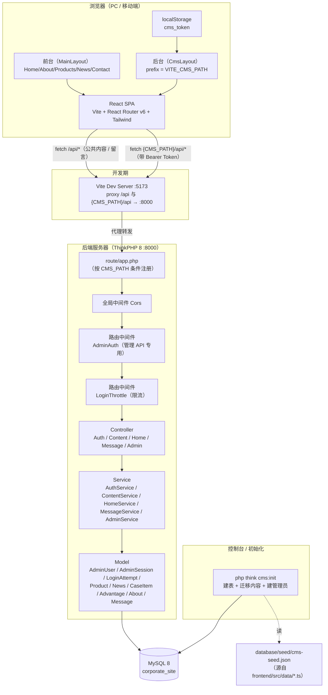
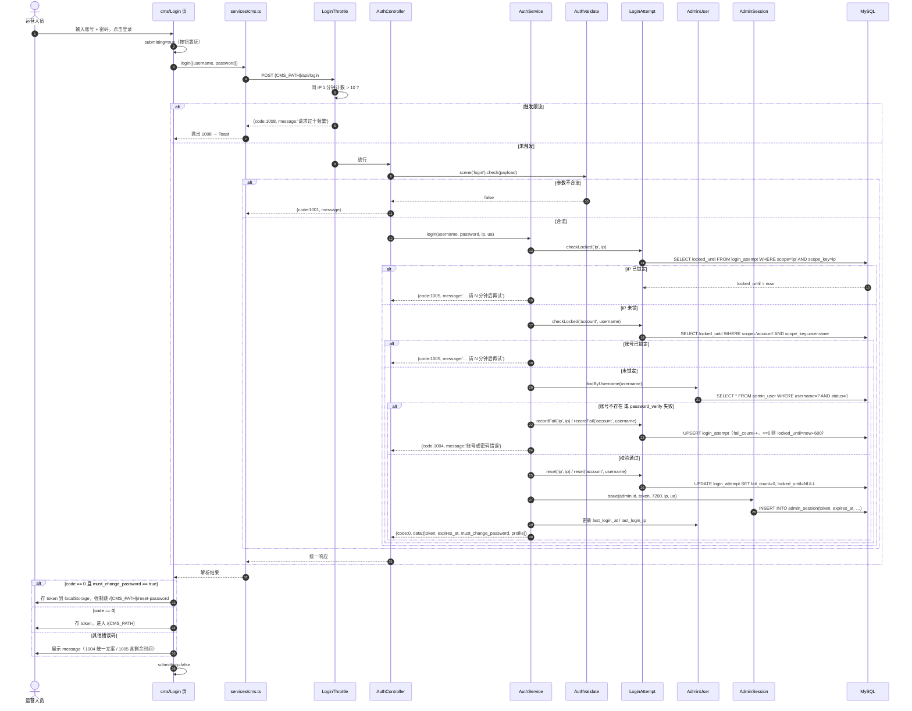
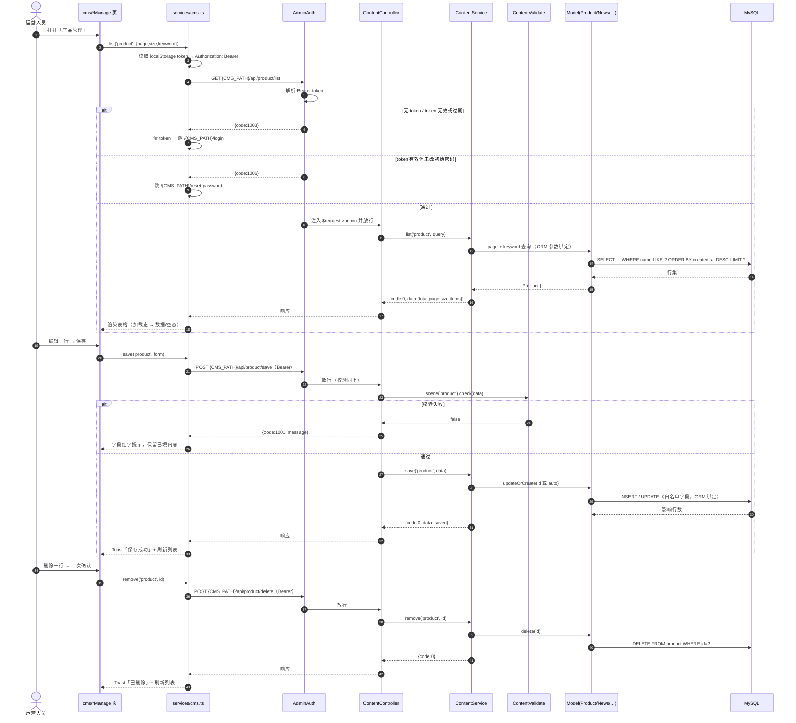
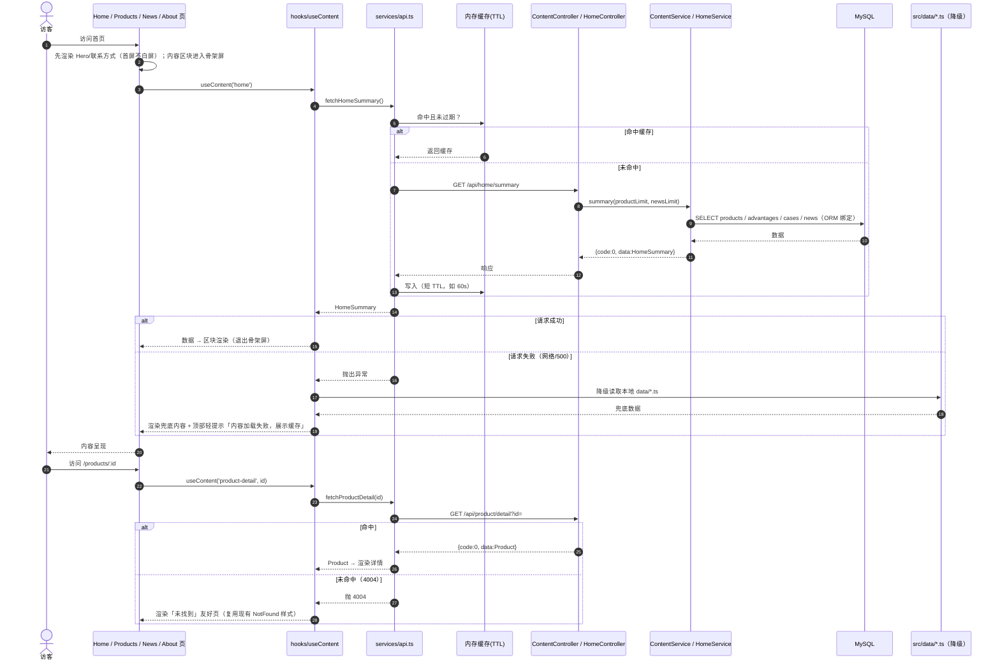
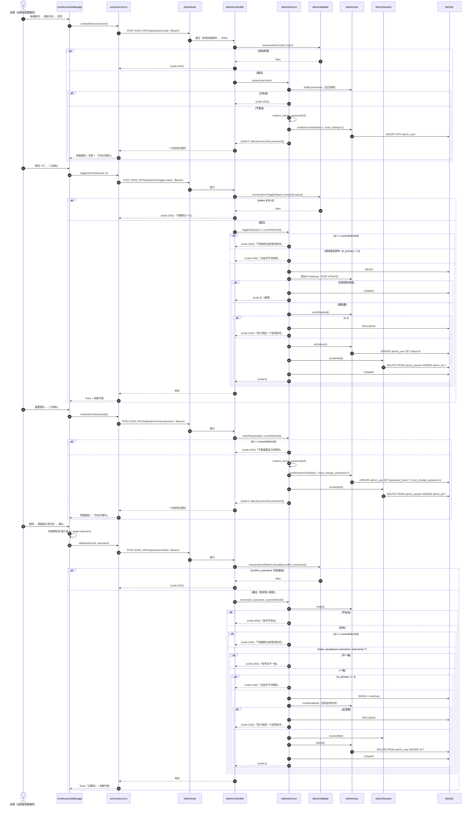

# 企业官网 CMS 内容管理后台 · 增量架构设计与任务分解

> **本文档为增量架构设计 v1.0，基于 `ARCHITECTURE.md` v1.0 与 `PRD-CMS.md` v1.0**
> 只描述本次**新增/变更**的设计，原有架构（前端 5 大页面、留言提交、设计 token、统一响应等）继续有效，不再重复。

| 项目 | 内容 |
| --- | --- |
| 项目名称 | corporate-site-cms（在 corporate-site 基础上增量） |
| 文档版本 | v1.0（增量架构设计） |
| 作者 | 高见远（架构师 Gao） |
| 上游文档 | `docs/PRD-CMS.md` v1.0、`docs/ARCHITECTURE.md` v1.0、`docs/PRD.md` v1.2 |
| 目标读者 | 工程师寇豆码（按本文档任务列表实现） |
| 输出语言 | 简体中文 |
| 范围 | **仅本期 P0**（产品/新闻/案例/优势 CRUD + 关于我们单例编辑 + **网站配置单例编辑** + 留言管理 + 认证/登出/改密/强制改密 + 可配置后台路径 + 前台内容改 API 读取 + 数据迁移）。**不做 P1/P2** |

> 本文档只做设计与接口定义，**不含业务实现代码**（含 DDL、TypeScript 类型、接口/方法签名，但不含 Controller/Service 逻辑实现）。

---

## 目录

1. [增量实现方案概述](#一增量实现方案概述)
2. [数据库设计（重点）](#二数据库设计重点)
3. [后端设计](#三后端设计)
4. [数据结构与接口定义](#四数据结构与接口定义)
5. [程序调用流程（时序图）](#五程序调用流程时序图)
6. [前台改造方案](#六前台改造方案)
7. [数据迁移方案](#七数据迁移方案)
8. [有序任务列表](#八有序任务列表)
9. [依赖包列表](#九依赖包列表)
10. [共享知识（跨文件约定）](#十共享知识跨文件约定)
11. [待明确事项](#十一待明确事项)

---

## 一、增量实现方案概述

### 1.1 一句话方案

在**同一 SPA 工程**内新增「独立的 CMS 后台布局 + 独立的可配置路由前缀」，把 5 类内容从 `frontend/src/data/*.ts` 迁移进 MySQL（**另增设「网站配置」单例**，把 `frontend/src/config/site.config.ts` 的公司信息/联系方式/页脚/SEO 一并上云，后者保留为静态兜底），后端在**现有 ThinkPHP 8 工程**上扩展认证/会话/内容/留言管理接口，前端前台页面由「静态 import」改为「API 动态读取」。前后台**同域部署、不同路由前缀**，全程复用现有分层约定（Controller/Service/Model/Validate/Middleware）与设计 token。

### 1.2 前后台共存方式（关键）

```
同域（dev: localhost:5173 ; prod: 单一域名）
├── /                     ← 前台路由（MainLayout）
│   ├── /about /products /products/:id /news /news/:id /contact
├── /{CMS_PATH}/login  /{CMS_PATH}/reset-password   ← 认证闸门页（顶级路由，无外壳）
├── /{CMS_PATH}           ← 后台路由（CmsLayout），CMS_PATH 由环境变量配置
│   ├── /password  /products  /news  /cases
│   ├── /advantages  /about  /site  /messages  /（首页概览）
│   └── /{CMS_PATH}/api/*  ← 后台管理 API（同前缀，需 Token 鉴权）
└── /api/*                ← 前台公共内容 API + 留言提交（匿名可读，仅 GET 内容）
```

- **前缀一致**：前端路由 `/{CMS_PATH}/...` 与后端管理 API `/{CMS_PATH}/api/...` 使用**同一配置值**，天然一致。
- **未配置即不存在**：`CMS_PATH` 为空/未设置时，前端不注册后台路由、后端不注册后台 API → 整体 404，不在任何默认路径暴露后台。
- **同域收益**：Token 存 localStorage、无跨域、无 CSRF（Token 走请求头而非 Cookie）。

### 1.3 整体架构图



### 1.4 核心技术难点与应对

| 难点 | 应对方案 |
| --- | --- |
| **后台路径可配置** | 前后端各读同一环境变量（前端 `VITE_CMS_PATH`、后端 `CMS_PATH`）；后端在 `route/app.php` **条件注册**路由，前端在 `router.tsx` **条件注册**路由；未配置则均不注册 → 404 |
| **鉴权与会话** | 服务端 `admin_session` 表存 Token + 过期时间；`AdminAuth` 中间件校验并注入 `$request->admin`；无效/过期 → 1003；未改初始密码 → 1006 |
| **登录失败双维度锁定** | `login_attempt` 表以 `(scope, scope_key)` 唯一键持久化计数（scope = account / ip）；判定顺序：先 IP 锁 → 再账号锁 → 再校验密码；成功清零 |
| **零前端字段改动** | 后端返回 JSON 的字段名**与 `frontend/src/types/index.ts` 完全一致**（内容字段本身均为小写单词，无大小写映射问题；多词字段统一用 snake_case，对齐现有 `MessageRecord.created_at`） |
| **首屏不退化** | 首页新增**聚合接口** `/api/home/summary` 一次取回多区块；内容 GET 接口加**短 TTL 内存缓存**；区块懒加载 + 骨架屏；接口失败**降级到 `src/data/*.ts`** |
| **支付/迁移幂等** | `php think cms:init` 对内容按主键 `updateOrCreate`，管理员「存在则跳过」，可重复执行不产生脏数据 |
| **`case` / `desc` / `date` 等保留字** | 表名改用 `case_item`（避 MySQL 保留字 `CASE`）；`desc`/`date`/`value` 作为列名保留，但**一律经 ORM/参数绑定与反引号**处理，禁止裸拼 SQL |

---

## 二、数据库设计（重点）

> 库：`corporate_site`（已存在）。字符集统一 `utf8mb4` / `utf8mb4_general_ci`。表前缀为空。
> 全部 DDL 规划写入 `backend/database/cms.sql`，由 `php think cms:init` 或手工执行。

### 2.1 表清单

| # | 表名 | 用途 | 主键 | 备注 |
| --- | --- | --- | --- | --- |
| 1 | `admin_user` | 后台管理员账号 | `id` AUTO | 存 bcrypt 哈希，**永不返回** |
| 2 | `admin_session` | 会话 Token | `id` AUTO | `token` 唯一索引；`expires_at` 索引 |
| 3 | `login_attempt` | 登录失败计数 / 锁定 | `id` AUTO | `(scope, scope_key)` 唯一索引 |
| 4 | `product` | 产品/服务 | `id` VARCHAR（= 前端 slug） | `features` 存 JSON |
| 5 | `news` | 新闻 | `id` VARCHAR（= 前端 slug） | `content` 保留 `\n` 原文 |
| 6 | `case_item` | 客户案例 | `id` VARCHAR（= 前端 slug） | **表名避 `case` 保留字** |
| 7 | `advantage` | 首页数据与优势 | `id` INT AUTO | 前端 `Advantage` 无 id，API 附带 `id` |
| 8 | `about` | 关于我们（**单例**） | `id` TINYINT（恒为 1） | 复杂数组存 JSON |
| 8.1 | `site_config` | 网站配置（**单例**） | `id` TINYINT（恒为 1） | 公司信息/联系方式/页脚/SEO；`socials` 存 JSON；**不含 nav/theme** |
| 9 | `message` | 留言（**ALTER 加列**） | `id` AUTO | 新增 `status`、`handled_at` |
| 10 | `op_log` | 操作日志（**增量新增**，见 `ARCHITECTURE-CMS-OPLOG.md`） | `id` AUTO | 只追加审计流水；12 字段；4 索引；随 `cms:init` 幂等建表 |

### 2.2 完整 DDL

```sql
-- ============================================================
-- CMS 增量建表脚本（MySQL 8 / utf8mb4）
-- 位置：backend/database/cms.sql
-- 幂等：全部使用 CREATE TABLE IF NOT EXISTS；admin_user.is_primary 与 message 的新列
--       用 ALTER（先查 information_schema 是否存在列/索引，见 2.3）
-- ============================================================
USE `corporate_site`;

-- ---------- 1) 管理员账号 ----------
CREATE TABLE IF NOT EXISTS `admin_user` (
  `id`                   INT UNSIGNED NOT NULL AUTO_INCREMENT COMMENT '管理员 ID',
  `username`             VARCHAR(50)  NOT NULL DEFAULT ''       COMMENT '登录账号',
  `password_hash`        VARCHAR(255) NOT NULL DEFAULT ''       COMMENT '密码哈希（password_hash/bcrypt，只写不读）',
  `must_change_password` TINYINT(1)   NOT NULL DEFAULT 1        COMMENT '1=需强制修改初始密码',
  `status`               TINYINT      NOT NULL DEFAULT 1        COMMENT '1=启用 0=禁用',
  `is_primary`           TINYINT(1)   NOT NULL DEFAULT 0        COMMENT '1=主账号（不可停用/删除）',
  `last_login_at`        DATETIME     NULL DEFAULT NULL         COMMENT '最近登录时间',
  `last_login_ip`        VARCHAR(45)  NOT NULL DEFAULT ''       COMMENT '最近登录 IP',
  `created_at`           DATETIME     NOT NULL,
  `updated_at`           DATETIME     NOT NULL,
  PRIMARY KEY (`id`),
  UNIQUE KEY `uk_username` (`username`)
) ENGINE=InnoDB DEFAULT CHARSET=utf8mb4 COLLATE=utf8mb4_general_ci COMMENT='后台管理员';

-- ---------- 2) 会话 Token ----------
CREATE TABLE IF NOT EXISTS `admin_session` (
  `id`         INT UNSIGNED NOT NULL AUTO_INCREMENT COMMENT '会话 ID',
  `admin_id`   INT UNSIGNED NOT NULL                 COMMENT '管理员 ID',
  `token`      CHAR(64)     NOT NULL DEFAULT ''       COMMENT '会话 Token（64 位十六进制）',
  `expires_at` DATETIME     NOT NULL                  COMMENT '过期时间（签发 +2h）',
  `ip`         VARCHAR(45)  NOT NULL DEFAULT ''       COMMENT '签发 IP',
  `user_agent` VARCHAR(255) NOT NULL DEFAULT ''       COMMENT '签发 UA',
  `created_at` DATETIME     NOT NULL,
  `updated_at` DATETIME     NOT NULL,
  PRIMARY KEY (`id`),
  UNIQUE KEY `uk_token` (`token`),
  KEY `idx_admin` (`admin_id`),
  KEY `idx_expires` (`expires_at`)
) ENGINE=InnoDB DEFAULT CHARSET=utf8mb4 COLLATE=utf8mb4_general_ci COMMENT='后台会话 Token';

-- ---------- 3) 登录失败计数 / 锁定（账号 + IP 双维度） ----------
CREATE TABLE IF NOT EXISTS `login_attempt` (
  `id`             INT UNSIGNED NOT NULL AUTO_INCREMENT COMMENT '计数 ID',
  `scope`          VARCHAR(10)  NOT NULL DEFAULT ''       COMMENT '维度：account | ip',
  `scope_key`      VARCHAR(100) NOT NULL DEFAULT ''       COMMENT '维度值：账号名 或 IP',
  `fail_count`     INT UNSIGNED NOT NULL DEFAULT 0        COMMENT '连续失败次数',
  `locked_until`   DATETIME     NULL DEFAULT NULL         COMMENT '锁定截止时间（NULL=未锁定）',
  `last_failed_at` DATETIME     NULL DEFAULT NULL         COMMENT '最近一次失败时间',
  `created_at`     DATETIME     NOT NULL,
  `updated_at`     DATETIME     NOT NULL,
  PRIMARY KEY (`id`),
  UNIQUE KEY `uk_scope_key` (`scope`, `scope_key`),
  KEY `idx_locked` (`locked_until`)
) ENGINE=InnoDB DEFAULT CHARSET=utf8mb4 COLLATE=utf8mb4_general_ci COMMENT='登录失败计数与锁定';

-- ---------- 4) 产品 / 服务 ----------
CREATE TABLE IF NOT EXISTS `product` (
  `id`          VARCHAR(80)  NOT NULL DEFAULT '' COMMENT '业务唯一标识（前端 slug）',
  `category`    VARCHAR(30)  NOT NULL DEFAULT '' COMMENT '分类（用于筛选）',
  `name`        VARCHAR(60)  NOT NULL DEFAULT '' COMMENT '名称（≤60）',
  `summary`     VARCHAR(200) NOT NULL DEFAULT '' COMMENT '简介（≤200）',
  `description` TEXT                             COMMENT '详情（不限）',
  `features`    JSON         NULL                COMMENT '特点列表 string[]',
  `image`       VARCHAR(255) NOT NULL DEFAULT '' COMMENT '图片路径',
  `icon`        VARCHAR(30)  NOT NULL DEFAULT '' COMMENT '图标标识',
  `created_at`  DATETIME     NOT NULL,
  `updated_at`  DATETIME     NOT NULL,
  PRIMARY KEY (`id`),
  KEY `idx_category` (`category`),
  KEY `idx_created` (`created_at`)
) ENGINE=InnoDB DEFAULT CHARSET=utf8mb4 COLLATE=utf8mb4_general_ci COMMENT='产品/服务';

-- ---------- 5) 新闻 ----------
CREATE TABLE IF NOT EXISTS `news` (
  `id`         VARCHAR(80)  NOT NULL DEFAULT '' COMMENT '业务唯一标识（前端 slug）',
  `title`      VARCHAR(100) NOT NULL DEFAULT '' COMMENT '标题（≤100）',
  `date`       DATE         NOT NULL              COMMENT '日期 YYYY-MM-DD（排序键）',
  `category`   VARCHAR(30)  NOT NULL DEFAULT '' COMMENT '分类',
  `cover`      VARCHAR(255) NOT NULL DEFAULT '' COMMENT '封面路径',
  `summary`    VARCHAR(300) NOT NULL DEFAULT '' COMMENT '摘要（≤300）',
  `content`    TEXT                             COMMENT '正文（保留 \\n 分段，P1 转富文本）',
  `created_at` DATETIME     NOT NULL,
  `updated_at` DATETIME     NOT NULL,
  PRIMARY KEY (`id`),
  KEY `idx_date` (`date`),
  KEY `idx_category` (`category`)
) ENGINE=InnoDB DEFAULT CHARSET=utf8mb4 COLLATE=utf8mb4_general_ci COMMENT='新闻';

-- ---------- 6) 客户案例（表名用 case_item，避 MySQL 保留字 CASE） ----------
CREATE TABLE IF NOT EXISTS `case_item` (
  `id`         VARCHAR(80)  NOT NULL DEFAULT '' COMMENT '业务唯一标识（前端 slug）',
  `name`       VARCHAR(50)  NOT NULL DEFAULT '' COMMENT '客户名称（≤50）',
  `logo`       VARCHAR(255) NOT NULL DEFAULT '' COMMENT 'Logo 路径',
  `desc`       VARCHAR(200) NOT NULL DEFAULT '' COMMENT '描述（≤200）',
  `created_at` DATETIME     NOT NULL,
  `updated_at` DATETIME     NOT NULL,
  PRIMARY KEY (`id`)
) ENGINE=InnoDB DEFAULT CHARSET=utf8mb4 COLLATE=utf8mb4_general_ci COMMENT='客户案例';

-- ---------- 7) 优势（前端 Advantage 无 id，用自增主键作后台操作标识） ----------
CREATE TABLE IF NOT EXISTS `advantage` (
  `id`         INT UNSIGNED NOT NULL AUTO_INCREMENT COMMENT '自增主键（后台操作标识）',
  `value`      VARCHAR(20)  NOT NULL DEFAULT '' COMMENT '突出数字/短语（≤20）',
  `label`      VARCHAR(30)  NOT NULL DEFAULT '' COMMENT '标签（≤30）',
  `desc`       VARCHAR(100) NOT NULL DEFAULT '' COMMENT '说明（≤100）',
  `sort_order` INT          NOT NULL DEFAULT 0  COMMENT '排序（越小越前，默认按创建顺序）',
  `created_at` DATETIME     NOT NULL,
  `updated_at` DATETIME     NOT NULL,
  PRIMARY KEY (`id`)
) ENGINE=InnoDB DEFAULT CHARSET=utf8mb4 COLLATE=utf8mb4_general_ci COMMENT='首页数据与优势';

-- ---------- 8) 关于我们（单例，恒 1 行） ----------
CREATE TABLE IF NOT EXISTS `about` (
  `id`         TINYINT UNSIGNED NOT NULL DEFAULT 1 COMMENT '单例主键，固定为 1',
  `intro`      TEXT                         COMMENT '公司简介',
  `vision`     VARCHAR(200) NOT NULL DEFAULT '' COMMENT '愿景（≤200）',
  `mission`    VARCHAR(200) NOT NULL DEFAULT '' COMMENT '使命（≤200）',
  `values`     JSON         NULL            COMMENT '价值观 string[]',
  `timeline`   JSON         NULL            COMMENT '发展历程 {year,title,desc}[]',
  `abilities`  JSON         NULL            COMMENT '能力资质 {title,desc}[]',
  `updated_at` DATETIME     NOT NULL,
  PRIMARY KEY (`id`)
) ENGINE=InnoDB DEFAULT CHARSET=utf8mb4 COLLATE=utf8mb4_general_ci COMMENT='关于我们（单例）';

-- ---------- 8.1) 网站配置（单例，恒 1 行） ----------
-- 承载公司信息 / 联系方式 / 页脚 / SEO，使运营可在后台修改。
-- 导航菜单（nav）与主题色（theme）不落库：nav 配错会导致前台 404，
-- theme 受构建期 Tailwind 编译约束，均保持前端静态配置。
-- 社交链接（socials）为结构化列表，用 JSON 存储。
CREATE TABLE IF NOT EXISTS `site_config` (
  `id`            TINYINT UNSIGNED NOT NULL DEFAULT 1 COMMENT '单例主键，固定为 1',
  `company_name`  VARCHAR(50)  NOT NULL DEFAULT '' COMMENT '公司名称（≤50）',
  `logo`          VARCHAR(255) NOT NULL DEFAULT '' COMMENT 'Logo 图片路径（≤255）',
  `slogan`        VARCHAR(100) NOT NULL DEFAULT '' COMMENT '标语（≤100）',
  `description`   VARCHAR(500) NOT NULL DEFAULT '' COMMENT '公司简介（≤500）',
  `phone`         VARCHAR(50)  NOT NULL DEFAULT '' COMMENT '联系电话（≤50）',
  `email`         VARCHAR(100) NOT NULL DEFAULT '' COMMENT '联系邮箱（≤100）',
  `address`       VARCHAR(200) NOT NULL DEFAULT '' COMMENT '联系地址（≤200）',
  `work_time`     VARCHAR(100) NOT NULL DEFAULT '' COMMENT '工作时间（≤100）',
  `map_image`     VARCHAR(255) NOT NULL DEFAULT '' COMMENT '地图占位图路径（≤255）',
  `copyright`     VARCHAR(200) NOT NULL DEFAULT '' COMMENT '版权文案（≤200）',
  `icp`           VARCHAR(100) NOT NULL DEFAULT '' COMMENT '备案号（≤100）',
  `socials`       JSON         NULL            COMMENT '社交链接 {label,url,icon}[]',
  `seo_title`     VARCHAR(200) NOT NULL DEFAULT '' COMMENT 'SEO 标题（≤200）',
  `seo_desc`      VARCHAR(500) NOT NULL DEFAULT '' COMMENT 'SEO 描述（≤500）',
  `seo_keywords`  VARCHAR(500) NOT NULL DEFAULT '' COMMENT 'SEO 关键词（≤500）',
  `updated_at`    DATETIME     NOT NULL,
  PRIMARY KEY (`id`)
) ENGINE=InnoDB DEFAULT CHARSET=utf8mb4 COLLATE=utf8mb4_general_ci COMMENT='网站配置（单例）';
```

### 2.3 存量表加列（`message` / `admin_user`，向后兼容、幂等）

两个存量表都在 `cms.sql` 里以「查 `information_schema` → 按需 `PREPARE/EXECUTE`」的方式加列，
因此**可重复执行**（`cms:init` 每次都会跑一遍）：

```sql
-- 位置：backend/database/cms.sql（追加）
-- 向后兼容：仅新增列，默认值填充，不改动/删除既有数据
ALTER TABLE `message`
  ADD COLUMN `status`     TINYINT  NOT NULL DEFAULT 0 COMMENT '处理状态：0=待处理 1=已处理' AFTER `ip`,
  ADD COLUMN `handled_at` DATETIME NULL     DEFAULT NULL COMMENT '处理时间' AFTER `status`,
  ADD KEY `idx_status` (`status`);

-- admin_user 主账号标记（C-P1-4 加固：初始管理员不可被停用/删除）
ALTER TABLE `admin_user`
  ADD COLUMN `is_primary` TINYINT(1) NOT NULL DEFAULT 0 COMMENT '1=主账号（不可停用/删除）' AFTER `status`;
```

> 说明：`ALTER` 不具备 `IF NOT EXISTS` 语法。实际 `cms.sql` 中的写法为
> `SET @col_exists = (SELECT COUNT(*) FROM information_schema.COLUMNS WHERE ...);`
> 拼出 `IF(..., 'ALTER TABLE ...', 'SELECT 1')` 再 `PREPARE` / `EXECUTE` / `DEALLOCATE`，
> 已经存在的列会自动跳过，重复执行安全。

**主账号标记的回填**（同一脚本内，幂等）：

```sql
-- 库中若尚无主账号，把「最早创建」的管理员标记为主账号
SET @has_primary  = (SELECT COUNT(*) FROM `admin_user` WHERE `is_primary` = 1);
SET @sql_backfill = IF(@has_primary = 0,
  'UPDATE `admin_user` SET `is_primary` = 1 ORDER BY `id` ASC LIMIT 1', 'SELECT 1');
```

回填规则说明：老库升级时不一定保留了 `cms:init` 创建的原始 `admin`（可能已被改名或删除），
故以「`id` 最小 = 最早创建」作为初始管理员的等价判定。回填后**任一时刻全库恰好 1 个主账号**。

### 2.4 索引与设计要点说明

| 表 | 关键索引 | 作用 |
| --- | --- | --- |
| `admin_session` | `uk_token`(token) | 鉴权按 Token 精确查询（最高频） |
| `admin_session` | `idx_expires`(expires_at) | 过期会话清理（可选定时任务） |
| `login_attempt` | `uk_scope_key`(scope, scope_key) | 登录时按 (account, 账号) / (ip, IP) 精确定位计数行 |
| `login_attempt` | `idx_locked`(locked_until) | 快速判定锁定 / 清理 |
| `product` | `idx_category` / `idx_created` | 后台筛选 + 默认按创建倒序 |
| `news` | `idx_date` / `idx_category` | 前台/后台均按 `date` 倒序 + 分类筛选 |
| `message` | `idx_status`(status) | 后台按处理状态筛选 |

**字段映射要点**：

- `Product.id` / `NewsItem.id` / `CaseItem.id`：前端为 string slug → 直接作为表主键 `VARCHAR`，**API 返回即 slug，前台零改动**。
- `Advantage`：前端类型无 `id` → 表用 `INT AUTO_INCREMENT` 主键，**API 返回时附带 `id`**（前台渲染忽略该多出的字段）。
- `about`：单例表，`id` 恒为 `1`，复杂结构（`values`/`timeline`/`abilities`）以 MySQL `JSON` 类型存储，ORM 侧用 `$json` 自动编解码。
- `site_config`：单例表，`id` 恒为 `1`，`socials` 以 `JSON` 存储（`$json`/`$jsonAssoc` 自动编解码）；字段**扁平 snake_case** 落库，对外 API 由 `toSiteConfig()` 映射为**嵌套 camelCase**（`contact`/`footer`/`seo`），且**只读业务字段**，`nav`/`theme`/`footer.quickLinks` 一律不落库、不返回。
- 排序默认：产品/案例/优势按 `created_at` 倒序；新闻按 `date` 倒序（与现有前台一致）。
- **保留字列名**（`date`/`desc`/`value`）：DDL 与任何 SQL 中**必须加反引号**；业务代码**只经 ORM / 参数绑定**访问，禁止拼接。

---

## 三、后端设计

### 3.1 目录与文件清单（相对 `backend/`）

| 文件 | 类型 | 用途 |
| --- | --- | --- |
| `config/cms.php` | **新增** | 读取 `CMS_PATH`：`['path' => env('cms.path', '')]` |
| `.example.env` | **改** | 追加 `CMS_PATH=/manage-x7k2`（示例） |
| `app/common.php` | **改** | 新增 `cms_path()` 辅助函数；扩展 `error_code()`（加 1003–1008） |
| `route/app.php` | **改** | 按 `cms_path()` **条件注册**后台 API 分组；公共内容 API 分组 |
| `database/cms.sql` | **新增** | 建表脚本（第二节 DDL）+ 存量表幂等加列（`message.status/handled_at`、`admin_user.is_primary`）与主账号回填 |
| `database/seed/cms-seed.json` | **新增** | 迁移数据源（源文件内容无损 JSON 化，见第七节） |
| `app/middleware/AdminAuth.php` | **新增** | 管理 API 鉴权：校验 Token、注入 admin、触发 1003/1006 |
| `app/middleware/LoginThrottle.php` | **新增** | 登录接口限流（同 IP ≤10 次/分钟 → 1008） |
| `app/controller/Auth.php` | **新增** | `login / logout / profile / resetPassword / changePassword` |
| `app/controller/Content.php` | **新增** | 内容 CRUD 分发（按 `type` 参数）+ 关于我们 `aboutDetail/aboutSave` |
| `app/controller/Home.php` | **新增** | 前台首页聚合接口 `summary` |
| `app/controller/Message.php` | **改** | 新增 `status()`（标记处理）、`delete()`；`list()` 增强（关键词/状态筛选） |
| `app/controller/Admin.php` | **新增** | 后台账号管理：`adminList / create / toggleStatus / resetPassword / delete` |
| `app/service/AuthService.php` | **新增** | 登录编排（锁定判定/密码校验/签发 Token）、登出、改密、强制改密 |
| `app/service/ContentService.php` | **新增** | 5 类内容 + 关于我们 + 网站配置的通用 CRUD（白名单字段 / JSON 编解码 / 幂等） |
| `app/service/HomeService.php` | **新增** | 首页聚合：一次取产品/优势/案例/新闻摘要 |
| `app/service/MessageService.php` | **改** | 新增 `markStatus()`、`remove()`；`getList()` 加关键词/状态筛选 |
| `app/service/AdminService.php` | **新增** | 账号管理编排：列表（附 `is_self` / `is_primary`）/ 新建（含停用账号查重）/ 启停（**主账号不可停用** + ≥1 启用保底）/ 重置密码 / 删除（账号名 `hash_equals` 二次确认 + **主账号不可删除**）；受保护动作均 `revokeAll()` 踢下线 |
| `app/model/AdminUser.php` | **新增** | 管理员模型（`password_hash` 设为 `hidden`）；含 `findByUsername / countEnabled / setStatus / resetPasswordTo / createAccount / toAdminItem / isPrimary / countPrimary / markAsPrimary` |
| `app/model/AdminSession.php` | **新增** | 会话模型：`findValid(token)`、`issue()`、`revoke()`、`revokeAll(adminId)` |
| `app/model/LoginAttempt.php` | **新增** | 计数模型：`checkLocked()`、`recordFail()`、`reset()` |
| `app/model/Product.php` | **新增** | 产品模型（`$json=['features']`） |
| `app/model/News.php` | **新增** | 新闻模型 |
| `app/model/CaseItem.php` | **新增** | 案例模型（`$name='case_item'`） |
| `app/model/Advantage.php` | **新增** | 优势模型 |
| `app/model/About.php` | **新增** | 关于我们模型（`$json=['values','timeline','abilities']`） |
| `app/model/Message.php` | **改** | 新增 `status`/`handled_at` 字段（`$type` 同步） |
| `app/validate/AuthValidate.php` | **新增** | 登录/改密/强制改密校验（含密码强度） |
| `app/validate/AdminValidate.php` | **新增** | 账号管理校验：`id` / `username`（新建格式规则）/ `confirm_username`（删除确认，仅非空+长度）/ `status`（`in:0,1`）；`$must=['status']` 避免空串跳过 |
| `app/validate/ContentValidate.php` | **新增** | 5 类内容 + 关于我们 + 网站配置校验（按 scene 分型） |
| `app/command/CmsInit.php` | **新增** | 初始化命令：建表/迁移（含 `admin_user.is_primary` 加列与回填）+ 迁移内容（幂等）+ 建管理员（随机强密码，**标记为主账号 `is_primary=1`**） |
| `config/console.php` | **改** | 注册 `cms:init` 命令 |
| `backend/README.md` | **改** | 补充后台路径配置、初始化命令、接口文档 |

### 3.2 鉴权中间件设计（`AdminAuth`）

**职责**：管理 API 的准入闸门——校验会话 Token、注入当前管理员、按需触发 `1003` / `1006`。

**处理流程**：

1. 从请求头取 `Authorization`，按 `Bearer <token>` 解析出 token；缺失/格式错 → **`1003`「请先登录」**。
2. `AdminSession::findValid($token)`：`WHERE token=? AND expires_at > NOW()`；未命中 → **`1003`「登录已过期，请重新登录」**。
3. 加载 `AdminUser`：不存在或 `status != 1` → **`1003`**。
4. **强制改密闸门**：若 `admin_user.must_change_password = 1`，且当前请求的 `controller/action` **不在白名单** `['Auth/resetPassword', 'Auth/logout']` 内 → **`1006`「请先修改初始密码」**。
   - 实现依据：`$request->controller()` / `$request->action()`（ThinkPHP 8 提供）。
   - **账号管理动作（`Admin/*`）刻意不在白名单内**：未改初始密码的新账号在完成改密前，访问账号管理接口一律得到 `1006`，与其它受保护模块行为一致。
5. 通过：`$request->admin = $admin;`、`$request->adminToken = $token;`，放行 `$next($request)`。

**响应规约**：中间件直接返回 `fail(code, message)`；`fail()` 封装为 JSON（HTTP 200 + 业务码，与现有体系一致）。

**注册方式**：**不使用**全局中间件（避免影响前台公共 API 与登录接口），而是**按路由分组挂载**（见 3.3 路由示例）。

### 3.3 可配置后台路径实现方案（重点）

#### 3.3.1 后端（ThinkPHP 8）

- `config/cms.php`：`return ['path' => env('cms.path', '')];`（`env('cms.path')` 对应 `.env` 的 `CMS_PATH`）。
- `app/common.php` 新增：
  ```php
  if (!function_exists('cms_path')) {
      function cms_path(): string {
          $path = (string) config('cms.path', '');
          // 归一化：去尾斜杠，保证以 '/' 开头，空则返回 ''
          if ($path === '') return '';
          return '/' . trim($path, '/');
      }
  }
  ```
- `route/app.php` 中**条件注册**：
  ```php
  $cms = cms_path();                 // 未配置 = ''
  if ($cms !== '') {
      Route::group($cms, function () {
          // —— 登录：无需鉴权，但挂限流中间件 ——
          Route::post('api/login', 'Auth/login')->middleware(LoginThrottle::class);

          // —— 其余管理 API：统一挂 AdminAuth ——
          Route::group('api', function () {
              Route::post('logout', 'Auth/logout');
              Route::get('profile', 'Auth/profile');
              Route::post('reset-password', 'Auth/resetPassword');
              Route::post('password', 'Auth/changePassword');

              Route::get('product/list',   'Content/list')->default(['type' => 'product']);
              Route::post('product/save',  'Content/save')->default(['type' => 'product']);
              Route::post('product/delete','Content/delete')->default(['type' => 'product']);
              // news / case / advantage 同上三条
              Route::get('about/detail',   'Content/aboutDetail');
              Route::post('about/save',    'Content/aboutSave');

              Route::get('site/detail',    'Content/siteDetail');
              Route::post('site/save',     'Content/siteSave');

              Route::post('upload/image',  'Upload/image');   // 图片上传：真 MIME 校验 + 按类型落 public/uploads/

              Route::get('message/list',   'Message/list');
              Route::post('message/status','Message/status');
              Route::post('message/delete','Message/delete');

              // —— 账号管理（C-P1-4 已交付；权限等同，无 RBAC）——
              Route::get('admin/list',            'Admin/adminList');
              Route::post('admin/create',         'Admin/create');
              Route::post('admin/toggle-status',  'Admin/toggleStatus');
              Route::post('admin/reset-password', 'Admin/resetPassword');
              Route::post('admin/delete',         'Admin/delete');
          })->middleware(AdminAuth::class);
      });
  } else {
      // 未配置：为保证语义明确，显式返回 404（code=4004）
      Route::rule('manage/:any', function () {
          return fail(error_code()['NOT_FOUND'], '请求的资源不存在');
      })->pattern(['any' => '.*'])->allowCrossDomain();
  }
  ```
- **404 语义**：路径不匹配任何后台分组 → 未命中路由 → `ExceptionHandle` 已把 `HttpException 404` 映射为 `code=4004`（HTTP 200 + 业务码，与全站一致）。未配置时该前缀下不存在任何管理 API，等价「整体 404」。

#### 3.3.2 前端（Vite）

- `.env.development` / `.env.production` 追加：`VITE_CMS_PATH=/manage-x7k2`（示例，含随机段；部署方自定义）。
- `vite.config.ts` 用 `loadEnv` 读取并**动态加入 proxy**：
  ```ts
  export default defineConfig(({ mode }) => {
    const env = loadEnv(mode, process.cwd(), '');
    const cmsPath = (env.VITE_CMS_PATH || '').replace(/\/$/, '');
    const proxy: Record<string, any> = {
      '/api': { target: 'http://localhost:8000', changeOrigin: true },
      '/uploads': { target: 'http://localhost:8000', changeOrigin: true },   // 图片上传后预览
    };
    if (cmsPath) proxy[`${cmsPath}/api`] = { target: 'http://localhost:8000', changeOrigin: true };
    return { plugins: [react()], resolve: { alias: { '@': fileURLToPath(new URL('./src', import.meta.url)) } },
      server: { port: 5173, host: true, proxy } };
  });
  ```
  > 关键：只代理 `{CMS_PATH}/api`（管理 API），`{CMS_PATH}/login` 等**路由仍由 Vite SPA 处理**。
- `src/constants/index.ts` 导出：
  ```ts
  export const CMS = {
    /** 可配置后台前缀（未配置 = ''，此时不注册后台路由/接口） */
    PATH: (import.meta.env.VITE_CMS_PATH || '').replace(/\/$/, ''),
    /** 管理 API 基础地址 */
    API_BASE: `${(import.meta.env.VITE_CMS_PATH || '').replace(/\/$/, '')}/api`,
    TOKEN_KEY: 'cms_token',
  } as const;
  export const CMS_ROUTES = { /* login/resetPassword/password/products/news/cases/advantages/about/site/messages/dashboard */ };
  ```
- `src/router.tsx`：**仅当 `CMS.PATH !== ''` 时**把 CMS 路由（`CmsLayout` + 子路由 + `CmsProtectedRoute` 包裹）注入 `createBrowserRouter`；否则不注册 → 落到 `*` NotFound（404）。
  - **路由归属**：`/login`、`/reset-password` 为**顶级路由**（登录前的闸门页，不套外壳）；`/password`（常规改密）挂在 `CMS.PATH` 的 **children 之内** —— 运营是登录后才改密，应在后台外壳（侧栏 + 顶栏）内，与其它管理页一致，便于随时返回。

### 3.4 接口清单

> 公共内容 API（`/api/*`，匿名只读）；管理 API（`{CMS_PATH}/api/*`，除 login 外均需 `Authorization: Bearer <token>`）。
> 响应统一 `{ code, message, data }`。

#### 3.4.1 公共内容 API（前台读取，匿名）

| 方法 | 路径 | 用途 | 鉴权 | 请求参数 | 响应 data | 备注 |
| --- | --- | --- | --- | --- | --- | --- |
| GET | `/api/product/list` | 产品列表 | 否 | `page,size,category,keyword` | `{total,page,size,items:Product[]}` | 默认按 `created_at` 倒序 |
| GET | `/api/product/detail` | 产品详情 | 否 | `id` | `Product` | 未命中 → 4004 |
| GET | `/api/news/list` | 新闻列表 | 否 | `page,size,category,keyword` | `{total,page,size,items:NewsItem[]}` | 按 `date` 倒序 |
| GET | `/api/news/detail` | 新闻详情（含上下篇） | 否 | `id` | `{item:NewsItem,prev:NewsNav|null,next:NewsNav|null}` | 未命中 → 4004 |
| GET | `/api/case/list` | 案例列表 | 否 | — | `{items:CaseItem[]}` | 全量（6 条） |
| GET | `/api/advantage/list` | 优势列表 | 否 | — | `{items:AdvantageItem[]}` | 附带 `id` |
| GET | `/api/about/detail` | 关于我们 | 否 | — | `AboutData` | 单例 |
| GET | `/api/site/config` | 网站配置 | 否 | — | `SiteConfigData`（业务字段，**不含 nav/theme/quickLinks**） | 单例 |
| GET | `/api/home/summary` | 首页聚合 | 否 | `productLimit,newsLimit` | `HomeSummary` | 一次返回多区块 |
| POST | `/api/message` | 提交留言 | 否 | `name,company,phone,email,content` | `null` | **沿用现有** |

#### 3.4.2 管理 API（`{CMS_PATH}/api/*`）

| 方法 | 路径（`{P}` = CMS_PATH） | 用途 | 鉴权 | 请求参数 | 响应 data | 可能错误码 |
| --- | --- | --- | --- | --- | --- | --- |
| POST | `{P}/api/login` | 登录 | 否（限流） | `username,password` | `{token,expires_at,must_change_password,profile}` | 1001/1004/1005/1008 |
| POST | `{P}/api/logout` | 登出 | 是 | — | `null` | 1003 |
| GET | `{P}/api/profile` | 当前管理员 | 是 | — | `AdminProfile` | 1003/1006 |
| POST | `{P}/api/reset-password` | 强制改初始密码 | 是（白名单放行） | `newPassword,confirmPassword` | `null` | 1001/1003 |
| POST | `{P}/api/password` | 修改密码 | 是（白名单放行） | `oldPassword,newPassword,confirmPassword` | `null` | 1001/1003/1007 |
| GET | `{P}/api/product/list` | 产品列表 | 是 | `page,size,category,keyword` | `{total,page,size,items}` | 1003/1006 |
| POST | `{P}/api/product/save` | 新增/编辑产品 | 是 | `Product`（无 id=新增，有=编辑） | `Product` | 1001/1003 |
| POST | `{P}/api/product/delete` | 删除产品 | 是 | `id` | `null` | 1003/4004 |
| … | … news / case / advantage 同上三条 | — | 是 | 同公共字段 | 同上 | — |
| GET | `{P}/api/about/detail` | 关于我们（后台） | 是 | — | `AboutData` | 1003 |
| POST | `{P}/api/about/save` | 保存关于我们 | 是 | `AboutData` | `AboutData` | 1001/1003 |
| GET | `{P}/api/site/detail` | 网站配置（后台） | 是 | — | `SiteConfigData` | 1003 |
| POST | `{P}/api/site/save` | 保存网站配置 | 是 | `SiteConfigData`（`nav`/`theme`/`quickLinks` 被白名单丢弃） | `SiteConfigData` | 1001/1003 |
| POST | `{P}/api/upload/image` | 图片上传 | 是 | multipart `file,type` | `{url,path,size,mime,name}` | 1001/1003 |
| GET | `{P}/api/message/list` | 留言列表 | 是 | `page,size,keyword,status` | `{total,page,size,items}` | 1003/1006 |
| POST | `{P}/api/message/status` | 标记处理状态 | 是 | `id,status` | `null` | 1003/4004 |
| POST | `{P}/api/message/delete` | 删除留言 | 是 | `id` | `null` | 1003/4004 |
| GET | `{P}/api/admin/list` | 后台账号列表 | 是 | `page,size,keyword` | `{total,page,size,items:AdminListItem[]}`（每行含 `is_self`、`is_primary`） | 1003/1006 |
| POST | `{P}/api/admin/create` | 新建后台账号 | 是 | `username` | `{id,username,password}`（`password` 为**一次性**随机强密码；新账号 `is_primary=0`） | 1001/1002/1003/1006 |
| POST | `{P}/api/admin/toggle-status` | 启用/停用账号 | 是 | `id,status`（`status` 必须为 `0/1`，否则 1001） | `null` | 1001/1003/1006/4004 |
| POST | `{P}/api/admin/reset-password` | 重置账号密码 | 是 | `id` | `{id,username,password}`（**一次性**随机强密码） | 1001/1003/1006/4004 |
| POST | `{P}/api/admin/delete` | 硬删除账号 | 是 | `id,confirm_username`（需与目标账号名**完全一致**） | `null` | 1001/1003/1006/4004 |

> **安全缺口修复**：现有匿名 `GET /api/message/list` **不再以匿名形式暴露**——留言管理统一走 `{P}/api/message/list`（`AdminAuth` 保护）。前台页面不使用该接口，故移除匿名入口无回归风险。

> **账号管理接口约定（C-P1-4）**：
> - **不返回密码哈希**：列表/详情响应绝不含 `password_hash`；密码只在新建/重置时**一次性明文**返回，落库仅存 bcrypt 哈希。
> - **自锁保护**：`toggleStatus / resetPassword / delete` 均拒绝作用在**当前登录账号**上（`Service` 层以当前 `adminId` 比对，命中 → 1001 并给出明确文案）。
> - **主账号保护**：`is_primary = 1` 的账号（`cms:init` 创建的初始管理员）**不可停用、不可删除**（→ 1001「主账号不可停用 / 主账号不可删除」）；但**允许启用**（历史原因被停用时仍可恢复）与**允许重置密码**（保留密码找回路径）。该标记**不是角色**，管理员权限仍完全等同。
> - **≥1 启用保底**：停用/删除一个 `status=1` 的账号前，在 `Db::transaction()` 内对该账号行 `->lock(true)`（`FOR UPDATE`）后 `countEnabled()`，若结果 ≤1 → 拒绝；保证并发下也不会把启用账号清零。
> - **停用优先**：`status=0` 为可逆软删；`delete` 为不可逆硬删，需 `confirm_username` 手动输入账号名（`Service` 用 `hash_equals` 精确比对，**大小写敏感**）。
> - **踢下线**：停用 / 重置密码 / 删除后调用 `AdminSession::revokeAll($adminId)`，目标账号所有会话立即失效。
> - **重复账号**：`create` 检测**含已停用**账号在内的重名 → 1002；并捕获 `1062 / Duplicate entry` 兜底并发。
> - **校验语义分离**：`username`（新建）走字母开头的格式规则；`confirm_username`（删除二次确认）**只校验非空 + 长度**，以防格式规则先于存在性判断把「准确 4004」掩盖成 1001。
> - **新增账号一律普通账号**：`createAccount()` 固定 `is_primary = 0`；主账号只能由 `cms:init` 产生或由 `cms.sql` 回填，界面**不提供**转移入口。

#### 3.4.3 错误码（在现有 0/1001/1002/4004/5000 基础上新增）

| code | 含义 | 说明 |
| --- | --- | --- |
| 0 | 成功 | 沿用 |
| 1001 | 参数校验失败 | 沿用 |
| 1002 | 重复提交 | 沿用（幂等审计） |
| **1003** | 未登录 / Token 无效或过期 | 前端收到 → 清 Token 跳登录页 |
| **1004** | 账号或密码错误 | **不区分账号/密码，防枚举** |
| **1005** | 登录失败次数过多（已锁定） | `message` 含剩余时间（分钟） |
| **1006** | 需要先修改初始密码 | 前端收到 → 跳改密页 |
| **1007** | 原密码错误 | 修改密码场景 |
| **1008** | 请求过于频繁（限流） | 登录接口 |
| 4004 | 资源不存在 | 含未配置后台路径时的 404 |
| 5000 | 服务器内部异常 | 沿用 |

### 3.5 登录失败锁定实现逻辑（重点）

**参数**：阈值 `MAX_FAIL = 5`、锁定 `LOCK_SECONDS = 600`（10 分钟）、限流 `RATE_LIMIT = 10 次/分钟/IP`。

**锁定的两个维度**（同一用户可能同时命中）：

- `scope='account', scope_key=${username}`：同一账号在多 IP 被爆破 → 锁账号。
- `scope='ip', scope_key=${ip}`：同一 IP 尝试多账号 → 锁 IP。

**登录判定顺序（严格按此顺序）**：

```
1. 限流（LoginThrottle）：同 IP 1 分钟请求数 > 10 → 返回 1008（不进入后续逻辑）
2. 读 IP 锁：login_attempt(scope=ip, key=ip).locked_until > now？
     是 → 返回 1005，message = "登录失败次数过多，请 {ceil(剩余秒/60)} 分钟后再试"
3. 读账号锁：login_attempt(scope=account, key=username).locked_until > now？
     是 → 返回 1005（同上，不透露账号是否存在）
4. 查 admin_user where username=? 且 status=1
     - 不存在 或 password_verify 失败：
         · recordFail(ip)      // fail_count++ ；>=5 → locked_until = now+600
         · recordFail(account) // 同上
         · 统一返回 1004「账号或密码错误」（防枚举）
     - 成功：
         · reset(ip)；reset(account)         // 计数清零、锁清除
         · 更新 last_login_at / last_login_ip
         · 签发 Token（random_bytes(32) → 64 hex），AdminSession 落库，expires_at = now + 2h
         · 返回 0，data = { token, expires_at, must_change_password, profile }
5. 前端据 must_change_password 决定跳「后台首页」还是「强制改密页」
```

**关键点**：

- **锁定期内即使密码正确也拒绝**：判定在密码校验**之前**完成（步骤 2/3）。
- **成功即清零**：步骤 4 成功分支 `reset()` 同时清 account 与 ip 两维计数。
- **持久化**：计数与 `locked_until` 落库（`login_attempt`），重启/多进程不失效。
- **限流**：`LoginThrottle` 用 TP `Cache`（file 驱动）计数，key=`login:rate:${ip}`，TTL 60s；超限返回 1008。
- **防枚举**：账号不存在与密码错误返回**同一** 1004 文案；锁定提示不暴露「账号是否存在」。

**密码规则**：

- 初始密码（`cms:init` 生成）：长度 ≥ 12，含大写+小写+数字+符号。
- 新密码（改密/强制改密）：长度 ≥ 8，含字母+数字，且不得与原密码相同、不得与账号名相同。
- 校验均由 `AuthValidate` 承担（`scene` 区分 `login/resetPassword/changePassword`）。

---

## 四、数据结构与接口定义

### 4.1 类图（新增类，Mermaid）

> 同时保存为 `docs/class-diagram-cms.mermaid`（与基础版 `docs/class-diagram.mermaid` 并存，不覆盖）。

```mermaid
classDiagram
    %% ===== 认证域 =====
    class AdminUser {
        +int id
        +string username
        +string password_hash
        +bool must_change_password
        +int status
        +int is_primary
        +string last_login_at
        +string last_login_ip
        +verifyPassword(plain) bool
        +changePassword(plain) void
        +isPrimary() bool
        +countPrimary() int
        +markAsPrimary() void
    }
    class AdminSession {
        +int id
        +int admin_id
        +string token
        +string expires_at
        +findValid(token) AdminSession
        +issue(adminId, token, ttlSeconds, ip, ua) AdminSession
        +revoke(token) void
        +revokeAll(adminId) void
    }
    class LoginAttempt {
        +int id
        +string scope
        +string scope_key
        +int fail_count
        +string locked_until
        +checkLocked(scope, key) int
        +recordFail(scope, key, max, lockSeconds) int
        +reset(scope, key) void
    }
    class AuthService {
        +login(username, password, ip, ua) ApiResponse
        +logout(token) ApiResponse
        +resetPassword(admin, newPassword) ApiResponse
        +changePassword(admin, token, oldPassword, newPassword) ApiResponse
        +profile(admin) ApiResponse
    }
    class AuthValidate {
        +scene(name) AuthValidate
        +check(data) bool
        +getError() string
    }
    class AdminAuth {
        +handle(request, next) Response
    }
    class LoginThrottle {
        +handle(request, next) Response
    }

    %% ===== 内容域 =====
    class Product {
        +string id
        +string category
        +string name
        +string summary
        +string description
        +string[] features
        +string image
        +string icon
    }
    class NewsItem {
        +string id
        +string title
        +string date
        +string category
        +string cover
        +string summary
        +string content
    }
    class CaseItem {
        +string id
        +string name
        +string logo
        +string desc
    }
    class AdvantageItem {
        +int id
        +string value
        +string label
        +string desc
    }
    class AboutData {
        +string intro
        +string vision
        +string mission
        +string[] values
        +TimelineItem[] timeline
        +Ability[] abilities
    }
    class TimelineItem {
        +string year
        +string title
        +string desc
    }
    class Ability {
        +string title
        +string desc
    }
    class HomeSummary {
        +Product[] products
        +AdvantageItem[] advantages
        +CaseItem[] cases
        +NewsItem[] news
    }
    class ContentService {
        +list(type, page, size, keyword, category, status) ApiResponse
        +detail(type, id) ApiResponse
        +save(type, data) ApiResponse
        +remove(type, id) ApiResponse
        +getAbout() ApiResponse
        +saveAbout(data) ApiResponse
    }
    class HomeService {
        +summary(productLimit, newsLimit) ApiResponse
    }
    class ContentValidate {
        +scene(name) ContentValidate
        +check(data) bool
        +getError() string
    }
    class PagedData_T_ {
        +int total
        +int page
        +int size
        +T[] items
    }
    class ApiResponse_T_ {
        +int code
        +string message
        +T data
    }

    %% ===== 留言域（变更） =====
    class MessageRecordAdmin {
        +int id
        +string name
        +string company
        +string phone
        +string email
        +string content
        +string ip
        +int status
        +string handled_at
        +string created_at
    }
    class MessageService {
        +submit(payload, ip) ApiResponse
        +getList(page, size, keyword, status) ApiResponse
        +markStatus(id, status) ApiResponse
        +remove(id) ApiResponse
    }

    %% ===== 账号管理域（C-P1-4 已交付，无 RBAC） =====
    class AdminListItem {
        +int id
        +string username
        +int status
        +int must_change_password
        +int is_primary
        +string last_login_at
        +string last_login_ip
        +string created_at
        +bool is_self
    }
    class AdminCredentialResult {
        +int id
        +string username
        +string password
    }
    class AdminService {
        +list(page, size, keyword, currentAdminId) ApiResponse
        +create(username) ApiResponse
        +toggleStatus(id, status, currentAdminId) ApiResponse
        +resetPassword(id, currentAdminId) ApiResponse
        +remove(id, username, currentAdminId) ApiResponse
    }
    class AdminValidate {
        +scene(name) AdminValidate
        +check(data) bool
        +getError() string
    }

    AdminUser "1" --> "*" AdminSession : 拥有
    LoginAttempt ..> AuthService : 被使用
    AuthService --> AdminUser
    AuthService --> AdminSession
    AuthService --> LoginAttempt
    AuthService --> AuthValidate
    AdminService --> AdminUser : 增删改查
    AdminService --> AdminSession : revokeAll 踢下线
    AdminService --> AdminValidate
    AdminService ..> AdminListItem : 列表项
    AdminService ..> AdminCredentialResult : 一次性密码
    AdminService ..> ApiResponse_T_
    AdminService ..> PagedData_T_
    AdminAuth ..> AdminSession : 校验
    AdminAuth ..> AdminUser : 注入
    ContentService ..> Product : 操作
    ContentService ..> NewsItem : 操作
    ContentService ..> CaseItem : 操作
    ContentService ..> AdvantageItem : 操作
    ContentService ..> AboutData : 操作
    ContentService --> ContentValidate
    HomeService --> ContentService : 聚合
    HomeSummary --> Product
    HomeSummary --> AdvantageItem
    HomeSummary --> CaseItem
    HomeSummary --> NewsItem
    AboutData --> TimelineItem
    AboutData --> Ability
    ContentService ..> ApiResponse_T_
    AuthService ..> ApiResponse_T_
    ContentService ..> PagedData_T_
```



### 4.2 前端 TypeScript 类型（追加到 `src/types/index.ts`）

> **关键约定**：以下类型的**字段名与现有类型保持零冲突**；内容类字段全部复用现有 `Product / NewsItem / CaseItem / AboutData / TimelineItem / Ability`，**新增仅在补充**。多词字段统一 `snake_case`（对齐现有 `MessageRecord.created_at`）。

```ts
/* ============================================================
   CMS 增量类型（后台）。内容类复用上方 Product/NewsItem/CaseItem/AboutData
   ============================================================ */

/** 分页容器（对齐现有 MessageListData 结构：total/page/size/items） */
export interface PagedData<T> {
  total: number;
  page: number;
  size: number;
  items: T[];
}

/** 优势：前端 Advantage 无 id，后台列表需 id 作操作标识（前台渲染忽略 id） */
export interface AdvantageItem extends Advantage {
  id: number;
}

/** 通用列表/分页请求参数 */
export interface ListQuery {
  page?: number;
  size?: number;
  keyword?: string;
  category?: string;
}

/* ---------- 管理员 / 认证 ---------- */

export interface AdminProfile {
  id: number;
  username: string;
  must_change_password: boolean;
  status: number;
  last_login_at: string | null;
  last_login_ip: string;
}

export interface LoginPayload {
  username: string;
  password: string;
}

export interface LoginResult {
  token: string;
  /** 过期时间 ISO 8601 */
  expires_at: string;
  must_change_password: boolean;
  profile: AdminProfile;
}

export interface ChangePasswordPayload {
  oldPassword: string;
  newPassword: string;
  confirmPassword: string;
}

export interface ResetPasswordPayload {
  newPassword: string;
  confirmPassword: string;
}

/* ---------- 内容写入载荷（后台保存用；字段与读取类型一致） ---------- */

/** 产品保存：有 id 视为编辑，无 id 视为新增 */
export type ProductSavePayload = Product & { _editing?: boolean };
export type NewsSavePayload = NewsItem & { _editing?: boolean };
export type CaseSavePayload = CaseItem & { _editing?: boolean };
export type AdvantageSavePayload = { id?: number; value: string; label: string; desc: string };

/* ---------- 新闻详情（含上下篇） ---------- */

export interface NewsNav {
  id: string;
  title: string;
}

export interface NewsDetailData {
  item: NewsItem;
  prev: NewsNav | null;
  next: NewsNav | null;
}

/* ---------- 首页聚合 ---------- */

export interface HomeSummary {
  products: Product[];
  advantages: AdvantageItem[];
  cases: CaseItem[];
  news: NewsItem[];
}

/* ---------- 留言（后台，扩展 status/handled_at） ---------- */

export interface MessageRecordAdmin extends MessageRecord {
  /** 0=待处理 1=已处理 */
  status: number;
  handled_at: string | null;
}

export interface MessageListAdminData extends PagedData<MessageRecordAdmin> {}

/* ---------- 网站配置（单例，业务字段） ---------- */

/** 页面 footer 可配置部分（注意：不含 quickLinks —— 与导航同源，保持静态） */
export interface SiteConfigFooterData {
  copyright: string;
  icp: string;
  socials: { label: string; url: string; icon?: string }[];
}

/** 后台可读写的站点配置业务字段（不含 nav / theme / footer.quickLinks） */
export interface SiteConfigData {
  companyName: string;
  logo: string;
  slogan: string;
  description: string;
  contact: {
    phone: string;
    email: string;
    address: string;
    workTime: string;
    mapImage: string;
  };
  footer: SiteConfigFooterData;
  seo: { title: string; desc: string; keywords: string };
}

/* ---------- 后台账号管理（C-P1-4，无 RBAC） ---------- */

export interface AdminListItem {
  id: number;
  username: string;
  /** 1=启用 0=停用 */
  status: number;
  /** 1=待改密（首次登录/被重置后） */
  must_change_password: number;
  /**
   * 1=主账号（cms:init 创建的初始管理员）——不可停用/删除。
   * 注意：**不是角色**，管理员权限仍完全等同（RBAC 属 P2-2）。
   */
  is_primary: number;
  last_login_at: string | null;
  last_login_ip: string;
  created_at: string;
  /** 是否为当前登录账号（前端据此禁用 停用/重置/删除） */
  is_self: boolean;
}

export interface AdminListData extends PagedData<AdminListItem> {}

/** 新建账号 / 重置密码返回：password 为一次性随机强密码，仅本次展示 */
export interface AdminCredentialResult {
  id: number;
  username: string;
  password: string;
}
```

> **与静态 `SiteConfig` 的关系**：`src/config/site.config.ts` 导出的完整 `SiteConfig`（含 `nav`/`theme`/`footer.quickLinks`）**保持不变**，作为 `SiteConfigProvider` 的同步兜底值；`SiteConfigData` 是**接口可读写子集**，由 Provider 合并进完整配置。二者字段名一致（camelCase），`site_config` 表内为扁平 snake_case，映射由后端 `toSiteConfig()` / `normalizeSiteConfig()` 负责。

### 4.3 后端 API 返回 schema（关键示例）

**登录成功**

```json
{
  "code": 0,
  "message": "ok",
  "data": {
    "token": "e3b0c44298fc1c149afbf4c8996fb92427ae41e4649b934ca495991b7852b855",
    "expires_at": "2026-01-01 12:00:00",
    "must_change_password": true,
    "profile": {
      "id": 1, "username": "admin", "must_change_password": true,
      "status": 1, "last_login_at": null, "last_login_ip": ""
    }
  }
}
```

**锁定（1005）**

```json
{ "code": 1005, "message": "登录失败次数过多，请 8 分钟后再试", "data": null }
```

**列表分页（产品）**

```json
{
  "code": 0, "message": "ok",
  "data": {
    "total": 8, "page": 1, "size": 10,
    "items": [
      {
        "id": "solution-cloud", "category": "解决方案", "name": "云原生解决方案",
        "summary": "……", "description": "……",
        "features": ["容器编排与微服务治理", "……"],
        "image": "/product-cloud.svg", "icon": "cloud"
      }
    ]
  }
}
```

**优势列表（附带 id）**

```json
{
  "code": 0, "message": "ok",
  "data": { "items": [ { "id": 1, "value": "300+", "label": "服务企业客户", "desc": "覆盖制造、零售、金融、能源等多个行业" } ] }
}
```

**关于我们**

```json
{
  "code": 0, "message": "ok",
  "data": {
    "intro": "……", "vision": "……", "mission": "……",
    "values": ["客户价值", "专业务实", "开放协作", "持续创新", "诚信担当"],
    "timeline": [ { "year": "2016", "title": "公司成立", "desc": "……" } ],
    "abilities": [ { "title": "技术研发能力", "desc": "……" } ]
  }
}
```

**后台账号列表（`admin/list`，每行含 `is_self`）**

```json
{
  "code": 0, "message": "ok",
  "data": {
    "total": 2, "page": 1, "size": 10,
    "items": [
      {
        "id": 1, "username": "admin", "status": 1, "must_change_password": 0, "is_primary": 1,
        "last_login_at": "2026-01-01 11:20:00", "last_login_ip": "127.0.0.1",
        "created_at": "2025-12-01 09:00:00", "is_self": true
      },
      {
        "id": 2, "username": "editor01", "status": 0, "must_change_password": 1, "is_primary": 0,
        "last_login_at": null, "last_login_ip": "",
        "created_at": "2026-01-01 11:30:00", "is_self": false
      }
    ]
  }
}
```

**新建账号 / 重置密码（一次性明文密码，仅返回一次）**

```json
{ "code": 0, "message": "ok", "data": { "id": 3, "username": "editor02", "password": "K7#mQp2vXr9!Tz4w" } }
```

**账号管理常见拒绝（自锁 / 主账号 / 保底 / 重名 / 状态非法 / 不存在）**

```json
{ "code": 1001, "message": "不能停用/重置/删除当前登录账号", "data": null }
{ "code": 1001, "message": "主账号不可停用", "data": null }
{ "code": 1001, "message": "主账号不可删除", "data": null }
{ "code": 1001, "message": "至少保留一个启用账号", "data": null }
{ "code": 1001, "message": "账号名不一致", "data": null }
{ "code": 1001, "message": "状态参数不合法", "data": null }
{ "code": 1002, "message": "账号已存在", "data": null }
{ "code": 4004, "message": "账号不存在", "data": null }
```

---

## 五、程序调用流程（时序图）

> 同时保存为 `docs/sequence-diagram-cms.mermaid`（与基础版并存）。

### 5.1 登录（含失败计数 / 锁定 / 首次强制改密判定）



### 5.2 内容 CRUD（带 Token 鉴权 + 1003 / 1006 处理）



### 5.3 前台动态读取（含加载态 / 错误降级）



### 5.4 账号管理（新建一次性密码 / 停用保底 / 删除二次确认）

> 与 `docs/sequence-diagram-cms.mermaid` §5.5 一致。核心：**无 RBAC**——管理员权限等同，仅做「一人一账号」；所有受保护动作（停用/重置/删除）均**禁止作用于当前登录账号**，**主账号（`is_primary=1`）不可停用/删除**，且在事务内加行锁保证**至少保留 1 个启用账号**。



**实现要点（后端硬约束）**：

| 约束 | 实现位置 | 说明 |
| --- | --- | --- |
| 不能操作当前登录账号 | `AdminService` 各方法比对 `currentAdminId` | 命中 → `fail(1001, '不能…当前登录账号')` |
| 主账号不可停用 / 删除 | `AdminService` 判 `$user->isPrimary()` | 命中 → `fail(1001, '主账号不可停用' / '主账号不可删除')`；**启用**与**重置密码**不受限 |
| 主账号来源 | `CmsInit::ensureAdmin()` 建号时 `is_primary=1`；`cms.sql` 对老库回填最早账号 | 界面**不提供**转移入口，防止「批量提权」或主账号被随意换手 |
| 新建账号恒为普通账号 | `AdminUser::createAccount()` 固定 `is_primary=0` | 避免「后台新建即主账号」导致主账号不唯一 |
| 至少保留 1 个启用账号 | `Db::transaction()` + `AdminUser::countEnabled()` + 目标行 `->lock(true)` | 行锁（`FOR UPDATE`）防并发；命中 → 回滚并拒绝 |
| 停用/重置/删除即踢下线 | `AdminSession::revokeAll($adminId)` | 目标账号所有 Token 立即失效 |
| 状态值不做静默归一化 | `Admin::toggleStatus` 传原生值（默认 `-1`）+ `AdminValidate` `in:0,1` | `status=5` → 1001，而非被悄悄当成 0（停用） |
| 删除确认语义分离 | `AdminValidate` 的 `confirm_username`（仅 `require|length:1,50`） | 避免账号名格式规则先于存在性判断，把准确的 4004 掩盖成 1001 |
| 不泄露密码哈希 | `AdminUser::$hidden = ['password_hash']` | 所有响应/日志均不含明文与哈希；明文密码仅创建/重置时一次性返回 |
| 一次性随机强密码 | `random_strong_password(16)`（`app/common.php`） | 保证含大写+小写+数字+符号，`random_int` + Fisher-Yates，`cms:init` 与本模块**共用同一实现** |

---

## 六、前台改造方案

### 6.1 逐文件改造点（对应 PRD 第九节 10 处）

| # | 文件 | 现状 | 改造后 | 要点 |
| --- | --- | --- | --- | --- |
| 1 | `src/sections/BusinessSection.tsx` | `import products` 取前 N | `useContent('home')` 的 `products` | 骨架屏 + 空态 |
| 2 | `src/sections/StatsSection.tsx` | `import advantages` | `useContent('home')` 的 `advantages` | 同上 |
| 3 | `src/sections/CasesSection.tsx` | `import cases` | `useContent('home')` 的 `cases` | 同上 |
| 4 | `src/sections/NewsSection.tsx` | `import news` 取前 3 | `useContent('home')` 的 `news` | 同上 |
| 5 | `src/pages/Home.tsx` | 组合区块 | 顶层调用一次 `useContent('home')` 并下发 props | **一次聚合请求**，避免 4 次请求 |
| 6 | `src/pages/Products.tsx` | `import products` | `fetchProductList({category})` | 分类筛选可传 `category`；加载/错误/空态 |
| 7 | `src/pages/ProductDetail.tsx` | `products.find` | `fetchProductDetail(id)` | 4004 → 「未找到」页 |
| 8 | `src/pages/News.tsx` | `import news` | `fetchNewsList({page,size})` | 保留「加载更多」或改分页 |
| 9 | `src/pages/NewsDetail.tsx` | `news.find` + 上下篇计算 | `fetchNewsDetail(id)`（返回 `item/prev/next`） | SEO title 在数据到达后写入 |
| 10 | `src/pages/About.tsx` | `import about` | `fetchAbout()` | 单例 |
| 11 | `src/services/api.ts` | 仅 `submitMessage` | **统一请求封装**扩展 | 见 6.2 |

### 6.2 统一请求封装扩展（`src/services/api.ts` + 新增 `src/services/cms.ts`）

**`api.ts`（公共）扩展**：

- 保留现有 `request<T>()`、`unwrap<T>()`、`ApiError`、超时/网络异常归一化。
- **新增 Token 注入**：`request()` 在请求头可选注入 `Authorization: Bearer <token>`（仅管理 API 需要；公共内容 API 不注入）。
- **新增错误码分流**（`ApiError.code`）：
  - `1003` → 清 `localStorage[cms_token]` → 跳 `CMS_ROUTES.LOGIN`。
  - `1006` → 跳 `CMS_ROUTES.RESET_PASSWORD`。
  - 其余 → 交由调用方展示 `message`。
  - （分流函数 `handleAuthError(err)` 放入 `utils/authToken.ts`，避免业务页面散写跳转。）
- **新增内容读取方法**：`fetchProductList / fetchProductDetail / fetchNewsList / fetchNewsDetail / fetchCaseList / fetchAdvantageList / fetchAbout / fetchSiteConfig / fetchHomeSummary`，返回强类型 `PagedData<T>` / `HomeSummary` / 实体。
- **短 TTL 内存缓存**：模块内 `Map<string, {data, expireAt}>` 包裹内容 GET（TTL 60s，与后端可另加 `Cache-Control`）；提供 `clearContentCache()`。

**站点配置的运行时注入（`SiteConfigProvider`）**：`frontend/src/config/site.config.ts` 作为**同步初始值**（首帧不闪白），`SiteConfigProvider` 挂载后请求 `fetchSiteConfig()` 覆盖；请求失败**静默回退**静态值。`nav`/`theme`/`footer.quickLinks` 始终取自静态常量，不受接口影响。消费方由 `import siteConfig` 改为 `const { siteConfig } = useSiteConfig()`（12 处）。

**`cms.ts`（新增，后台专用）**：

- 基于 `request()`（`base = CMS.API_BASE`），复用 Token 注入 + 错误码分流。
- 方法：`login / logout / fetchProfile / resetPassword / changePassword / listContent(type) / saveContent(type,data) / deleteContent(type,id) / fetchSiteDetail / saveSiteDetail / uploadImage / fetchMessageList / markMessageStatus / deleteMessage`。

### 6.3 缓存 / 聚合接口策略（建议方案）

| 项 | 方案 |
| --- | --- |
| 首页请求数 | **聚合接口** `/api/home/summary` 一次返回 products/advantages/cases/news（最少 1 次请求） |
| 缓存 | 前端内存缓存（TTL 60s）+ 后端可选 `Cache-Control: public, max-age=60`（内容读接口） |
| 首屏 | Hero/联系方式静态优先渲染；内容区块懒加载 + 骨架屏 |
| 降级 | 接口失败自动回退 `src/data/*.ts`（保留旧数据文件作 fallback，见第七节） |
| 失效 | 后台任意保存成功后，前端 `clearContentCache()`，保证「改完刷新即生效」 |

> 缓存 TTL 取 60s 是「即时性」与「首屏性能」的折中；后台保存后清缓存 + 前台刷新即命中新数据，满足 PRD「刷新即生效」。

---

## 七、数据迁移方案

### 7.1 目标与条数

| 内容 | 表 | 期望条数 | 源文件 |
| --- | --- | --- | --- |
| 产品 | `product` | **8** | `frontend/src/data/products.ts` |
| 新闻 | `news` | **7** | `frontend/src/data/news.ts` |
| 案例 | `case_item` | **6** | `frontend/src/data/cases.ts` |
| 优势 | `advantage` | **4** | `frontend/src/data/advantages.ts` |
| 关于我们 | `about` | **1** | `frontend/src/data/about.ts` |
| 网站配置 | `site_config` | **1** | `frontend/src/config/site.config.ts` |
| 管理员 | `admin_user` | **1** | `php think cms:init` 生成 |

### 7.2 迁移脚本形态（决策）

**采用「TP8 控制台命令 + JSON 种子」形态**（不用外部迁移框架，符合 PRD「不引入额外框架」）：

- `backend/database/seed/cms-seed.json`：把 5 个 TS 数据文件 + `site.config.ts` 的内容**逐字段无损导出**为 JSON（结构见下）。这是唯一数据源。
- `backend/app/command/CmsInit.php`：命令 `php think cms:init`，职责：
  1. 执行 `database/cms.sql` 的建表语句（`CREATE TABLE IF NOT EXISTS`；`message` 的 `ALTER` 先判断列是否存在）。
  2. 读取 `cms-seed.json`，对每类内容按主键 `updateOrCreate`（**幂等**）。
  3. 若 `admin_user` 无记录：生成随机强密码（≥12 位含大小写+数字+符号）→ `password_hash` 落库（`must_change_password=1`）→ **把账号名与初始密码打印到终端**；若已存在则**跳过**（不覆盖已改密码）。
  4. 输出导入统计（各类条数）供一致性核对。
- `backend/config/console.php`：注册 `CmsInit` 命令。
- 执行方式：
  ```bash
  cd E:/aicode/backend
  E:/ServBay/bin/php.cmd think cms:init
  ```
- **幂等保证**：内容以业务主键（slug 或 `advantage` 的 `id`）判定存在则 `update`、不存在则 `insert`；管理员「有则跳过」。重复执行不产生重复数据。
- **不删旧文件**：`frontend/src/data/*.ts` **保留**（前台失败降级 + 迁移数据源），不做硬删除（可回滚）。
- **回滚**：迁移为新增表，不触碰 `message` 既有数据；失败可 `TRUNCATE` 新表重跑。

### 7.3 种子 JSON 结构（示例）

```jsonc
{
  "products": [ { "id": "solution-cloud", "category": "解决方案", "name": "云原生解决方案",
    "summary": "…", "description": "…", "features": ["…","…"], "image": "/product-cloud.svg", "icon": "cloud" } ],
  "news": [ { "id": "news-2024-06", "title": "…", "date": "2024-06-18", "category": "公司动态",
    "cover": "/news-cover-1.svg", "summary": "…", "content": "…（保留 \\n）" } ],
  "cases": [ { "id": "case-1", "name": "某制造集团", "logo": "/case-logo-1.svg", "desc": "…" } ],
  "advantages": [ { "value": "300+", "label": "服务企业客户", "desc": "…" } ],
  "about": { "intro": "…", "vision": "…", "mission": "…",
    "values": ["…","…"], "timeline": [ { "year": "2016", "title": "…", "desc": "…" } ],
    "abilities": [ { "title": "…", "desc": "…" } ] },
  "site": { "company": { "name": "…", "logo": "…", "slogan": "…", "description": "…" },
    "contact": { "phone": "…", "email": "…", "address": "…", "workTime": "…", "mapImage": "…" },
    "footer": { "copyright": "…", "icp": "…", "socials": [ { "label": "…", "url": "…", "icon": "…" } ] },
    "seo": { "title": "…", "desc": "…", "keywords": "…" } }
}
```

> **一致性核对**：`CmsInit` 结束打印 `products:8 / news:7 / cases:6 / advantages:4 / about:1 / site_config:1`，与预期一致即通过；再抽样比对前台渲染与导入前逐字段一致。

---

## 八、有序任务列表

> **分组原则**：按「功能模块 / 层次」分组，不按单文件拆分；配置文件集中在基础设施任务；任务间尽量只依赖前置基础任务，避免长线性链。
> **任务数 16 个**（C01–C16），覆盖后端（建表/模型/鉴权/认证接口/内容接口/留言接口/配置化路径/迁移脚本/**账号管理**）与前端（请求封装/后台布局与路由/登录改密/内容管理/留言管理/**账号管理**/前台改造/文档）。
> 优先级：P0（本期全部）；依赖关系见每行「依赖」列。

| 任务ID | 任务名称 | 依赖 | 涉及文件 | 优先级 | 验收标准 |
| --- | --- | --- | --- | --- | --- |
| **C01** | 后端数据层（建表脚本 + 全部 Model） | — | `backend/database/cms.sql`、`database/seed/cms-seed.json`、`app/model/AdminUser.php`、`AdminSession.php`、`LoginAttempt.php`、`Product.php`、`News.php`、`CaseItem.php`、`Advantage.php`、`About.php`、`SiteConfig.php`、`app/model/Message.php`(改) | P0 | 执行 `cms.sql` 后 9 张表（含 `case_item`、`site_config`）+ `message` 两列均存在，utf8mb4；各 Model `$json`/`$name`/`$pk` 正确；`AdminUser` 的 `password_hash` 已隐藏；`CaseItem` 正确映射 `case_item`；`SiteConfig` 单例恒 1 行 |
| **C02** | 后端公共基础（错误码 + CMS_PATH 配置 + 鉴权/限流中间件） | C01 | `app/common.php`(改)、`config/cms.php`、`.example.env`(改)、`app/middleware/AdminAuth.php`、`app/middleware/LoginThrottle.php` | P0 | `error_code()` 含 1003–1008；`cms_path()` 归一化正确；未带 Token 访问管理 API 返回 1003；未改初始密码访问受保护接口返回 1006；登录限流超限返回 1008 |
| **C03** | 后端认证接口（登录/登出/改密/强制改密/资料） | C02 | `app/controller/Auth.php`、`app/service/AuthService.php`、`app/validate/AuthValidate.php` | P0 | 登录成功签发 64 位 Token（2h 过期）并返回 `must_change_password`；连续 5 次失败锁 10 分钟（账号+IP 双维度，锁定期正确密码亦拒）；成功清零；登出/改密后旧 Token 立即失效；改密校验原密码（错→1007）；响应不含密码/哈希 |
| **C04** | 后端内容接口（5 类 CRUD + 关于我们 + 网站配置） | C01,C02 | `app/controller/Content.php`、`app/controller/PublicContent.php`、`app/service/ContentService.php`、`app/validate/ContentValidate.php`、`app/model/SiteConfig.php` | P0 | 产品/新闻/案例/优势 可增删改查（列表分页+搜索+分类筛选）；关于我们整页读写；网站配置单例读写（白名单丢弃 nav/theme/quickLinks）；字段名与 `types/index.ts` 完全一致；`advantage` 返回含 `id`；id 重复 → 1001；全 ORM 参数绑定 |
| **C05** | 后端留言管理接口（鉴权 + 状态/删除） | C01,C02 | `app/controller/Message.php`(改)、`app/service/MessageService.php`(改) | P0 | `{P}/api/message/list` 支持分页+关键词+状态筛选且**必须鉴权**（匿名→1003）；`status` 标记（0/1）与 `handled_at` 写入；`delete` 可用；原匿名 `GET /api/message/list` 不再暴露 |
| **C06** | 后端路由与配置化路径（条件注册 + 公共内容接口） | C03,C04,C05 | `route/app.php`(改)、`app/controller/Home.php`、`app/service/HomeService.php` | P0 | `CMS_PATH` 已配置时后台 API 全部可用且鉴权生效；**未配置时该前缀整体 404（code=4004）**；公共内容接口 `/api/product/list` 等 9 个 + `/api/home/summary` 匿名可用；`/api/message` 提交不回归 |
| **C07** | 数据迁移/初始化命令（建表 + 迁移 + 建管理员） | C01,C02 | `app/command/CmsInit.php`、`config/console.php`(改)、`backend/README.md`(改) | P0 | `php think cms:init` 可重复执行且幂等；导入条数 8/7/6/4/1/1 通过；首次执行打印随机强初始密码（≥12 位含大小写+数字+符号）且 `must_change_password=1`；二次执行不重复插入、不覆盖已改密码；不修改/删除 `message` 既有数据 |
| **C08** | 前端类型 + 常量 + 环境变量（CMS_PATH/路由/错误码扩展） | — | `frontend/src/types/index.ts`(改)、`src/constants/index.ts`(改)、`.env.development`(改)、`.env.production`(改)、`vite.config.ts`(改) | P0 | 追加 4.2 全部类型且与后端字段一致；`CMS.PATH/CMS_ROUTES` 正确导出；`ERROR_CODES` 含 1003–1008；`VITE_CMS_PATH` 生效；dev proxy 同时代理 `/api` 与 `{CMS_PATH}/api`；`tsc` 无错 |
| **C09** | 前端统一请求封装（Token 注入 + 错误码分流 + 内容方法 + 缓存） | C08 | `src/services/api.ts`(改)、`src/services/cms.ts`、`src/utils/authToken.ts`、`src/hooks/useContent.ts` | P0 | `request()` 支持 Token 注入；1003→清 token 跳登录、1006→跳改密；新增 8 个内容读取方法 + `cms.ts` 全部管理方法；内容 GET 有 60s 内存缓存与 `clearContentCache()`；`useContent` 提供 `{data,loading,error,retry}` 且失败降级 `data/*.ts` |
| **C10** | 前端后台基础（布局 + 受保护路由 + 路由注册） | C08 | `src/layouts/CmsLayout.tsx`、`src/components/cms/CmsProtectedRoute.tsx`、`src/router.tsx`(改)、`src/pages/cms/Dashboard.tsx` | P0 | `CMS.PATH` 非空时后台路由注册、为空时不注册（前台 404）；`CmsLayout` 左侧边栏+顶部条+内容区、移动端抽屉可开合、375px 无横向溢出；未登录/Token 失效自动跳登录页；**`/login`·`/reset-password` 为顶级路由（无外壳），`/password` 在 `CMS.PATH` children 内**；全部复用设计 token，无十六进制 |
| **C11** | 前端后台通用组件（表格/表单控件/确认弹窗） | C10 | `src/components/cms/DataTable.tsx`、`src/components/cms/ConfirmDialog.tsx`、`src/components/cms/FormFields.tsx` | P0 | `DataTable` 支持列配置/分页(10/20/50)/空态/加载态/行操作；表单控件含输入/多行/标签列表/日期/图片路径；`ConfirmDialog` 删除二次确认；复用前台 Toast |
| **C12** | 前端登录 / 强制改密 / 修改密码 页 | C09,C10,C11 | `src/pages/cms/Login.tsx`、`ResetPassword.tsx`、`ChangePassword.tsx` | P0 | 登录成功按 `must_change_password` 跳首页或改密页；失败统一文案（1004）与锁定剩余时间（1005）；改密页原密码校验+强度规则+二次确认；改密成功后清 Token 回登录页；提交中按钮置灰防重复点击；**`/password` 渲染在后台外壳内容区之内（非整屏独立卡片）**，侧栏与顶栏均有入口 |
| **C13** | 前端五类内容 + 网站配置管理页（产品/新闻/案例/优势/关于我们/网站配置） | C09,C11 | `src/pages/cms/ProductsManage.tsx`、`NewsManage.tsx`、`CasesManage.tsx`、`AdvantagesManage.tsx`、`AboutManage.tsx`、`SiteConfigManage.tsx` | P0 | 列表（搜索+分页）+ 新增/编辑表单 + 删除二次确认；保存成功 Toast 且前台刷新即生效；关于我们分区编辑整页保存（价值观标签、时间轴增删、能力资质增删）；网站配置分区编辑（公司信息/联系方式/页脚/SEO）单例保存；字段与 TS 类型一致；错误展示后端 message |
| **C14** | 前端留言管理页 | C09,C11 | `src/pages/cms/MessagesManage.tsx` | P0 | 列表（姓名/公司/电话/邮箱/摘要/时间/状态）+ 关键词搜索 + 分页；详情查看（含 IP）；标记待处理/已处理；删除二次确认；匿名调用被 1003 拦截 |
| **C15** | 前台改造 + 文档 + 联调 | C09,C10,C13,C14 | `src/pages/Home.tsx`、`src/sections/{BusinessSection,StatsSection,CasesSection,NewsSection}.tsx`、`src/pages/{Products,ProductDetail,News,NewsDetail,About}.tsx`、`src/providers/SiteConfigProvider.tsx`、`docs/CMS-USAGE.md`、`README.md`(改) | P0 | 前台内容全部 API 读取（后台改完刷新即生效），站点配置经 `SiteConfigProvider` 以静态值为同步初始值 + 挂载后覆盖（改完刷新即生效、失败静默回退）；加载态/错误态/空态齐备、首屏 Hero 不白屏；`docs/CMS-USAGE.md` 含登录/改密/各模块操作与后台路径配置/初始化命令；README 补充部署说明与 Nginx 路由示例；全链路联调通过 |

| **C16** | 账号管理（后端接口 + 前端页面，**C-P1-4 已交付**） | C02,C03,C11,C12 | `app/controller/Admin.php`、`app/service/AdminService.php`、`app/validate/AdminValidate.php`、`app/model/AdminUser.php`(补方法)、`app/common.php`(补 `random_strong_password()`)、`database/cms.sql`(补 `is_primary` 加列与回填)、`app/command/CmsInit.php`(初始账号标主账号)、`route/app.php`(改)、`src/pages/cms/AccountsManage.tsx`、`src/services/cms.ts`(补方法)、`src/types/index.ts`(补类型)、`src/layouts/CmsLayout.tsx`(补导航)、`src/router.tsx`(补路由)、`src/constants/index.ts`(补 `CMS_ROUTES.ACCOUNTS`) | P0 | 列表（分页+关键词搜索，每行含 `is_self` / `is_primary`）；新建账号自动生成**一次性**随机强密码并弹凭据面板（含复制、明确「仅本次展示」）；启停/重置密码/删除均**不能作用于当前登录账号**（按钮置灰）；**主账号（`cms:init` 创建的初始账号）不可停用/删除**（→ 1001「主账号不可停用 / 主账号不可删除」），但可被启用与重置密码；`cms:init` 全新安装时初始账号 `is_primary=1`，老库升级由 `cms.sql` 回填最早账号，全库恒 1 个主账号；后台新建账号恒 `is_primary=0`；停用/重置/删除后目标账号会话**立即失效**；停用或删除**启用中**账号时事务内加行锁校验**至少保留 1 个启用账号**；重名（含已停用）→ 1002；删除需手动输入账号名（`hash_equals` 精确比对）；`status` 非 0/1 → 1001；删除不存在 id → **4004**（非 1001）；响应**不含** `password_hash`；`tsc` 无错、`vite build` 成功 |

> **并行建议**：C01 与 C08 可同时启动；后端 C02→C03/C04/C05→C06→C07 为主线；前端 C09→C10/C11→C12/C13/C14；C16 依赖 C02 的鉴权中间件与 C03 的 AdminUser/会话模型，可与 C13/C14 并行；C15 收口联调。

> **增量续作（C-P1-3 操作日志）**：任务 **C17–C21** 见 **`docs/ARCHITECTURE-CMS-OPLOG.md`**（增量架构设计）。
> 该增量在**不新增任何依赖、不改动现有 HTTP 契约**的前提下，新增「操作日志」审计表
> `op_log` + 统一写入器 `OpLogService::record()` + 只读查询接口 `{P}/api/oplog/list|detail` + 前端日志页
> `/{CMS_PATH}/oplogs`，并将 **18 类**状态变更操作接入埋点。详见该文件 §十二「有序任务列表」。

---

## 九、依赖包列表

**原则：零新增依赖优先**（TP8 内置能力优先）。

### 9.1 后端（`backend/composer.json`）——**无新增**

| 能力 | 实现方式 | 结论 |
| --- | --- | --- |
| 密码哈希 | PHP 内置 `password_hash` / `password_verify`（`PASSWORD_BCRYPT`） | 无需库 |
| 随机 Token | PHP 内置 `random_bytes` + `bin2hex` | 无需库 |
| 会话 | 自建 `admin_session` 表（非 JWT） | **不引入 JWT 库** |
| 限流 | TP `Cache`（file 驱动）计数 | 无需库 |
| 控制台命令 | TP8 内置 `think` 命令 + `topthink/think-orm` | 无需库 |

> 现有依赖保持：`topthink/framework ^8.0`、`topthink/think-orm ^3.0`。**不新增任何 composer 包。**

### 9.2 前端（`frontend/package.json`）——**无新增**

| 能力 | 实现方式 | 结论 |
| --- | --- | --- |
| 路由 / 状态 | React Router v6 + 原生 React（hooks / 自建 `useContent`） | 无需状态库 |
| 表单 / 表格 | 原生 + Tailwind（自建 `DataTable`/`FormFields`） | **不引入 Antd/MUI 等 UI 库** |
| HTTP | 原生 `fetch`（现有封装扩展） | 无需 axios |
| 缓存 | 模块内 `Map`（TTL） | 无需库 |

> 保持现有依赖不变。**不新增任何 npm 包。**

---

## 十、共享知识（跨文件约定）

> 保证工程师多文件实现一致，**逐条遵守**。

### 10.1 统一响应与错误码

- 所有接口返回 `{ code, message, data }`，`code=0` 成功；成功 `message` 固定 `"ok"`。
- 失败 `data` 为 `null`（或附加字段），`message` 为**可直接展示的中文**。
- 错误码：`0/1001/1002/1003/1004/1005/1006/1007/1008/4004/5000`（见 3.4.3）。
- 后端 `error_code()` 与前端 `ERROR_CODES` **同步维护**，新增码必须两处都加。

### 10.2 Token 头名与格式

- 请求头：`Authorization: Bearer <token>`；后端按 `Bearer ` 前缀解析。
- Token：64 位十六进制（`bin2hex(random_bytes(32))`），存 `admin_session.token`（`CHAR(64)` 唯一）。
- 前端存储 key：`localStorage['cms_token']`（常量 `CMS.TOKEN_KEY`）；**不得**放入 URL 或日志。
- 有效期：**固定 2 小时**（`expires_at = 签发 + 7200s`），本期不做滑动续期（Q7 默认）。
- 失效：登出、改密、强制改密成功后，删除该管理员对应会话（改密删全部会话，登出删当前 token）。

### 10.3 `CMS_PATH` 前后端一致约定（核心）

- 前端：`VITE_CMS_PATH`（`.env.*`）→ `CMS.PATH`；后端：`CMS_PATH`（`.env`）→ `cms_path()`。
- **两值必须完全相同**（含前导 `/`，不含尾斜杠）；部署方一次配置两处。
- 未配置（空）时：前端不注册后台路由、后端不注册后台 API → **404**。
- 约定归一化：去尾斜杠、保证前导 `/`；示例值 `manage-x7k2` → `/manage-x7k2`。

### 10.4 字段命名约定

- **JSON 字段名 = 前端 TS 类型字段名**，前台改造后**零字段改动**。
- 内容类字段本身均为小写单词（`id/name/summary/...`），无大小写映射问题。
- 多词字段统一 **snake_case**（对齐现有 `MessageRecord.created_at`）：`must_change_password`、`expires_at`、`handled_at`、`last_login_at`、`last_login_ip`。
- 分页结构统一 `{ total, page, size, items }`（对齐 `MessageListData`）。
- 布尔字段后端转换为 `true/false` 返回（如 `must_change_password`）。

### 10.5 安全约定（P0 硬要求）

- 密码**只写不读**：`AdminUser.password_hash` 加入 `$hidden`，任何响应/日志不得出现明文或哈希。
- 全 ORM / 参数绑定，**禁止**字符串拼接 SQL；输入先经 `Validate`。
- 所有管理 API 必过 `AdminAuth`；登录接口必过 `LoginThrottle`。
- 错误信息不回显堆栈/库结构；生产 `APP_DEBUG=false`（`.example.env` 注明）。
- 前台渲染用户输入内容需转义（React 默认转义；`content` 的 `\n` 用 `whitespace-pre-line` 呈现，不注入 HTML）。

### 10.6 设计 token 复用（后台）

- **禁止十六进制**，只用语义类名：`bg-primary`、`text-text-secondary`、`border-border`、`bg-bg-soft`、`text-error` 等（`tailwind.config.js` 已固化）。
- 后台沿用：主色 `#1E4FD8`（`bg-primary`）、卡片圆角 `rounded-md 12px`、按钮 `rounded-btn 8px`、`shadow-sm/md`、页面背景 `bg-bg-soft`、危险操作 `text-error`/`bg-error`。
- 后台布局：左侧边栏固定宽 `w-60`（240px），内容区白卡 `bg-white`；移动端 `<768px` 侧边栏转抽屉。

### 10.7 后台布局与组件约定

- `CmsLayout`：左栏导航 + 顶部条（页面标题 + 账号 + 登出）+ 内容区；当前项高亮用主色。
  - 左栏导航项：仪表盘 / 产品 / 新闻 / 案例 / 优势 / 关于我们 / 网站配置 / 留言 / **账号管理** / **操作日志** / **修改密码**；顶栏同时保留「修改密码」「登出」快捷入口。
- `CmsProtectedRoute`：无有效 Token → `Navigate` 到登录页；1006 状态 → 改密页。
- 导航项与 `CMS_ROUTES` 一一对应，**禁止**散写路径字符串。
- 复用前台 `Button / Card / Toast / Container / SEO`；新增组件统一导出 `<组件名>Props`。
- 列表交互统一：右上「新增」、行内「编辑」「删除」（删除二次确认）、保存成功 Toast。

### 10.8 后台路由常量（示例）

```ts
export const CMS_ROUTES = {
  LOGIN: `${CMS.PATH}/login`,
  RESET_PASSWORD: `${CMS.PATH}/reset-password`,
  PASSWORD: `${CMS.PATH}/password`,
  DASHBOARD: `${CMS.PATH}`,
  PRODUCTS: `${CMS.PATH}/products`,
  NEWS: `${CMS.PATH}/news`,
  CASES: `${CMS.PATH}/cases`,
  ADVANTAGES: `${CMS.PATH}/advantages`,
  ABOUT: `${CMS.PATH}/about`,
  SITE: `${CMS.PATH}/site`,
  MESSAGES: `${CMS.PATH}/messages`,
  ACCOUNTS: `${CMS.PATH}/accounts`,
  OPLOGS: `${CMS.PATH}/oplogs`,
} as const;
```

---

## 十一、待明确事项

> PRD-CMS 第十三节列了 Q1–Q12。以下是**架构层面**的处置建议（不确认即按此实现）。

| 编号 | PRD 问题 | 架构处置建议（默认） |
| --- | --- | --- |
| **Q1** | 初始账号/密码交付 | ✅ 账号名**随机生成**（`cms_` + 8 位，可用 `--username=` 指定，不再固定 `admin`）；密码由 `cms:init` 生成**随机强口令**（≥12 位，含大小写+数字+符号）**打印到终端**，落库仅存 bcrypt 哈希且 `must_change_password=1`，首次登录强制改密 |
| **Q3** | 表结构：独立表 vs 单表 JSON | ✅ **产品/新闻/案例/优势各独立表**（利于搜索/分页/筛选）；**关于我们单例表 `about`、网站配置单例表 `site_config`**（复杂数组以 `JSON` 列存储）。另：案例表名用 **`case_item`**（避 MySQL 保留字 `CASE`），模型类 `CaseItem` 与前端类型同名，**此处与 PRD 建议的 `case` 有偏离，属架构层规避保留字的必要调整** |
| **Q4** | `Advantage` 无 id | ✅ 表用 `INT AUTO_INCREMENT` 主键；API 返回附带 `id`；前台渲染忽略 |
| **Q5** | 是否保留旧数据文件 | ✅ **保留** `src/data/*.ts`：既作迁移数据源，又作前台接口失败**降级兜底**；本期不删除（可回滚） |
| **Q6** | 前台聚合/缓存 | ✅ 首页用**聚合接口** `/api/home/summary`；内容 GET 加**短 TTL（60s）**后端 `Cache-Control` + 前端内存缓存；后台保存后前端清缓存 → 满足「刷新即生效」 |
| **Q7** | Token 是否滑动续期 | ✅ **固定 2 小时**（简单可控）；滑动续期列为后续可选 |
| **Q8** | 留言状态字段 | ✅ 新增 `status`(0/1) + `handled_at`，`ALTER` 加列向后兼容 |
| **Q9** | 密码规则 | ✅ 初始 ≥12（大小写+数字+符号）；新密码 ≥8（字母+数字）、≠ 原密码、≠ 账号名 |
| **Q12** | 操作日志 | ✅ 列为 **P1**；P0 仅记录登录成功/失败（`Log` 写文件，配合锁定排查），不建审计表 |
| **Q2** | 路径配置粒度 | ✅ 前端 `VITE_CMS_PATH` + 后端 `CMS_PATH` 同名同值；未配置 → 404 |
| **Q10** | 是否带 P1 项 | ✅ **本期只做 P0**；富文本/操作日志等 P1 待验收后追加。**例外**：图片上传（原 P1-2）、站点基础信息编辑（原 P1-6）、多管理员账号（原 P1-4）因用户明确要求，已在本期以 P0 交付 |
| **Q11** | 前后台视觉区分 | ✅ 共用 token，仅布局不同（`CmsLayout`），品牌一致 |

**新增（本文档引入，需 PM/用户知悉）**：

| 编号 | 待明确点 | 默认建议 |
| --- | --- | --- |
| **A-CMS-1** | 案例表名 `case` vs `case_item` | ✅ 用 **`case_item`**（避 MySQL 保留字 `CASE`，降低 SQL 风险）；对外 API 字段仍为 `id/name/logo/desc`，对前端无感 |
| **A-CMS-2** | `{CMS_PATH}/api/*` 与 `/api/*` 的划分 | ✅ 后台管理 API 全部挂 `{CMS_PATH}/api/*`（受路径配置约束 + 鉴权）；前台公共内容 API 留在 `/api/*`（匿名只读）；原匿名 `GET /api/message/list` **移除**，留言管理迁移到 `{CMS_PATH}/api/message/list` |
| **A-CMS-3** | 未配置路径时后端是否返回 HTTP 404 状态码 | 默认返回 **HTTP 200 + `code=4004`**（与全站统一响应一致）；如需严格 HTTP 404 状态码，可在 `ExceptionHandle` 对管理前缀特判（列为可选） |
| **A-CMS-4** | 登录限流阈值 | ✅ 同 IP **10 次/分钟** → `1008`；可经配置调整 |
| **A-CMS-5** | 过期会话清理 | 本期不做定时任务；`AdminAuth` 命中即校验 `expires_at`，过期自然失效；可选后续加清理命令 |
| **A-CMS-6** | 操作日志（原 PRD Q12，已于 C-P1-3 落地） | ✅ 由 **P1** 提升为**本期交付**。独立审计表 `op_log` + 统一写入器 `OpLogService::record()`（`try/catch` 全包，**绝不阻断主流程**）+ 只读查询接口 `{P}/api/oplog/list\|detail` + 前端只读页 `/{CMS_PATH}/oplogs`（默认最近 7 天）。**只记状态变更类操作**（18 类），**不记**读取/密码/Token/请求体原文。保留期 `OPLOG_RETAIN_DAYS`（默认 180 天），由 `php think oplog:clean` 清理。**零新增依赖、零 HTTP 契约变更**。详见 `docs/ARCHITECTURE-CMS-OPLOG.md` |

---

*文档结束 · 架构师 高见远 · 增量架构设计 v1.0（基于 ARCHITECTURE.md v1.0 与 PRD-CMS.md v1.0）*
