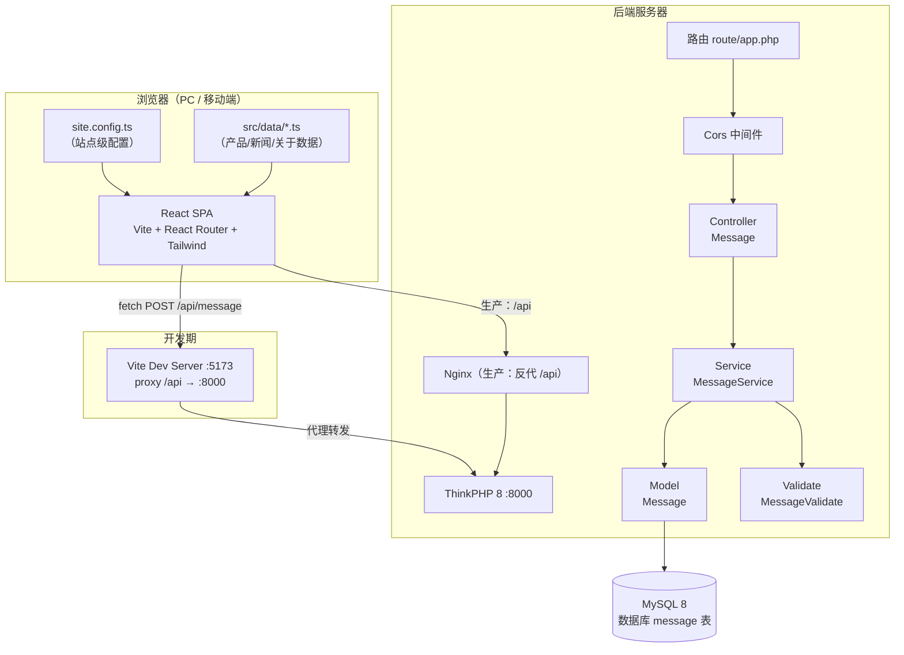
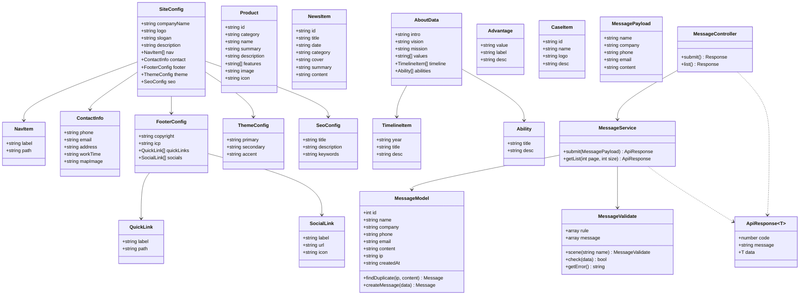
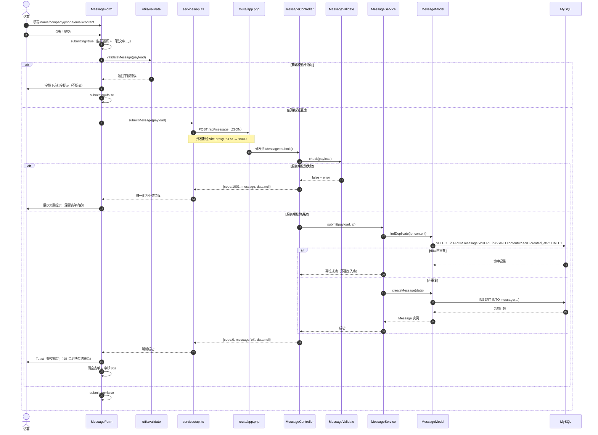
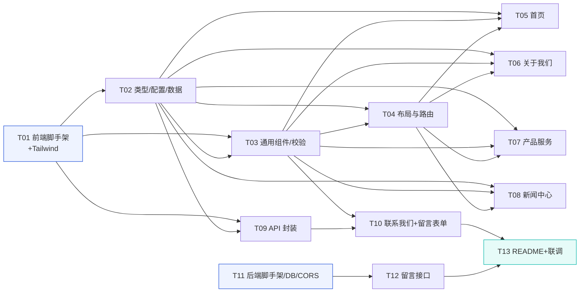

# 通用企业官网（corporate-site）系统架构设计与任务分解

| 项目 | 内容 |
| --- | --- |
| 项目名称 | corporate-site（通用企业官网） |
| 文档版本 | v1.0（架构评审稿） |
| 作者 | 高见远（架构师 Gao） |
| 上游文档 | `docs/PRD.md` v1.2 |
| 输出语言 | 简体中文 |
| 目标读者 | 工程师寇豆码（按本文档任务列表实现） |

> 本文档只做设计与接口定义，**不含业务实现代码**（可含类型签名 / 接口协议 / 配置结构）。

---

## 一、实现方案概述

### 1.1 整体架构

前端为 **SPA（Vite + React 18 + React Router v6 + Tailwind CSS）**，负责全部页面渲染与交互；后端为 **ThinkPHP 8 + MySQL 8**，当前仅提供留言接口（`POST /api/message` 为 P0）。前端页面内容全部由 **配置 + 数据文件** 驱动（`site.config.ts` / `src/data/*.ts`），后端不参与页面内容下发，从而保证「换企业只改配置文件」。

> ⚠️ **本节为 CMS 上线前的原始架构**。当前实际形态：页面内容已由后端 API 下发
> （产品/新闻/案例/优势/关于我们/网站配置），`site.config.ts` / `src/data/*.ts` 降级为
> **空值兜底 + 接口失败兜底**，内容在 CMS 后台在线维护。增量设计见
> [`ARCHITECTURE-CMS.md`](ARCHITECTURE-CMS.md)，下文保留原始方案仅作演进对照。



### 1.2 前后端职责划分

| 层 | 职责 | 不做什么 |
| --- | --- | --- |
| 前端 SPA | 页面渲染、路由、响应式布局、表单交互与前端校验、SEO 标签写入、留言提交、成功/失败反馈 | 不硬编码公司信息（全部来自配置）；不做可信校验 |
| 后端 TP8 | 承接 `/api/*` 接口、服务端二次校验、留言入库、防重复提交（幂等）、IP 记录、统一响应 | 不下发页面内容；不做模板渲染（纯 API） |
| MySQL 8 | 持久化 `message` 留言数据 | — |
| Nginx | 生产环境同域部署，把 `/api` 反代到 TP8 入口，其余走前端静态产物 | — |

### 1.3 核心难点与应对

| 难点 | 应对方案 |
| --- | --- |
| 「通用」——换企业零改代码 | 全站文案/联系方式/导航由 `site.config.ts` 驱动；产品/新闻/关于由 `src/data/*.ts` 驱动；组件内**禁止**出现公司名、电话、行业词 |
| 设计 token 落地一致性 | 把 PRD 的 CSS 变量固化为 **Tailwind theme**（`tailwind.config.js`），全站只用语义化类名（如 `bg-primary`、`text-text-secondary`），禁止散落十六进制色值 |
| 响应式（375/768/1024/1440） | Tailwind 默认断点 + 自定义 `sm/md/lg/xl` 映射；容器统一 `max-w-[1200px]`；移动端汉堡菜单 |
| 留言防重复 + 幂等 | 前端：提交中禁用按钮 + 成功冷却 30s；后端：同 IP + 同内容 60s 内重复 → 直接返回成功但不重复入库 |
| 生产环境跨域 | 开发期用 Vite proxy（首选，零 CORS）；后端附带 Cors 中间件作为双保险 |

---

## 二、框架选型说明

| 层 | 选型 | 一句话理由 |
| --- | --- | --- |
| 前端构建 | **Vite** | 冷启动快、HMR 好、零配置支持 React + TS，静态产物可直接交给 Nginx |
| 前端框架 | **React 18 + React Router v6** | 组件化生态成熟，Router v6 的嵌套路由 + 动态参数天然适配「列表/详情」结构 |
| 样式 | **Tailwind CSS** | 原子类 + theme 配置，是把「设计 token 配置化」落地的最短路径，便于多人协作保持视觉一致 |
| 后端 | **ThinkPHP 8** | 国产成熟框架，内置路由/Validate 验证器/中间件/ORM，分层（Controller/Service/Model）清晰，开发效率高 |
| 数据库 | **MySQL 8** | 用户本地 ServBay 自带，无需额外安装，便于后续扩展（后台管理、统计）（SQLite 仅作文档备选） |

---

## 三、完整文件列表及相对路径

> 根目录：`E:/aicode`。前端在 `frontend/`，后端在 `backend/`。

### 3.1 根目录

| 文件 | 用途 |
| --- | --- |
| `README.md` | 项目总说明：目录结构、环境要求、前后端启动步骤、如何换企业配置、部署说明 |
| `docs/PRD.md` | 产品需求文档（已有） |
| `docs/ARCHITECTURE.md` | 本文档 |
| `docs/sequence-diagram.mermaid` | 留言提交时序图源文件 |
| `docs/class-diagram.mermaid` | 数据结构与接口类图源文件 |

### 3.2 前端 `frontend/`（Vite 工程）

| 文件 | 用途 |
| --- | --- |
| `frontend/package.json` | 依赖与脚本（dev / build / preview） |
| `frontend/vite.config.ts` | Vite 配置：React 插件 + `server.proxy` 将 `/api` 转发到 `http://localhost:8000` |
| `frontend/tailwind.config.js` | **设计 token 固化**：colors / fontFamily / borderRadius / 断点（核心文件） |
| `frontend/postcss.config.js` | PostCSS：tailwindcss + autoprefixer |
| `frontend/tsconfig.json` | TS 配置 |
| `frontend/tsconfig.node.json` | TS（Node 侧，供 vite.config 使用） |
| `frontend/index.html` | 入口 HTML，含基础 meta、`<div id="root">`、字体兜底 |
| `frontend/.env.development` | 开发环境变量（`VITE_API_BASE=/api`） |
| `frontend/.env.production` | 生产环境变量（`VITE_API_BASE=/api`） |
| `frontend/public/logo.svg` | 占位 Logo（部署方可替换） |
| `frontend/public/favicon.svg` | 站点图标占位 |
| `frontend/src/main.tsx` | 应用入口：挂载 `<App/>`、引入全局样式 |
| `frontend/src/index.css` | Tailwind 指令（`@tailwind base/components/utilities`）+ 全局基础样式 |
| `frontend/src/vite-env.d.ts` | Vite 环境类型声明 |
| `frontend/src/App.tsx` | 顶层组件：`<RouterProvider>` 挂载路由 |
| `frontend/src/router.tsx` | **路由表**：主布局嵌套路由 + 404（懒加载页面） |
| `frontend/src/types/index.ts` | **全站类型定义**：SiteConfig / Product / NewsItem / AboutData / MessagePayload / ApiResponse |
| `frontend/src/config/site.config.ts` | **站点级配置**（公司名/Logo/标语/导航/联系方式/页脚/主题/SEO） |
| `frontend/src/data/products.ts` | 产品/服务数据（id、分类、名称、简介、详情、特点、图片、图标） |
| `frontend/src/data/news.ts` | 新闻数据（id、标题、日期、封面、摘要、正文、分类） |
| `frontend/src/data/about.ts` | 关于我们数据（简介、愿景、使命、价值观、时间轴、能力/资质） |
| `frontend/src/data/advantages.ts` | 首页「数据与优势」区块数据 |
| `frontend/src/data/cases.ts` | 首页「客户案例/合作伙伴」数据 |
| `frontend/src/constants/index.ts` | 全局常量：`ROUTES` 路由常量、`MESSAGES` 提示文案 |
| `frontend/src/layouts/MainLayout.tsx` | 主布局：Navbar + `<Outlet/>` + Footer |
| `frontend/src/layouts/ScrollToTop.tsx` | 路由切换时回到顶部 |
| `frontend/src/components/common/Container.tsx` | 内容容器（1200px 居中 + 左右留白） |
| `frontend/src/components/common/SectionTitle.tsx` | 区块标题（主标题 + 副标题，居中/左对齐） |
| `frontend/src/components/common/Button.tsx` | 通用按钮（primary / outline / text 三种变体，支持 `as Link`） |
| `frontend/src/components/common/Card.tsx` | 通用卡片（圆角 + 阴影 + hover 加深） |
| `frontend/src/components/common/Breadcrumb.tsx` | 内页面包屑 |
| `frontend/src/components/common/SEO.tsx` | 每页 title / description 写入（含 og 基础标签） |
| `frontend/src/components/common/Toast.tsx` | 轻量提示组件（成功/失败，自动消失） |
| `frontend/src/components/Navbar.tsx` | 顶部导航：Logo + 菜单 + 滚动吸顶 + 移动端汉堡菜单 |
| `frontend/src/components/Footer.tsx` | 统一页脚：公司信息 + 快速链接 + 备案/社交 |
| `frontend/src/components/MessageForm.tsx` | **留言表单组件**：字段、前端校验、提交反馈、防重复提交 |
| `frontend/src/sections/HeroSection.tsx` | 首页 Hero 首屏 |
| `frontend/src/sections/BusinessSection.tsx` | 首页核心业务概览（取 products 前 N） |
| `frontend/src/sections/StatsSection.tsx` | 首页数据与优势 |
| `frontend/src/sections/CasesSection.tsx` | 首页客户案例/合作伙伴 |
| `frontend/src/sections/NewsSection.tsx` | 首页新闻摘要（取 news 前 3） |
| `frontend/src/sections/ContactCtaSection.tsx` | 首页底部联系入口 |
| `frontend/src/pages/Home.tsx` | 首页（组合 6 大区块） |
| `frontend/src/pages/About.tsx` | 关于我们页 |
| `frontend/src/pages/Products.tsx` | 产品服务列表页（含分类筛选） |
| `frontend/src/pages/ProductDetail.tsx` | 产品详情页（`/products/:id`） |
| `frontend/src/pages/News.tsx` | 新闻中心列表页 |
| `frontend/src/pages/NewsDetail.tsx` | 新闻详情页（`/news/:id`，含上一篇/下一篇） |
| `frontend/src/pages/Contact.tsx` | 联系我们页（联系方式 + 地图占位 + 留言表单） |
| `frontend/src/pages/NotFound.tsx` | 404 页 |
| `frontend/src/services/api.ts` | **API 封装**：统一请求函数、超时、错误归一化、`submitMessage()` |
| `frontend/src/utils/validate.ts` | 前端校验工具（姓名/电话/邮箱/内容规则，与后端保持一致） |

### 3.3 后端 `backend/`（ThinkPHP 8 工程）

> 由 `composer create-project topthink/think backend` 生成骨架，以下为**新增/修改**文件。

| 文件 | 用途 |
| --- | --- |
| `backend/composer.json` | Composer 依赖声明（TP8 骨架自带，确认 `topthink/think-orm` 存在） |
| `backend/.example.env` | 环境变量示例（数据库连接、APP_DEBUG、`APP_TRACE=false`） |
| `backend/.env` | 实际环境变量（不入库；README 说明由 `.example.env` 复制） |
| `backend/database/message.sql` | **建表脚本**：创建 `message` 表（含索引） |
| `backend/config/database.php` | 数据库连接配置（MySQL 8，host=127.0.0.1，user=root，pass=root，dbname=corporate_site） |
| `backend/app/common.php` | **公共函数**：`success($data)` / `fail($code,$message,$data)` 统一响应封装 |
| `backend/app/middleware/Cors.php` | **跨域中间件**：开发期放行 `localhost:5173`，处理 OPTIONS 预检 |
| `backend/app/controller/Message.php` | **留言控制器**：`submit()`（POST 提交）、`list()`（GET 列表，P2） |
| `backend/app/service/MessageService.php` | **业务服务**：参数校验编排、防重复判定、落库、组装响应 |
| `backend/app/model/Message.php` | **模型**：字段定义、自动时间戳、`findDuplicate()` 查询 |
| `backend/app/validate/MessageValidate.php` | **验证器**：name/phone/email/content 规则 + 自定义错误消息 |
| `backend/route/app.php` | **路由**：`POST /api/message`、`GET /api/message/list` |
| `backend/config/middleware.php` | 注册全局/路由中间件（挂载 Cors） |
| `backend/public/index.php` | TP8 入口（骨架自带，无需改动） |
| `backend/README.md` | 后端单独说明（建库建表、启动、接口文档） |

---

## 四、数据结构与接口定义

### 4.1 类图（数据结构与服务类）

> 同时保存为 `docs/class-diagram.mermaid`。`~T~` 为 Mermaid 泛型写法。



### 4.2 前端 TypeScript 接口（`src/types/index.ts`）

```ts
// 统一响应
export interface ApiResponse<T = unknown> {
  code: number;        // 0 = 成功
  message: string;     // 'ok' 或错误信息
  data: T | null;
}

// 站点配置
export interface NavItem { label: string; path: string; }
export interface QuickLink { label: string; path: string; }
export interface SocialLink { label: string; url: string; icon: string; }
export interface ContactInfo {
  phone: string;
  email: string;
  address: string;
  workTime: string;
  mapImage: string;    // 静态地图占位图路径
}
export interface FooterConfig {
  copyright: string;
  icp: string;         // 备案号
  quickLinks: QuickLink[];
  socials: SocialLink[];
}
export interface ThemeConfig { primary: string; secondary: string; accent: string; }
export interface SeoConfig { title: string; description: string; keywords: string; }
export interface SiteConfig {
  companyName: string;
  logo: string;
  slogan: string;
  description: string;
  nav: NavItem[];
  contact: ContactInfo;
  footer: FooterConfig;
  theme: ThemeConfig;
  seo: SeoConfig;
}

// 业务数据
export interface Product {
  id: string;
  category: string;
  name: string;
  summary: string;
  description: string;
  features: string[];
  image: string;
  icon: string;
}
export interface NewsItem {
  id: string;
  title: string;
  date: string;        // ISO 8601（YYYY-MM-DD）
  category: string;
  cover: string;
  summary: string;
  content: string;
}
export interface TimelineItem { year: string; title: string; desc: string; }
export interface Ability { title: string; desc: string; }
export interface AboutData {
  intro: string;
  vision: string;
  mission: string;
  values: string[];
  timeline: TimelineItem[];
  abilities: Ability[];
}
export interface Advantage { value: string; label: string; desc: string; }
export interface CaseItem { id: string; name: string; logo: string; desc: string; }

// 留言
export interface MessagePayload {
  name: string;
  company?: string;  // 公司名称（选填）
  phone: string;     // 与 email 至少填一项
  email: string;
  content: string;
}
```

### 4.3 后端接口定义

#### `POST /api/message` —— 提交留言（P0）

- Content-Type：`application/json`
- 请求体：

| 字段 | 类型 | 必填 | 校验规则 | 错误提示 |
| --- | --- | --- | --- | --- |
| name | string | 是 | 长度 2~30 | 姓名需为 2~30 个字符 |
| company | string | 否 | 长度 ≤50，可空 | 公司名称不得超过 50 个字符 |
| phone | string | 条件必填 | 手机 `^1[3-9]\d{9}$` 或座机 `^0\d{2,3}-?\d{7,8}$`；与 email 至少填一项 | 请填写正确的电话号码 |
| email | string | 条件必填 | 邮箱正则；与 phone 至少填一项 | 请填写正确的邮箱 |
| content | string | 是 | 长度 5~500 | 留言内容需为 5~500 个字符 |

- 成功响应：
```json
{ "code": 0, "message": "ok", "data": null }
```
- 失败响应（示例）：
```json
{ "code": 1001, "message": "姓名需为 2~30 个字符", "data": null }
```

#### `GET /api/message/list` —— 留言列表（P2）

| 参数 | 类型 | 必填 | 说明 |
| --- | --- | --- | --- |
| page | int | 否 | 页码，默认 1 |
| size | int | 否 | 每页条数，默认 10，最大 50 |

- 响应：
```json
{ "code": 0, "message": "ok",
  "data": { "total": 12, "page": 1, "size": 10,
    "items": [ { "id": 1, "name": "张先生", "phone": "13800000000",
      "email": "", "content": "想了解产品报价", "ip": "127.0.0.1",
      "created_at": "2025-01-01 10:00:00" } ] } }
```

#### 错误码表（全站统一）

| code | 含义 | 说明 |
| --- | --- | --- |
| 0 | 成功 | `message = "ok"` |
| 1001 | 参数校验失败 | `message` 为具体字段错误，前端直接展示 |
| 1002 | 重复提交 | 60s 内同 IP+同内容；**实际返回 code=0 幂等成功**，此码仅备审计日志用 |
| 4004 | 资源不存在 | 列表/详情未命中（预留） |
| 5000 | 服务器内部异常 | 兜底错误，`message` 为通用提示，不回显堆栈 |

### 4.4 数据库表结构（`backend/database/message.sql`）

| 字段 | 类型 | 约束 | 说明 |
| --- | --- | --- | --- |
| id | INT UNSIGNED | PK, AUTO_INCREMENT | 留言 ID |
| name | VARCHAR(30) | NOT NULL | 姓名 |
| company | VARCHAR(50) | NULL DEFAULT NULL | 公司名称（选填） |
| phone | VARCHAR(20) | DEFAULT '' | 电话 |
| email | VARCHAR(100) | DEFAULT '' | 邮箱 |
| content | VARCHAR(500) | NOT NULL | 留言内容 |
| ip | VARCHAR(45) | DEFAULT '' | 提交者 IP |
| created_at | DATETIME | NOT NULL | 创建时间 |

索引建议：`KEY idx_ip_created (ip, created_at)`（支撑防重复查询）。

> 建表 SQL（供工程师参考，`utf8mb4` 字符集）：
> ```sql
> CREATE TABLE IF NOT EXISTS `message` (
>   `id` INT UNSIGNED NOT NULL AUTO_INCREMENT,
>   `name` VARCHAR(30) NOT NULL DEFAULT '',
>   `company` VARCHAR(50) NULL DEFAULT NULL COMMENT '公司名称（选填）',
>   `phone` VARCHAR(20) NOT NULL DEFAULT '',
>   `email` VARCHAR(100) NOT NULL DEFAULT '',
>   `content` VARCHAR(500) NOT NULL DEFAULT '',
>   `ip` VARCHAR(45) NOT NULL DEFAULT '',
>   `created_at` DATETIME NOT NULL,
>   PRIMARY KEY (`id`),
>   KEY `idx_ip_created` (`ip`, `created_at`)
> ) ENGINE=InnoDB DEFAULT CHARSET=utf8mb4 COLLATE=utf8mb4_general_ci;
> ```

---

## 五、程序调用流程（留言提交时序图）

> 同时保存为 `docs/sequence-diagram.mermaid`。



---

## 六、依赖包列表

### 6.1 前端 `frontend/package.json`

```jsonc
{
  "dependencies": {
    "react": "^18.3.1",              // UI 库
    "react-dom": "^18.3.1",          // DOM 渲染
    "react-router-dom": "^6.26.0"    // 路由（嵌套路由 + 动态参数）
  },
  "devDependencies": {
    "@types/react": "^18.3.3",
    "@types/react-dom": "^18.3.0",
    "@vitejs/plugin-react": "^4.3.1",
    "typescript": "^5.5.4",
    "vite": "^5.3.5",
    "tailwindcss": "^3.4.7",
    "postcss": "^8.4.39",
    "autoprefixer": "^10.4.19"
  }
}
```

### 6.2 后端 Composer（TP8 骨架自带，确认存在即可）

```jsonc
{
  "require": {
    "php": ">=8.0.0",
    "topthink/framework": "^8.0",   // ThinkPHP 8 核心
    "topthink/think-orm": "^3.0"    // ORM（Model 依赖）
  },
  "require-dev": {
    "topthink/think-trace": "^1.0"  // 调试（生产关闭）
  }
}
```

---

## 七、共享知识（跨文件约定）

> 这是保证多人 / 多文件实现一致性的关键，工程师务必逐条遵守。

### 7.1 统一响应格式
- 所有后端接口返回 `{ code, message, data }`，`code=0` 表示成功。
- 成功时 `message` 固定为 `"ok"`；失败时 `data` 为 `null`，`message` 为可直接展示的中文提示。
- 前端 `services/api.ts` 统一处理：`code===0` 视为成功，否则抛出携带 `message` 的业务错误。

### 7.2 主题色 / 设计 token（固化进 `tailwind.config.js`）
```js
// theme.extend
colors: {
  primary:       { DEFAULT: '#1E4FD8', dark: '#173DA8', light: '#EEF3FF' },
  secondary:     '#0F1B33',   // 深蓝近黑（标题、页脚背景）
  accent:        '#00B4A6',   // 点缀色
  text:          '#1A1A1A',
  'text-secondary': '#5A6472',
  'text-muted':  '#8C97A6',
  border:        '#E5E8EE',
  'bg-soft':     '#F7F8FA',
  success:       '#12B76A',
  error:         '#F04438',
}
fontFamily: { sans: ['"PingFang SC"','"Microsoft YaHei"','"Helvetica Neue"','Arial','sans-serif'] }
borderRadius: { sm: '6px', md: '12px', lg: '20px', btn: '8px' }
```
- **禁止**在组件里写十六进制色值，只用 `bg-primary` / `text-text-secondary` / `border-border` 等语义类名。
- 区块上下内边距：PC `py-24`（96px），移动 `py-14`（56px）→ 统一用 `py-14 md:py-24`。

### 7.3 断点约定
- Tailwind 默认：`sm=640` `md=768` `lg=1024` `xl=1280`；本项目语义映射为 mobile <768、tablet 768–1023、desktop 1024–1439、wide ≥1440。
- 网格：`grid-cols-1 md:grid-cols-2 lg:grid-cols-3`；容器统一 `max-w-[1200px] mx-auto px-6`。

### 7.4 命名与目录规范
- React 组件：`PascalCase.tsx`，文件名 = 组件名；一个文件一个默认导出组件。
- 工具函数 / 数据导出：`camelCase`（如 `products`、`siteConfig`、`validateMessage`）。
- 路由常量集中在 `src/constants/index.ts`，**禁止**在组件里散写字符串路径：
```ts
export const ROUTES = {
  HOME: '/', ABOUT: '/about', PRODUCTS: '/products',
  PRODUCT_DETAIL: (id: string) => `/products/${id}`,
  NEWS: '/news', NEWS_DETAIL: (id: string) => `/news/${id}`,
  CONTACT: '/contact',
} as const;
```

### 7.5 组件 props 约定
- 通用组件统一导出 props 接口，命名 `<组件名>Props`。
- `Button`：`variant: 'primary' | 'outline' | 'text'`、`size: 'md' | 'lg'`、可选 `to?: string`（传则渲染 `<Link>`）。
- `SectionTitle`：`title: string`、`subtitle?: string`、`align?: 'center' | 'left'`。
- `SEO`：`title: string`、`description?: string`（渲染时写入 `document.title` 与 meta）。

### 7.6 统一错误 / 成功文案（`src/constants/index.ts` 的 `MESSAGES`）
```ts
export const MESSAGES = {
  SUBMIT_SUCCESS: '提交成功，我们会尽快与您联系',
  SUBMIT_FAIL: '提交失败，请稍后重试',
  NETWORK_ERROR: '网络异常，请检查网络后重试',
  SUBMITTING: '提交中…',
  FORM_PRIVACY: '提交即表示同意我们联系您',
  REQUIRED: '此项为必填',
} as const;
```

### 7.7 前端校验与后端校验一致性
- 姓名 2~30；内容 5~500；电话/邮箱至少填一项；正则规则前后端**完全一致**（见 4.3）。
- 前端校验仅为体验，**后端 Validate 二次校验为最终裁决**，前端须能展示后端返回的 `message`。

### 7.8 API 调用约定
- 基础地址来自环境变量 `VITE_API_BASE`（默认 `/api`），开发期由 Vite proxy 转发。
- 请求统一 `Content-Type: application/json`，`credentials` 视需要；封装超时（如 10s）。
- 所有 `fetch` 必须捕获网络异常与 JSON 解析异常，归一化为 `MESSAGES.NETWORK_ERROR`。

### 7.9 图片与占位
- 统一放 `frontend/public/` 或 `src/assets/`，命名语义化（`product-1.svg`、`news-cover-1.svg`）；统一比例 `object-cover` + 圆角。
- 未确定图片一律用 SVG 占位图，部署方按文件名替换。
- ⚠️ **CMS 上线后**：Logo / 产品图 / 新闻封面 / 案例图 / 地图改为**后台上传**，落盘
  `backend/public/uploads/{type}/`（随机文件名，仅 jpg/png/webp/gif，**不接受 SVG 上传**）；
  上述静态 SVG 仅剩「数据库为空的占位显示」，不再由部署方按文件名替换。

---

## 八、有序任务列表

> 任务按依赖顺序排列，可直接交给工程师逐条实现。每个任务含：涉及文件、依赖、优先级、验收标准。
> 优先级：P0 = MVP 必须；P1 = 应做；P2 = 可选。

| 任务ID | 任务名称 | 依赖 | 涉及文件 | 优先级 | 验收标准 |
| --- | --- | --- | --- | --- | --- |
| **T01** | 前端项目脚手架与 Tailwind 主题配置 | — | `frontend/package.json`、`vite.config.ts`、`tailwind.config.js`、`postcss.config.js`、`tsconfig.json`、`tsconfig.node.json`、`index.html`、`.env.development`、`.env.production`、`src/main.tsx`、`src/index.css`、`src/vite-env.d.ts`、`src/App.tsx` | P0 | `npm install && npm run dev` 可启动空白页于 5173；Tailwind 生效（能渲染 `bg-primary` 品牌蓝）；`/api` proxy 指向 8000；`npm run build` 成功产出静态文件 |
| **T02** | 类型定义 + 站点配置 + 业务数据文件 | T01 | `src/types/index.ts`、`src/constants/index.ts`、`src/config/site.config.ts`、`src/data/products.ts`、`src/data/news.ts`、`src/data/about.ts`、`src/data/advantages.ts`、`src/data/cases.ts` | P0 | 类型与 4.2 完全一致（`MessagePayload` 含选填 `company?: string`）；`site.config.ts` 含公司名/Logo/导航/联系方式/页脚/主题/SEO 示例值；products ≥ 6 条（≥2 分类）、news ≥ 6 条、about 含时间轴；组件可通过 import 读取，无编译错误 |
| **T03** | 通用 UI 组件库 + 校验工具 | T01,T02 | `src/components/common/Container.tsx`、`SectionTitle.tsx`、`Button.tsx`、`Card.tsx`、`Breadcrumb.tsx`、`SEO.tsx`、`Toast.tsx`、`src/utils/validate.ts` | P0 | 各组件 props 符合 7.5；按钮三态、卡片 hover、SEO 写入 title；`validateMessage` 规则与后端一致并有单测思路（可手测） |
| **T04** | 全局布局与路由（Navbar/Footer/MainLayout/router） | T01,T02,T03 | `src/components/Navbar.tsx`、`src/components/Footer.tsx`、`src/layouts/MainLayout.tsx`、`src/layouts/ScrollToTop.tsx`、`src/router.tsx`、`src/App.tsx`、`src/pages/NotFound.tsx` | P0 | 顶部导航滚动吸顶 + 移动端汉堡菜单可开合；页脚来自 site config；路由 `ROUTES` 全覆盖，切换页面滚动回顶部；404 页可命中 |
| **T05** | 首页（6 大区块） | T02,T03,T04 | `src/pages/Home.tsx`、`src/sections/HeroSection.tsx`、`BusinessSection.tsx`、`StatsSection.tsx`、`CasesSection.tsx`、`NewsSection.tsx`、`ContactCtaSection.tsx` | P0 | 一屏内可见价值主张 + 主 CTA；业务概览取 products 前 N；新闻摘要取 news 前 3 并可跳转；全部文案来自配置；375px 无横向滚动 |
| **T06** | 关于我们页 | T02,T03,T04 | `src/pages/About.tsx` | P0 | 公司简介 + 时间轴 + 能力/资质 + 企业文化四区块；内容全部来自 `data/about.ts` 与 `site.config.ts`；含面包屑与 SEO |
| **T07** | 产品服务（列表 + 详情） | T02,T03,T04 | `src/pages/Products.tsx`、`src/pages/ProductDetail.tsx` | P0 | 列表卡片网格 + 分类 Tab 筛选（P1 可选）；点击进入 `/products/:id` 渲染详情；非法 id 显示友好提示/返回；响应式 1/2/3 列 |
| **T08** | 新闻中心（列表 + 详情） | T02,T03,T04 | `src/pages/News.tsx`、`src/pages/NewsDetail.tsx` | P0 | 列表含封面/标题/日期/摘要；详情含标题/日期/正文 + 上一篇/下一篇；非法 id 友好处理；SEO 使用新闻标题 |
| **T09** | 前端 API service 封装 | T01,T02 | `src/services/api.ts` | P0 | 统一请求函数（超时、JSON 解析、网络异常归一化）；`submitMessage(payload)` 返回 `ApiResponse`；`code!=0` 抛出携带 `message` 的错误；读取 `VITE_API_BASE` |
| **T10** | 联系我们页 + 留言表单 | T03,T09 | `src/pages/Contact.tsx`、`src/components/MessageForm.tsx` | P0 | 展示电话/邮箱/地址/工作时间/地图占位；表单字段 name/**company（选填输入框）**/phone/email/content + 前端校验（company 非必填、长度 ≤50）；提交中按钮置灰；成功 Toast + 清空 + 30s 冷却；失败保留内容并展示后端 message；隐私提示 |
| **T11** | 后端 TP8 脚手架 + 数据库 + CORS + 统一响应 | — | `backend/composer.json`、`.example.env`、`config/database.php`、`config/middleware.php`、`app/common.php`、`app/middleware/Cors.php`、`database/message.sql`、`backend/README.md` | P0 | `composer create-project topthink/think backend` 后按文档补文件；MySQL 建表成功；`success()/fail()` 可用；OPTIONS 预检返回 204；`php think run` 于 8000 可访问 |
| **T12** | 后端留言接口（Controller/Service/Model/Validate/路由） | T11 | `app/controller/Message.php`、`app/service/MessageService.php`、`app/model/Message.php`、`app/validate/MessageValidate.php`、`route/app.php` | P0 | `POST /api/message` 校验通过入库（含 **company 非必填、长度 ≤50**）、返回 `{code:0}`；校验失败返回 `{code:1001, message}`；同 IP+同内容 60s 内重复幂等返回成功且不重复入库；`GET /api/message/list`（P2）分页可用 |
| **T13** | README + 部署说明 + 前后端联调 | T10,T12 | `README.md`、`docs/`（补充说明） | P0 | 根 README 含目录结构、环境要求、前后端启动步骤、换企业配置说明、Nginx 同域部署示例；本地 5173→proxy→8000 提交留言全链路成功入库 |

> 说明：任务数 13 个，粒度按「功能模块 / 层次」划分（非单文件一任务），配置类文件集中在 T01/T11，避免线性依赖链过长。

---

## 九、任务依赖图



> 并行建议：T01/T11 可同时启动；T02–T04 为前端主干；T05–T08 页面可并行；T10 依赖 T09；T13 最后联调。

---

## 十、待明确事项

| 编号 | 待确认点 | 默认建议（不确认即按此实现） |
| --- | --- | --- |
| A1 | **留言表是否包含 `company` 字段** | ✅ **已决策：包含 `company`（可空列 `varchar(50) NULL`）**。B2B 获客中公司信息是高价值线索，成本极低。前端表单加「公司」选填输入框，后端 Validate 非必填、长度 ≤50；表结构/TS 类型/类图/时序图已同步 |
| A2 | 产品分类筛选（PRD P1-1/P1-2）是否本期实现 | 默认**实现基础分类 Tab 筛选**（成本低、提升体验），关键词搜索列为后续 |
| A3 | 新闻列表分页方式 | 默认**前端「加载更多」**（数据为本地文件，无后端分页） |
| A4 | 地图 | 默认**静态占位图**（`site.config.contact.mapImage`），不引入付费地图 Key |
| A5 | 是否接入邮件/短信通知（P1-3） | 默认**不做**，仅入库；预留 Service 扩展点 |
| A6 | 后台留言管理页 + 鉴权（P2-1） | 本期仅提供 `GET /api/message/list` 接口，**不做前端管理页与鉴权** |
| A7 | Logo / 品牌色替换 | 默认用占位 Logo + 示例蓝 `#1E4FD8`，由 `site.config.ts` 与 Tailwind theme 替换 |
| A8 | 数据库名 | 默认 `corporate_site`；如用户已有库名，改 `config/database.php` 即可 |
| A9 | 多语言（Q6/Q2-2） | 默认**简体中文单语言** |

---

*文档结束 · 架构师 高见远*
